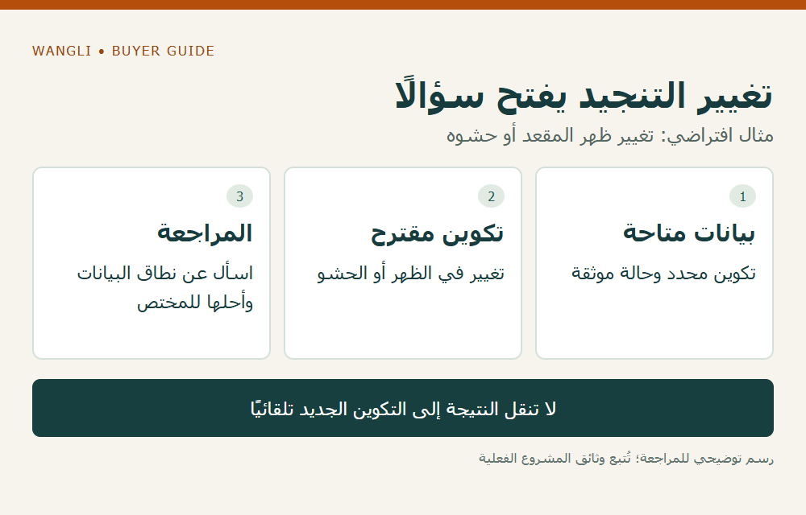

<!-- blog {"slug": "auditorium-seating-acoustic-data", "title": "بيانات الامتصاص الصوتي لمقاعد القاعة: ما الذي تطلبه قبل اختيار التنجيد؟", "seo_title": "بيانات الامتصاص الصوتي لمقاعد القاعة | WangLi", "description": "عرّف تكوين المقعد وحالة الإشغال وترتيب العينة، وافصل بيانات الامتصاص عن اعتماد الأداء الصوتي للقاعة كلها.", "category": "specifications", "published": "2026-11-02T00:19:43+08:00", "image": "/assets/auditorium-seating-acoustic-data-cover-20261102.png", "image_alt": "بيانات المقعد أم أداء القاعة؟ — اطلب البيانات التي يحتاج إليها المختص", "image_caption": "بيانات المقعد أم أداء القاعة؟ — اطلب البيانات التي يحتاج إليها المختص", "image_kind": "diagram", "image_width": 1000, "image_height": 640, "draft": false} -->

# بيانات الامتصاص الصوتي لمقاعد القاعة: ما الذي تطلبه قبل اختيار التنجيد؟

قد يصف عرض كراسي القاعة التنجيد بأنه «مناسب للصوت»، دون بيان يربط هذا الوصف ببيانات يستطيع استشاري المشروع استخدامها. يحتاج الموزع أو شركة تجهيز المدرسة إلى فصل خصائص المقعد عن نتيجة القاعة كلها. القرار هنا هو اكتمال مدخلات التقييم الصوتي للمقعد وتكوينه، لا تصميم القاعة أو ضمان زمن ارتداد معين أو خفض ضوضاء بمقدار غير موثق.

## خذ سؤال البيانات من المختص الصوتي

اطلب من جهة المشروع الاستخدام المقصود للقاعة ومتطلبات التقييم والجهة المسؤولة عنه. قد يشمل البرنامج حديثًا أو عروضًا أو موسيقى أو أكثر من نشاط؛ لا تحوّل هذه الأسماء إلى تصنيف صوتي يختاره المورد. اسأل عن البيانات المطلوبة للمقاعد وشكلها وحالة استخدامها، وكيف ستراجع ضمن التصميم أو التقييم القائم.

توضح [إرشادات BB93 البريطانية للمدارس](https://www.gov.uk/government/publications/bb93-acoustic-design-of-schools-performance-standards) أن الأداء الصوتي يتعلق بالغرفة، ويحدد مستندها حالة التأثيث والإشغال عند عرض بعض متطلبات الأداء. نستخدمه لإظهار أهمية تحديد حالة التقييم؛ لا ننقل حدوده إلى مدرسة في سوق آخر، ولا نعتبره اعتمادًا لأي كرسي معروض.

## عرّف المقعد الذي تخصه البيانات

اطلب رمز الموديل وبيان الأجزاء ذات العلاقة: التنجيد والحشو والظهر والمقعد وأي جزء يختلف في التكوين. اربط ذلك بوصف العينة في المستند، وحالة المقعد أثناء التقييم كما يوردها المصدر. لا تجعل لون القماش أو سماكته الظاهرة بديلًا عن بيانات الأداء، ولا تنقل نتيجة لتكوين آخر لأنه يبدو مشابهًا.

يعرض [شرح بحثي تاريخي منشور لدى الجمعية الصوتية الأمريكية](https://acoustics.org/pressroom/httpdocs/131st/lay02.html) أثر المقاعد والجمهور، والفرق بين مجموعة المقاعد في الاختبار وكتلة المقاعد في القاعة. يقدم خلفية لفهم ضرورة وصف العينة وترتيبها؛ ليس جدول معاملات تختاره منه للمشروع، ولا تجربة على منتجات WangLi.

## اطلب نطاقًا واضحًا بدل رقم منفرد

| البيان المطلوب | السؤال العملي | ما لا يغلقه وحده |
|---|---|---|
| هوية التكوين | هل العينة هي المقعد المعروض؟ | قبول تغيير القماش أو الحشو |
| حالة الإشغال | هل البيانات للمقاعد فارغة أو لحالة أخرى موصوفة؟ | تعميمها على كل حضور |
| ترتيب العينة | ما العدد والترتيب والمساحة التي يتناولها المستند؟ | استنتاج أداء كامل القاعة |
| طريقة عرض النتائج | ما الطريقة والوحدات والنطاق الذي يورده المصدر؟ | ترتيب عرضين برقم لا يحمل المعنى نفسه |
| مراجعة المشروع | هل يستطيع المختص استخدام البيانات أو يحتاج إلى توضيح؟ | اعتبار استلام الملف موافقة |

لا نحدد في هذا الجدول اختبارًا إلزاميًا أو مقدار امتصاص مطلوبًا. يختار صاحب الاختصاص المتطلبات المناسبة ويراجع ما يكفي لها. إذا لم تتوفر بيانات مقبولة، اتركها فجوة معلنة؛ لا تستبدلها بوصف تسويقي أو بأرقام من كتاب لكرسي غير معروف.

## ميّز دليل التنجيد عن أدلة أخرى

قد تطلب القاعة مقاومة اشتعال أو متانة أو تعليمات عناية إلى جانب البيانات الصوتية. تبقى هذه أسئلة مستقلة؛ تقرير اشتعال لا يثبت امتصاصًا صوتيًا، وقبول الصوت لا يغطي تلقائيًا بقية المتطلبات. يمكن الرجوع إلى [دليل نطاق اشتعال التنجيد](/blog/auditorium-upholstery-ignition-evidence/) لهذا الجزء، مع الاحتفاظ بمرجع مستقل لكل مراجعة.

في مثال افتراضي، حصل المشروع على بيانات لمقعد فارغ بتكوين محدد، ثم اقترح تغيير ظهره أو حشوه. لا تفترض أن النتيجة تبقى نفسها أو تصبح أفضل. سجّل الفرق، واطلب من مصدر البيانات توضيح نطاقه، ثم أحل الأمر إلى المختص قبل اعتماد البديل. ليس هذا وصفًا لاختبار أو مشروع منفذ.

*رسم توضيحي: تغيير التنجيد يفتح سؤالًا — مثال افتراضي: تغيير ظهر المقعد أو حشوه — اضغط لعرض الصورة بالحجم الكامل.*

## جهز ملف الاستفسار مع مخطط القاعة

أرفق قائمة الموديلات والتنجيد والأسئلة الصوتية التي يقدمها المختص، مع [جدول الصفوف والترقيم](/blog/auditorium-seating-row-schedule/) وإصدار المخطط. راجع [فئة كراسي القاعات](/products/auditorium/) لتحديد مرجع للمناقشة، ثم [اطلب عرض سعر من WangLi](/request-a-quote/) يوضح البيانات المتاحة وحدودها. يبقى اختيار التكوين وقبوله الصوتي مرتبطين بمراجعة المشروع، دون افتراض توفر تقرير أو أداء معين قبل الرد.
