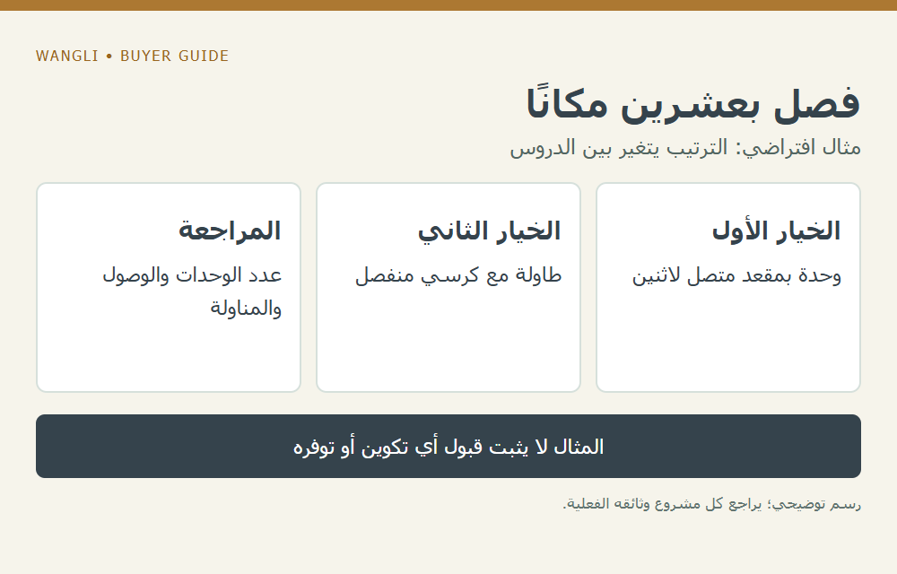

<!-- blog {"slug": "classroom-attached-bench-separate-chair-choice", "title": "طاولة بمقعد متصل أم طاولة وكراسي منفصلة؟ أسئلة لتكوين الفصل المدرسي", "seo_title": "مقعد متصل أم كرسي منفصل للفصل؟ | WangLi", "description": "قارن التكوين والدخول وإعادة الترتيب قبل اختيار طاولة الفصل ومقعدها.", "category": "specifications", "published": "2026-11-18T11:48:55+08:00", "image": "/assets/classroom-attached-bench-separate-chair-choice-cover-20261118.png", "image_alt": "مقعد متصل أم كراسي منفصلة؟ — قارن التكوين داخل الفصل قبل تحديد القائمة", "image_caption": "مقعد متصل أم كراسي منفصلة؟ — قارن التكوين داخل الفصل قبل تحديد القائمة", "image_kind": "diagram", "image_width": 1000, "image_height": 640, "draft": false} -->

# طاولة بمقعد متصل أم طاولة وكراسي منفصلة؟ أسئلة لتكوين الفصل المدرسي

قد تحتوي قائمة تأثيث الفصل على طاولات وكراسي من دون أن تبين هل يقصد المشروع وحدة بمقعد متصل أم طاولة وكراسي مستقلة. يحتاج موزع الأثاث أو شركة توريد المشروع إلى مقارنة طريقة الجلوس والدخول وإعادة ترتيب الفصل، ثم تثبيت محتوى كل بند وعدد أماكن الجلوس. لا يحدد عدد القطع وحده الاختيار المناسب للمستخدمين.

## ابدأ بالدرس والمستخدمين

اسأل جهة المشروع عن عدد الأماكن المطلوبة، والأنشطة التي تستخدم فيها الطاولة، وهل يبقى الترتيب ثابتًا أو يتغير بين الدروس. اطلب أيضًا متطلبات المقاسات والوصول التي يحددها المختصون، من دون جمع أسماء الطلاب أو بياناتهم الصحية في استفسار السعر. لا تفترض أن كل طالب يستطيع الدخول إلى تكوين مشترك بالطريقة نفسها.

يعرض [دليل UNICEF لإتاحة المدارس في الهند](https://www.unicef.org/india/media/1191/file/Making-Schools-Accessible.pdf) أمثلة للأثاث ذي المقعد المتصل والطاولة والكرسي المنفصلين في سياق الوصول. إنه مرجع لتحديد أسئلة التكوين، وليس مواصفة سارية تلقائيًا في السعودية أو دليلًا على توافق منتج WangLi. يراجع مختص المشروع متطلباته الفعلية.

## قارن مكونات الوحدة وطريقة استخدامها

| سؤال المقارنة | ما تحتاجه من المشروع | ما تطلبه للموديل المعروض |
|---|---|---|
| عدد الأماكن | المستخدمون المطلوبون لكل غرفة | هل العدد للقطع أم لمواضع الجلوس؟ |
| الدخول والخروج | احتياجات المستخدمين وترتيب الصف | الرسم والحيز المتاح للتكوين |
| تغيير الترتيب | الأنشطة والجهة التي تعيد ترتيب الفصل | الأبعاد وتعليمات المناولة إن توفرت |
| المقاس والوصول | المتطلبات التي يعتمدها المختص | قياسات السطح والمقعد وطريقة القياس |
| التخزين والعناية | المحتويات ومهام العناية المطلوبة | تفاصيل الوحدة وتعليماتها وحدودها |

المقعد المتصل والطاولة المستقلة ليسا حكمين عامين على الراحة أو السلامة. اسأل عما يمكن تغييره أو استبداله في الموديل المحدد، ولا تفترض إمكان فصل المقعد أو تحريك جزء من الصورة. كما لا تستنتج أن الأثاث المنفصل يناسب كل المستخدمين تلقائيًا؛ القرار مرتبط بالأبعاد والمخطط والمراجعة المختصة.

## طابق رموز المنتجات مع قائمة المشروع

تعرض صفحة [طاولة YT_D_08 بمقعد متصل لطالبين](/products/school-desk-attached-bench/) تكوينًا مع بيانات أبعاد منشورة، بينما تعرض صفحة [طقم طاولة وكرسي منفصل](/products/student-desk-separate-chair/) تكوينًا مختلفًا. استخدم الصفحتين للتعرف إلى ما يصفه كل بند، ثم اطلب تأكيد الموديل والتكوين والمقاسات الحالية في عرض السعر. لا تنقل أبعاد إحداهما أو موادها إلى الأخرى، ولا تعتبر المرجعين موافقة على متطلبات مشروع محدد.

**مثال افتراضي:** يريد فصل عشرين مكان جلوس وتغيّر المدرسة ترتيب الطاولات في بعض الدروس. يعرض مورد تكوينًا بمقعد متصل لاثنين وآخر طاولة مع كرسي منفصل. يكتب فريق المشروع عدد الوحدات وأماكن الجلوس في كل خيار، ويراجع الوصول والمناولة على مخطط الفصل قبل اعتماد القائمة. المثال لا يثبت أن أي خيار متاح أو مقبول في هذا المشروع.

*مثال افتراضي؛ اضغط لتكبير الرسم.*

## جهّز طلبًا يقارن النطاق نفسه

راجع [توزيع المقاسات والكميات على الفصول](/blog/school-desk-chair-size-quantity-planning/) لتثبيت احتياجات كل غرفة، و[مراجعة طاولة مستخدم الكرسي المتحرك](/blog/school-wheelchair-desk-procurement/) لتسمية أسئلة الوصول، و[مقارنة وحدة السعر](/blog/school-furniture-quote-unit-comparison/) للفصل بين سعر القطعة والطقم.

[أرسل طلب عرض سعر إلى WangLi](/request-a-quote/) مع مخطط الفصل وعدد أماكن الجلوس والتكوينات المرجعية والكميات والمقاسات المعتمدة، وحدد البنود التي لا تزال تنتظر تأكيدًا من المورد أو مراجعة من جهة المشروع.
