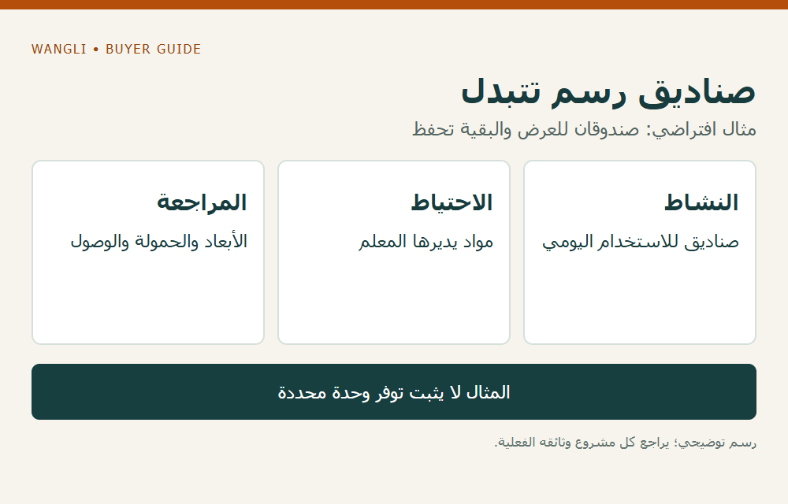

<!-- blog {"slug": "kindergarten-activity-materials-storage-planning", "title": "تخزين مواد الأنشطة في رياض الأطفال: كيف تفرق بين العرض اليومي والتخزين الاحتياطي؟", "seo_title": "تخزين أنشطة رياض الأطفال | WangLi", "description": "حدد العرض اليومي وتخزين المواد الاحتياطية والحمولة والوصول قبل طلب وحدات الروضة.", "category": "specifications", "published": "2026-11-16T00:06:29+08:00", "image": "/assets/kindergarten-activity-materials-storage-planning-cover-20261116.png", "image_alt": "تخزين مواد الأنشطة — افصل ما يستخدم يوميًا عما يحفظ للاحتياط", "image_caption": "تخزين مواد الأنشطة — افصل ما يستخدم يوميًا عما يحفظ للاحتياط", "image_kind": "diagram", "image_width": 1000, "image_height": 640, "draft": false} -->

# تخزين مواد الأنشطة في رياض الأطفال: كيف تفرق بين العرض اليومي والتخزين الاحتياطي؟

قد تتضمن قائمة تجهيز روضة الأطفال عددًا من الخزائن والرفوف، لكنها لا تبين ما الذي سيستخدمه الأطفال يوميًا وما الذي سيبقى لدى المعلمين للتبديل لاحقًا. يحتاج الموزع أو شركة توريد المشروع إلى فصل هاتين الوظيفتين وربطهما بمخطط الغرفة والأشياء الفعلية، قبل اقتراح وحدات التخزين والكميات.

## اجمع قائمة المواد ومستخدميها

اسأل جهة الروضة عن الألعاب والكتب ومواد الرسم والصناديق المراد حفظها، وأبعاد أكبر قطعة وعددها التقريبي وطريقة إخراجها. حدد ما تختاره مجموعة الأطفال مباشرة، وما يتعامل معه المعلم أو يبقى خارج متناول الأطفال وفق قواعد المنشأة. لا تطلب أسماء الأطفال أو بياناتهم الشخصية، ولا تفترض أن جميع المواد مناسبة للعرض المفتوح.

تشير [إرشادات وزارة التعليم النيوزيلندية لمساحات تخزين الطفولة المبكرة](https://www.education.govt.nz/education-professionals/early-learning/running-ece-centre/starting-a-centre-based-ece-service/designing-your-early-childhood-service-to-comply-with-the-licensing-criteria/storage-space) إلى الحاجة إلى تخزين موارد كثيرة مع عرض جزء منها للاستخدام، ومراجعة مواضع التخزين والسلامة. هذا توجيه في سياقه وليس مواصفة ملزمة لكل بلد أو دليلًا على أداء وحدة من WangLi.

## أنشئ سجلين للتجهيز

| نقطة القرار | العرض اليومي | التخزين الاحتياطي |
|---|---|---|
| المحتوى | المواد التي تحدد المدرسة إتاحتها | المواد التي تديرها الجهة المسؤولة |
| الوصول | طريقة وصول المستخدم إلى القطع | المسؤول عن الإخراج والإعادة |
| المساحة | الأبعاد الصافية ومكان الصناديق | الأبعاد والحمولة وحالة الوحدة |
| الموقع | العلاقة بالنشاط ومسار الحركة | موقع التخزين ومسار نقل المواد |
| الموافقة | مراجعة الاستخدام والثبات من المختص | مراجعة الموقع والتعليمات والمسؤولية |

اطلب من المورد رسم الوحدة وأبعاد الفتحات والأرفف وبيانات الحمولة وطريقة التثبيت إن وجدت. لا تستنتج قابلية تعديل الرف أو سعة الصناديق أو صلاحية التثبيت من صورة. يحدد مختص المشروع مواضع التخزين والاستقرار وفق المستخدمين وتعليمات المنتج والمتطلبات المحلية.

## مثال افتراضي: صناديق نشاط تتبدل

تريد الروضة إتاحة صندوقي رسم في الغرفة وحفظ صناديق إضافية لدى المعلم. تسجل الشركة أبعاد الصناديق وطريقة الوصول والمساحة المطلوبة في كل موقع، وتسأل عن تكوين الرف والحمل المسموح قبل اعتماد القائمة. المثال لا يمثل غرفة أو طلبًا حقيقيًا ولا يؤكد توفر موديل معين.

*مثال افتراضي؛ اضغط لتكبير الرسم.*

## اربط التخزين بترتيب الأنشطة

راجع [تجميع طاولات أنشطة الروضة](/blog/kindergarten-activity-table-grouping/) لوضع القطع في حالات الاستخدام، و[تخطيط حجرات التخزين](/blog/school-locker-compartment-planning/) لفصل المحتويات والفتحات، و[تنسيق التثبيت مع الموقع](/blog/school-furniture-fixing-substrate-coordination/) عند الحاجة إلى ربط الوحدة بالمنشأة.

[أرسل استفسارًا إلى WangLi](/request-a-quote/) يتضمن وصف المواد وأبعادها وعدد الوحدات ومخطط الغرفة والبيانات المطلوب تأكيدها لكل تكوين.
