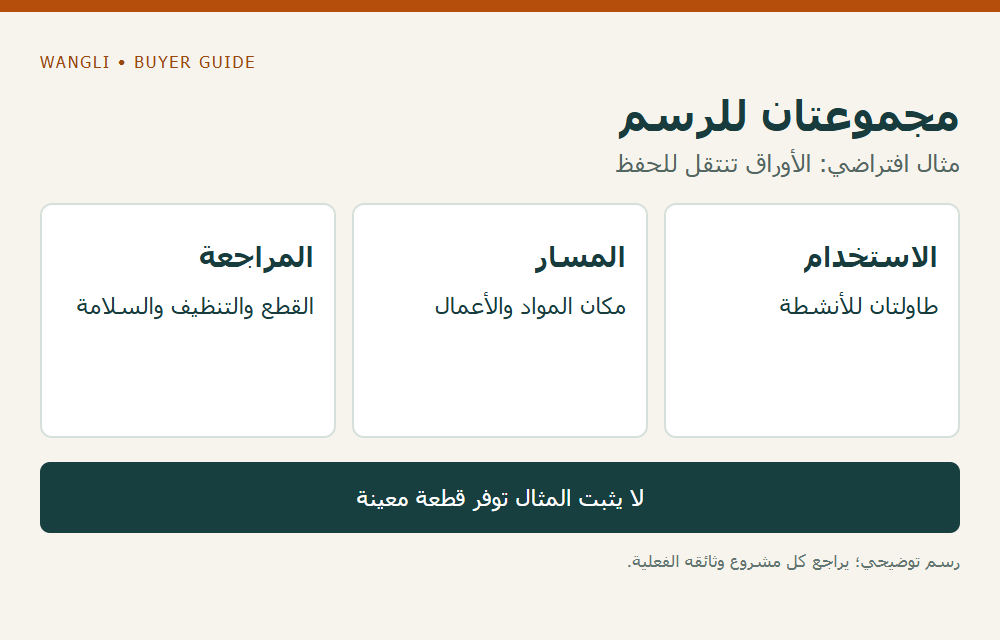

<!-- blog {"slug": "kindergarten-art-activity-furniture-brief", "title": "تجهيز مساحة الرسم في الروضة: كيف تحدد طاولة النشاط ومسار المواد؟", "seo_title": "أثاث مساحة الرسم في الروضة | WangLi", "description": "صف دورة الرسم والمواد والتنظيف واطلب تأكيد نطاق أثاث النشاط.", "category": "specifications", "published": "2026-11-16T00:09:24+08:00", "image": "/assets/kindergarten-art-activity-furniture-brief-cover-20261116.png", "image_alt": "أثاث نشاط الرسم — حدد دورة النشاط والمواد قبل اختيار التكوين", "image_caption": "أثاث نشاط الرسم — حدد دورة النشاط والمواد قبل اختيار التكوين", "image_kind": "diagram", "image_width": 1000, "image_height": 640, "draft": false} -->

# تجهيز مساحة الرسم في الروضة: كيف تحدد طاولة النشاط ومسار المواد؟

عند شراء أثاث نشاط الرسم، قد تركز القائمة على عدد الطاولات والكراسي وتغفل أين توضع المواد والأعمال أثناء الجفاف وكيف تنظف المساحة بعد انتهاء النشاط. يحتاج موزع الأثاث أو شركة المشروع إلى وصف دورة الاستخدام وربطها بمخطط الغرفة، ثم التحقق من التكوينات والخدمات التي يشملها عرض المورد.

## ابدأ بالنشاط والأدوات

اطلب من جهة الروضة وصف الأنشطة وعدد الأطفال في كل مجموعة والأدوات والورق الذي سيستخدم، ومكان حفظ المواد والأعمال المكتملة. ارسم موضع سطح العمل ومسار انتقال المواد إلى منطقة الحفظ أو التجفيف، مع مراعاة الأبواب والممرات وتوجيهات المشرف. تحدد الجهة المختصة احتياجات المستخدمين والسلامة؛ لا يفترض المورد أن مقاسًا واحدًا يناسب جميع الأطفال.

تدرج [إرشادات وزارة التعليم النيوزيلندية لخدمات الطفولة المبكرة](https://web-assets.education.govt.nz/s3fs-public/2026-05/Starting%20a%20centre-based%20early%20childhood%20service.pdf?VersionId=m.InDnFtrkKWb788wO3Gg2SM20e4uck5) الطاولة والتخزين ضمن نشاط، وحامل الرسم ورف التجفيف ضمن نشاط آخر. هذا مثال لتنظيم الوظائف وليس قائمة إلزامية لكل روضة أو دليلًا على توفر كل قطعة لدى WangLi.

## حدد ما يجب تأكيده في العرض

| نقطة | بيانات المشروع | أسئلة المورد |
|---|---|---|
| سطح النشاط | عدد المستخدمين وحجم المواد | الأبعاد والتكوين والمواد المؤكدة |
| الجلوس | المقاسات التي تحددها المدرسة | ارتفاع المقعد والطاولة ورسم القياس |
| المواد | عدد الصناديق وموقعها | أبعاد التخزين والحمولة والملحقات |
| الأعمال المكتملة | طريقة الحفظ أو التجفيف | هل القطعة المطلوبة ضمن نطاق العرض؟ |
| العناية | طريقة التنظيف المعتمدة | تعليمات العناية للسطح المحدد |

لا تستنتج مقاومة الطلاء أو الماء أو المواد المنظفة من اسم السطح، ولا تضف حاملًا أو رفًا إلى العرض دون تأكيد. اطلب من المختص مراجعة ترتيب الحركة واستقرار القطع ومتطلبات المشروع.

## مثال افتراضي: مجموعتان ومسار واحد

تستخدم مجموعتان طاولتين للرسم ثم تنقلان الأوراق إلى موضع تحفظ فيه الأعمال. يراجع الفريق موضع الطاولات ومسار الأوراق وعدد القطع المطلوبة وبيانات التنظيف، ثم يحدد ما يحتاج إلى تسعير منفصل. المثال لا يصف روضة أو منتجًا فعليًا.

*مثال افتراضي؛ اضغط لتكبير الرسم.*

## اربط الطلب ببقية الغرفة

راجع [تخزين مواد الأنشطة في الروضة](/blog/kindergarten-activity-materials-storage-planning/) لتحديد ما يعرض وما يحفظ، و[تجميع طاولات أنشطة الأطفال](/blog/kindergarten-activity-table-grouping/) لترتيب المجموعات، و[توافق تعليمات التنظيف](/blog/school-furniture-cleaning-compatibility/) لمراجعة المادة الفعلية.

[أرسل استفسارًا إلى WangLi](/request-a-quote/) يتضمن رسم الغرفة وعدد المستخدمين والتكوينات والكميات والبيانات المطلوبة، ليؤكد الفريق نطاق العرض المتاح لكل طلب.
