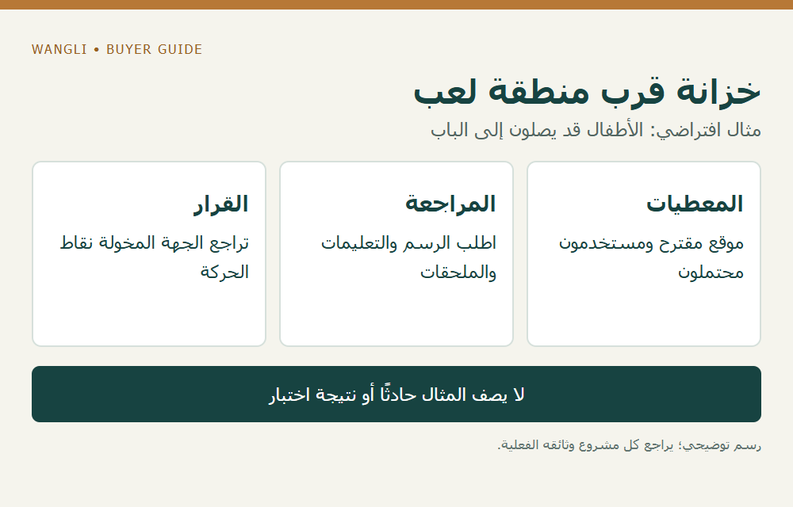

<!-- blog {"slug": "kindergarten-cabinet-door-finger-trap-review", "title": "أبواب خزائن رياض الأطفال: كيف تراجع الوصول ونقاط انحشار الأصابع قبل التوريد؟", "seo_title": "أبواب خزائن الروضة ونقاط الحركة | WangLi", "description": "حدّد مستخدمي خزانة الروضة ونقاط حركة الباب والوثائق المطلوبة للمراجعة قبل التوريد.", "category": "specifications", "published": "2026-11-20T16:21:30+08:00", "image": "/assets/kindergarten-cabinet-door-finger-trap-review-cover-20261120.png", "image_alt": "أبواب خزائن الروضة — راجع الاستخدام ونقاط الحركة قبل اعتماد التكوين", "image_caption": "أبواب خزائن الروضة — راجع الاستخدام ونقاط الحركة قبل اعتماد التكوين", "image_kind": "diagram", "image_width": 1000, "image_height": 640, "draft": false} -->

# أبواب خزائن رياض الأطفال: كيف تراجع الوصول ونقاط انحشار الأصابع قبل التوريد؟

قد تعرض قائمة المشروع خزائن لحفظ الألعاب والمواد، لكنها لا توضح من سيفتح الأبواب أو كيف ستُراجع نقاط الحركة قرب الأطفال. يحتاج موزع الأثاث أو شركة توريد المشروع إلى تحديد الاستخدام والموديل ومعلومات الباب، ثم رفع أسئلة السلامة للجهة المختصة. وجود قفل أو ملصق «آمن للأطفال» لا يثبت وحده أن الخزانة مناسبة لكل مستخدم أو موقع.

## ابدأ بمن يفتح الخزانة وما يحفظ فيها

اطلب من جهة الروضة تحديد الخزائن التي يصل إليها الأطفال مباشرة، والخزائن التي يديرها البالغون، ونوع المواد المخزنة وموقع الوحدة في مخطط الغرفة. تساعد [مراجعة تخزين مواد أنشطة الروضة](/blog/kindergarten-activity-materials-storage-planning/) في فصل العرض اليومي عن المخزون؛ أما هنا فالقرار يخص تشغيل الباب ونقاط التقاء الأجزاء المتحركة.

توضح [وزارة التعليم النيوزيلندية في تقرير الشكاوى والحوادث لعام 2020](https://web-assets.education.govt.nz/s3fs-public/2025-04/18.-BN1278022-Publication-of-the-2020-Early-Learning-Services-Complai.._.pdf?VersionId=I_j2wlnGA0tbDDBff4Hr.ooqFxWGakLC) تقارير حوادث في خدمات الطفولة المبكرة، ومنها حادث مرتبط بباب خزانة في الجدول الوارد في الصفحة 57 من الملف. هذا مثال محدود خارج السوق المستهدف، وليس حالة لمنتجات WangLi أو دليلًا على تكرار المشكلة في بلد محدد.

## اطلب بيانات الباب للتكوين الفعلي

| السؤال | ما تجمعه من المشروع والمورد | ما يبقى بحاجة إلى مراجعة |
|---|---|---|
| من يستخدم الباب؟ | الغرفة والمستخدمون ودورة الاستخدام | هل يسمح المشروع بوصول الأطفال؟ |
| أين تتحرك الأجزاء؟ | الرسم ووصف الباب والمفصلات | المواضع التي تحتاج إلى تقييم مختص |
| ما الملحقات؟ | قائمة القطع وتعليمات الموديل | هل تشمل المتطلبات ملحقًا خاصًا؟ |
| ما الوثائق؟ | التقارير أو التعليمات المناسبة للتكوين | هل تغطي الموديل والمتطلب؟ |
| ماذا يحدث عند الاختلاف؟ | طريقة رفع السؤال ومسؤول الرد | قرار الجهة المخولة قبل الاستخدام |

لا تفترض أن وسيلة حماية معينة متاحة أو فعالة على كل خزانة، ولا تركب ملحقًا من مصدر آخر دون مراجعة توافقه مع تعليمات المصنع ومتطلبات المشروع. لا يحدد هذا الدليل اختبارًا ذاتيًا أو أبعادًا آمنة عامة؛ تعتمد الجهة المختصة معايير السوق وطريقة التحقق.

## مثال افتراضي: خزانة في متناول الأطفال

تريد روضة وحدة مغلقة لبعض الأدوات، وتقترح وضعها قرب منطقة اللعب. يحدد فريق المشروع من سيستخدم الباب ومكان الوحدة، ثم يطلب رسم الموديل وتعليماته وما يوضح الملحقات المتاحة. تبقى مراجعة نقاط الحركة وقرار الاستخدام لدى المختص، حتى بعد وصول رد المورد. هذا مثال لتوضيح السؤال وليس وصفًا لحادث عميل أو نتيجة اختبار.

*مثال افتراضي؛ اضغط لتكبير الرسم.*

## جهّز الاستفسار قبل اعتماد العرض

استخدم [دليل توزيع حجرات الخزائن](/blog/school-locker-compartment-planning/) لتحديد المحتويات والفتح، و[تنسيق تثبيت الأثاث بالموقع](/blog/school-furniture-fixing-substrate-coordination/) لتعيين مسؤولية مراجعة الوحدة، و[دليل مراجعة المواصفات](/school-desk-chair-specifications/) لتنظيم هوية المستند والتكوين.

[أرسل استفسارًا إلى WangLi](/request-a-quote/) مع مخطط الغرفة والموديل المرجعي والكمية وطريقة الاستخدام والوثائق المطلوبة. يحتاج توفر التكوين والملحقات ونطاق التوريد إلى تأكيد خاص بالطلب؛ ولا يقرر رد المورد وحده قبول السلامة.
