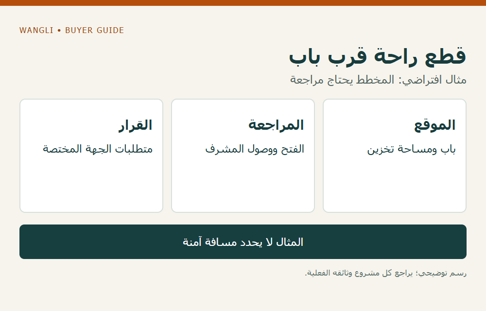

<!-- blog {"slug": "kindergarten-rest-room-furniture-brief", "title": "أثاث راحة الأطفال في الروضة: كيف تنظم أسئلة الغرفة قبل طلب التوريد؟", "seo_title": "تجهيز غرفة راحة الأطفال | WangLi", "description": "اجمع مخطط غرفة الراحة ومتطلبات الإشراف والعناية وبيانات التكوين قبل التوريد.", "category": "specifications", "published": "2026-11-16T00:06:58+08:00", "image": "/assets/kindergarten-rest-room-furniture-brief-cover-20261116.png", "image_alt": "تجهيز غرفة راحة الأطفال — حدد الغرفة والاستخدام قبل اختيار التكوين", "image_caption": "تجهيز غرفة راحة الأطفال — حدد الغرفة والاستخدام قبل اختيار التكوين", "image_kind": "diagram", "image_width": 1000, "image_height": 640, "draft": false} -->

# أثاث راحة الأطفال في الروضة: كيف تنظم أسئلة الغرفة قبل طلب التوريد؟

قد تحتاج روضة إلى تجهيز مساحة راحة للأطفال مع إبقاء المجال متاحًا للمراقبة وفتح الأبواب وحفظ المفروشات. لا يكفي تحديد عدد قطع الأثاث وحده؛ على شركة توريد المشروع جمع متطلبات عمر المستخدمين وحجم الغرفة وطريقة الاستخدام التي تؤكدها الجهة المسؤولة، ثم طلب بيانات التكوين من المورد. لا يحل هذا الدليل محل قرار السلامة أو متطلبات الجهة المحلية.

## اجمع خطة الغرفة من المسؤولين

اطلب مخطط الغرفة والأبواب ومواقع الإشراف والتخزين وطبيعة الاستخدام وعدد الأطفال والفئات العمرية بحسب خطة المنشأة. اجعل معلومات المستخدمين مجمعة دون أسماء أو بيانات صحية. تحدد الجهة المختصة نوع الأثاث وعدده والمسافات المطلوبة والإشراف المناسب؛ لا يختار المورد ذلك اعتمادًا على صورة.

توضح [إرشادات وزارة التعليم النيوزيلندية لبدء خدمة الطفولة المبكرة](https://web-assets.education.govt.nz/s3fs-public/2026-05/Starting%20a%20centre-based%20early%20childhood%20service.pdf?VersionId=m.InDnFtrkKWb788wO3Gg2SM20e4uck5) ضرورة النظر في حجم أثاث الراحة وتخطيط الغرفة ووصول البالغين. هذه متطلبات وتوجيهات في نيوزيلندا فقط، وليست موافقة محلية أو دليلًا على توفر أو سلامة منتج من WangLi.

## اطلب معلومات كل تكوين

| سؤال | ما تؤكده جهة المشروع | ما تطلبه من المورد |
|---|---|---|
| المستخدم والحاجة | الفئة العمرية وحالة الاستخدام | نوع القطعة وأبعادها الموثقة |
| مساحة الغرفة | مواضع الأبواب والتخزين والإشراف | الأبعاد الخارجية والرسم |
| السطح والعناية | إجراء التنظيف المعتمد | المادة وتعليمات العناية وحدودها |
| النقل والحفظ | الجهة المسؤولة والموضع المقترح | تعليمات الحالة المسموحة للموديل |
| القبول | المتطلبات المحلية والجهة المخولة | الأدلة المتاحة للتكوين نفسه |

لا تفترض قابلية الطي أو التكديس أو شمول المرتبة أو أن مادة معينة مناسبة للمشاركة من مجرد الصورة. إذا كان المشروع يحتاج إلى تقرير أو اختبار محدد، اطلب نطاقه وربطه بالموديل، واتركه غير مؤكد حتى تتم مراجعته.

## مثال افتراضي لمخطط يحتاج إلى تعديل

يبين رسم أولي قطع راحة قرب باب ومساحة تخزين. تراجع الجهة المسؤولة فتح الباب وإمكان وصول المشرف وتضع متطلبات التباعد الخاصة بها، ثم تطلب الشركة أبعاد التكوين المقترح. المثال لا يحدد مسافة آمنة، ولا يصف منشأة أو منتجًا فعليًا.

*مثال افتراضي؛ اضغط لتكبير الرسم.*

## اربط الطلب بمتطلبات الاستخدام

راجع [تنظيم مواد الأنشطة والتخزين](/blog/kindergarten-activity-materials-storage-planning/) لتحديد موقع المفروشات والمواد، و[مراجعة تعليمات التنظيف](/blog/school-furniture-cleaning-compatibility/) لربط العناية بالمادة المؤكدة، و[تخطيط الدخول إلى الموقع](/blog/school-furniture-site-access-planning/) لترتيب التسليم. تعتمد جهة المشروع المتطلبات والقرار النهائي.

[أرسل استفسارًا إلى WangLi](/request-a-quote/) يتضمن وصف التكوين والكميات والأبعاد والوجهة والمستندات التي تحتاج إلى تأكيدها؛ يوضح الفريق البيانات المتاحة للطلب المعني.
