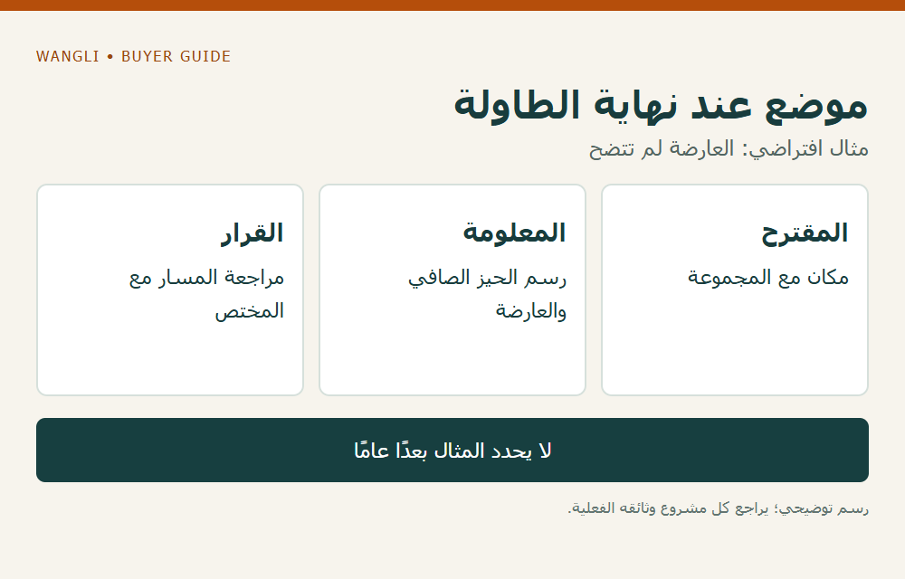

<!-- blog {"slug": "school-canteen-wheelchair-table-access", "title": "طاولات المقصف المدرسي: كيف تراجع مكان مستخدم الكرسي المتحرك مع ترتيب الجلوس؟", "seo_title": "الوصول إلى طاولة المقصف المدرسي | WangLi", "description": "راجع مسار الوصول والحيز أسفل طاولة المقصف مع مختص المشروع.", "category": "specifications", "published": "2026-11-16T00:12:18+08:00", "image": "/assets/school-canteen-wheelchair-table-access-cover-20261116.png", "image_alt": "الوصول إلى طاولة المقصف — اربط المسار والحيز بترتيب الجلوس", "image_caption": "الوصول إلى طاولة المقصف — اربط المسار والحيز بترتيب الجلوس", "image_kind": "diagram", "image_width": 1000, "image_height": 640, "draft": false} -->

# طاولات المقصف المدرسي: كيف تراجع مكان مستخدم الكرسي المتحرك مع ترتيب الجلوس؟

قد يتضمن مخطط المقصف العدد المطلوب من المقاعد من دون أن يوضح كيف يصل مستخدم كرسي متحرك إلى الطاولة ويشارك المجموعة. يحتاج مورد المشروع إلى جمع احتياجات الموقع والمستخدم من الجهة المختصة، وطلب رسم الطاولة والحيز تحتها، ثم مراجعة الترتيب مع المختص قبل تحديد الكميات. لا يثبت الوصف العام «مناسب لذوي الإعاقة» مطابقة منتج بعينه.

## ابدأ بمسار الاستخدام الكامل

اطلب مخطط الدخول ومنطقة الخدمة وموقع الطاولات واتجاه الاقتراب ومكان أدوات الطعام. حدّد مع المدرسة ما يحتاجه المستخدم للوصول والجلوس والمغادرة، دون جمع أسماء أو بيانات صحية ضمن طلب السعر. لا تفترض أن وضع فراغ بين طاولتين يكفي إذا لم تُراجع الأرجل والعوارض والحيز الصافي ومسارات الحركة.

تذكر [إرشادات وزارة التعليم النيوزيلندية لتحسين الوصول في المدارس](https://web-assets.education.govt.nz/s3fs-public/2025-03/Improving%20Accessibility%20at%20Schools_v1.0_Final%201%201.pdf?VersionId=j6njad6tNWEq7rzV6WBRaJcx27AtrIVs) أهمية الأثاث المناسب وإتاحة الحيز أسفل أسطح العمل للمستخدمين عند الحاجة. هي إرشادات لسياقها وليست مواصفة محلية لجميع المقاصف أو إثباتًا لموديل WangLi.

## طابق مخطط الموقع برسم الطاولة

| نقطة المراجعة | ما تحدده الجهة المختصة | ما يطلب من المورد |
|---|---|---|
| الاقتراب | المسار وموقع الجلوس مع المجموعة | الأبعاد الخارجية وموضع الأرجل |
| الحيز تحت السطح | نقاط القياس والاحتياج الفعلي | العرض والارتفاع والعمق الصافي في تلك النقاط |
| تشغيل المقصف | الخدمة والتنظيف وإعادة الترتيب | تكوين الطاولة والمقاعد والملحقات |
| القرار | المتطلبات المحلية وصاحب الاعتماد | الرسم والبيانات الخاصة بالموديل |

إذا كانت المقاعد متصلة بالطاولة، اطلب رسمًا يوضح علاقتها بموضع الاقتراب، ولا تستنتج إمكان إزالة مقعد من صورة. إذا تغير الموديل أو اتجاهه، أعد عرض الترتيب على الجهة المختصة. لا يحدد هذا المقال أبعادًا عامة أو يمنح اعتماد وصول.

## مثال افتراضي: موضع عند نهاية الطاولة

يقترح المخطط مكانًا عند نهاية طاولة جماعية، لكن الرسم الأول لا يبين موضع العارضة السفلية. تطلب الشركة الرسم والأبعاد الصافية، ويقرر مختص المشروع مدى ملاءمة الموضع والمسار. المثال لا يمثل مستخدمًا أو منتجًا أو نتيجة اختبار فعلية.

*مثال افتراضي؛ اضغط لتكبير الرسم.*

## اربط المراجعة ببقية الطلب

يساعد [دليل مقارنة أثاث المقصف](/blog/school-cafeteria-furniture-procurement/) في وصف الخدمة والتنظيف، و[دليل طاولة مستخدم الكرسي المتحرك](/blog/school-wheelchair-desk-procurement/) في تسمية نقاط القياس، و[دليل توزيع الأثاث على المواقع](/blog/school-furniture-multiple-site-distribution/) في ربط التكوين بالكميات والغرف.

[أرسل استفسارًا إلى WangLi](/request-a-quote/) مع مخطط المقصف وأبعاد الاستخدام التي حددها المختص والكميات وتفاصيل التكوين المطلوبة؛ يؤكد الفريق بيانات الموديل المتاحة.
