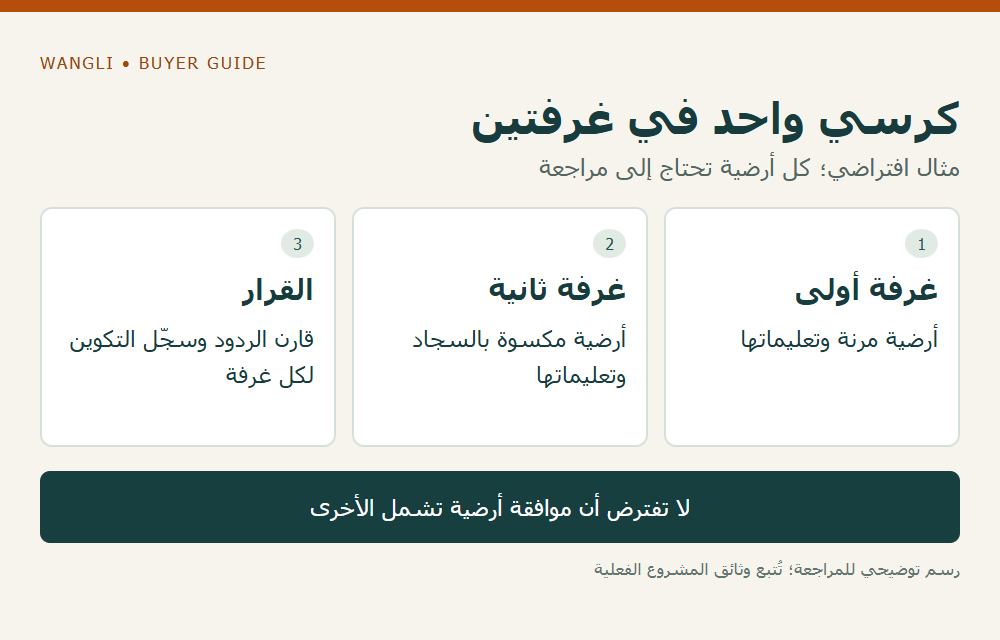

<!-- blog {"slug": "school-chair-glides-floor-compatibility", "title": "قواعد أرجل الكراسي وعجلاتها: كيف تراجع توافقها مع أرضية المدرسة؟", "seo_title": "قواعد الكراسي والعجلات وأرضية المدرسة | WangLi", "description": "اجمع بيانات الأرضية ونمط الحركة وتعليمات العناية، ثم اطلب تأكيد توافق قاعدة الكرسي أو عجلته مع التكوين الفعلي.", "category": "specifications", "published": "2026-11-02T00:17:09+08:00", "image": "/assets/school-chair-glides-floor-compatibility-cover-20261102.png", "image_alt": "هل تلائم القاعدة أرضية المدرسة؟ — القرار يربط الأرضية والكرسي ونمط الحركة", "image_caption": "هل تلائم القاعدة أرضية المدرسة؟ — القرار يربط الأرضية والكرسي ونمط الحركة", "image_kind": "diagram", "image_width": 1000, "image_height": 640, "draft": false} -->

# قواعد أرجل الكراسي وعجلاتها: كيف تراجع توافقها مع أرضية المدرسة؟

قد يطلب المشروع كرسيًا ثابتًا أو متحركًا قبل أن يحسم تفصيل الجزء الملامس للأرضية. لكن اسم «قاعدة حماية» أو «عجلة» لا يثبت ملاءمته لكل أرضية. يحتاج الموزع وشركة توريد المدارس إلى جمع بيانات الغطاء الأرضي والاستعمال، ثم طلب توصية مكتوبة للتكوين المقترح. القرار يتعلق بالزوج الفعلي من الأرضية والكرسي، وليس بمادة القاعدة وحدها.

## عرّف الأرضية قبل اختيار الجزء

اطلب من المشروع اسم الغطاء الأرضي ومورده أو مصنّعه، والموديل أو التشطيب إن عُرف، وما إذا كان جديدًا أو مستخدمًا. سجّل تعليمات العناية والقيود التي يقدمها صاحبه، وأي مناطق تختلف مادتها داخل الغرفة أو على مسار الحركة. لا تختزل الأرضيات كلها في وصف «صلبة»، ولا تفترض أن ما يناسب غرفة مكسوة بالسجاد يناسب بقية المدرسة.

يناقش [مصنّع الأثاث التعليمي Artcobell](https://www.artcobell.com/en-us/blog/choosing-the-right-glides-or-casters?hs_amp=true) ارتباط اختيار القواعد والعجلات بنوع الأرضية والأنشطة والصيانة، ويذكر أن حلًا واحدًا لا يحقق الأداء الأمثل في جميع الظروف. هذه خبرة منشورة تخص منتجاته؛ تدعم سؤال التوافق، ولا تمنح ضمانًا لأثاث WangLi أو للأرضية المقصودة.

## افصل القاعدة المنزلقة عن العجلة

حدد إن كان المشروع يريد كرسيًا يُنقل عند إعادة الترتيب، أم كرسيًا يحتاج إلى حركة أثناء المهمة. لا تعتبر العجلات مجرد بديل شكلي للقاعدة؛ اطلب وصف التكوين وسلوكه الذي يحتاج إلى مراجعة، وما يتوفر من خيارات أو قيود للموديل. وجود قطعة قابلة للتبديل لدى منتج آخر لا يعني إمكان تركيبها في الكرسي المعروض.

| نقطة القرار | بيانات المدرسة | تأكيد مطلوب للتكوين |
|---|---|---|
| سطح التلامس | نوع الأرضية وتعليمات صاحبها | مادة القاعدة أو سطح العجلة ووصفه |
| نمط الحركة | مواضع الاستخدام وتكرار النقل | التكوين المقترح وأي تعليمات للمناولة |
| التوافق | قيود الأرضية أو شروط صيانتها | رد مكتوب يحدد الزوج الذي راجعه المورد |
| الاستبدال لاحقًا | حاجة التشغيل إلى قطع بديلة | مرجع القطعة وطريقة التحقق من التوافق |

عند وجود رد من مورد الأرضية وآخر من مورد الأثاث، احتفظ بنطاق كل منهما. إذا تعارضا أو تناولا مواد مختلفة، يبقى السؤال مفتوحًا إلى أن يراجع الطرفان التكوين الصحيح؛ لا تختَر الرد الأكثر تفاؤلًا وتعدّه موافقة مشتركة.

## راجع حالة الأرضية وبرنامج المتابعة

قد تتأثر النتيجة بحالة القواعد والعجلات وبما يلتصق بها وبالعناية بالأرضية. لذلك اطلب من المدرسة تحديد الجهة التي تفحص الأجزاء الملامسة ومتى تحيل التآكل أو التلف إلى الصيانة، وفق تعليمات الأطراف. لا تقدم هذه المقالة جدول استبدال موحدًا أو برنامج تنظيف، ولا تَعِد بمنع الخدوش أو الآثار.

إذا طلب المشروع مراجعة عينة، فعرّف السؤال والجزء والأرضية وإجراء المراجعة مع أصحاب الاختصاص قبلها. سجّل النتيجة وحدودها؛ ملاحظة قصيرة على عينة لا تثبت عدم تأثر الأرضية بعد سنوات أو تحت ظروف مختلفة. يظل أي شرط ضمان للأرضية أو الأثاث بحاجة إلى مراجعة مستقلة.

## مثال افتراضي: الموديل نفسه في غرفتين

لنفترض أن المدرسة تريد كرسيًا واحدًا لغرفتين، لكن الأرضية في الأولى مرنة وفي الثانية مكسوة بالسجاد. أرسل وصف كل غرفة وتعليماتها بدل افتراض أن التكوين المفضل في الأولى يغطي الثانية. إذا اقترح المورد قطعتين مختلفتين، افصل رمزيهما وكميتيهما في الطلب وفي سجل قطع الاستبدال. الأسماء هنا أمثلة، وليست توصية بنوع أو مادة.

*رسم توضيحي: كرسي واحد في غرفتين — مثال افتراضي؛ كل أرضية تحتاج إلى مراجعة — اضغط لعرض الصورة بالحجم الكامل.*

يمكن مراجعة [فئة كراسي الطلاب](/products/student-chairs/) لتحديد الموديل، و[دليل قطع الغيار](/blog/school-furniture-spare-parts-inquiry/) لتعريف البديل، و[أسئلة الضمان قبل الشراء](/blog/school-furniture-warranty-scope-questions/) لفصل نطاق الالتزام عن وصف المنتج. [أرسل طلب عرض سعر إلى WangLi](/request-a-quote/) مع بيانات الأرضية والموديل والكمية ونمط الحركة وأي تأكيد مكتوب تحتاج إليه.
