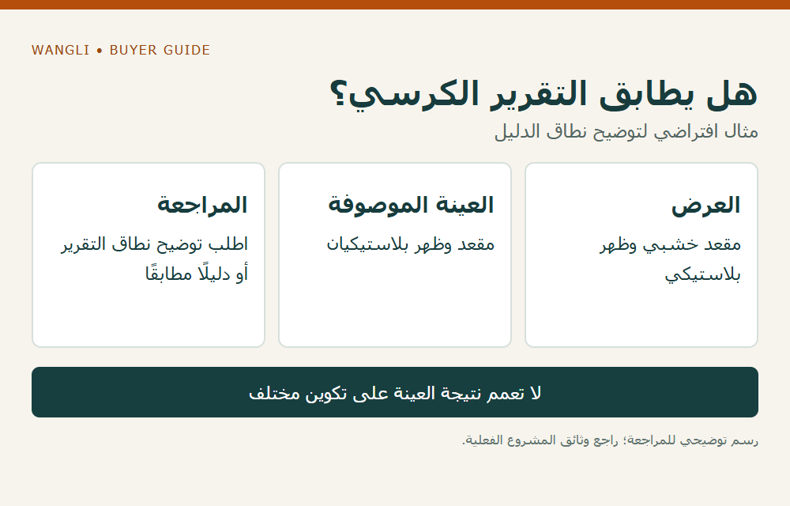

<!-- blog {"slug": "school-chair-seat-back-material-comparison", "title": "مقعد الكرسي المدرسي وظهره: كيف تقارن الخشب والبلاستيك قبل اختيار التكوين؟", "seo_title": "مادة مقعد الكرسي المدرسي وظهره | WangLi", "description": "راجع مادة المقعد والظهر وتشطيبهما واتصالهما بالهيكل، وطابق مستند الاختبار مع التكوين المعروض قبل اختيار الكرسي.", "category": "specifications", "published": "2026-11-03T00:04:50+08:00", "image": "/assets/school-chair-seat-back-material-comparison-cover-20261103.png", "image_alt": "مقعد الكرسي وظهره — قارن التكوين المعروض قبل اختيار المادة", "image_caption": "مقعد الكرسي وظهره — قارن التكوين المعروض قبل اختيار المادة", "image_kind": "diagram", "image_width": 1000, "image_height": 640, "draft": false} -->

# مقعد الكرسي المدرسي وظهره: كيف تقارن الخشب والبلاستيك قبل اختيار التكوين؟

قد تظهر صورتان متشابهتان لكرسي مدرسي، لكن المقعد والظهر مصنوعان من مواد مختلفة وبطرق تثبيت مختلفة. يحتاج الموزع أو شركة توريد المشروع إلى مقارنة التكوين الذي سيُعرض فعلًا، لا الاكتفاء بكلمة «خشب» أو «بلاستيك» في جدول السعر. ابدأ بمتطلبات الاستخدام والأدلة المطلوبة، ثم اطلب بيانات المقعد والظهر ونقاط الاتصال مع الهيكل لكل موديل.

## حدد المادة في كل جزء على حدة

اطلب من المورد تسمية مادة المقعد ومادة الظهر وأي طبقة تغطيهما أو تشكل الحافة. إذا ذكر لوحًا خشبيًا، فاسأل عن نوع اللوح والتشطيب وطريقة حماية الحواف في التكوين المعروض؛ وإذا ذكر بلاستيكًا، فاطلب تعريف المادة وطريقة وصف الجزء. لا تُحوّل اسم المادة وحده إلى وعد بعمر أو قدرة تحمل، ولا تفترض أن جميع أجزاء الكرسي مصنوعة منها.

تضع [إرشادات UNICEF لشراء الأثاث المدرسي](https://www.unicef.org/innovation/school-furniture-design-and-procurement-guidelines) جودة المواد والمتانة والنقل والصيانة ضمن مسائل التخطيط والشراء. وهي إرشادات عامة قابلة للتكييف مع الظروف المحلية، وليست اعتمادًا لمادة أو موديل من WangLi. مواصفات طلب المشروع والدليل المقدم للموديل هما أساس المراجعة.

## قارن التكوين بدل مقارنة اسم المادة فقط

| ما تراجعه | السؤال للمورد | ما يبقى غير محسوم دون دليل |
|---|---|---|
| المقعد والظهر | ما مادة كل جزء وما تشطيبه؟ | أداء منتج آخر يحمل الاسم نفسه |
| الاتصال بالهيكل | ما طريقة الربط وهل يمكن تعريف الأجزاء؟ | صلاحية أي مثبت بديل |
| الحواف والسطح | ماذا يوضح الرسم والعينة عن الحافة والتشطيب؟ | أي نتيجة اختبار لم تُقدَّم |
| العناية | ما تعليمات تنظيف السطح المحدد؟ | توافق منظف لم يُراجع |
| الإثبات | ما الموديل والتكوين الذي يغطيه تقرير الاختبار؟ | تعميم النتيجة على تكوين آخر |

لا ينقل المقارن مزايا مُفترضة من منتج بلاستيكي إلى كل كرسي بلاستيكي، أو من لوح خشبي إلى كل سطح خشبي. تختلف المكونات والتصميم والتشطيب وظروف الاستخدام؛ وعند غياب بيانات قابلة للمقارنة يبقى السؤال مفتوحًا.

## طابق الدليل والعينة مع العرض

اطلب رمز الكرسي وإصدار الرسم ومعلومات المقعد والظهر والهيكل، ثم قارنهما بوصف العينة أو المستند. يوضح [دليل مراجعة مواصفات الطاولات والكراسي](/school-desk-chair-specifications/) كيف تربط الدليل بالموديل، بينما يساعد [دليل الحواف والألواح](/blog/school-desk-edge-core-construction/) في صياغة أسئلة سطح الطاولة؛ لا تفترض أن معالجة حافة الطاولة هي نفسها معالجة مقعد الكرسي.

**مثال افتراضي:** يتضمن العرض كرسيًا بمقعد خشبي وظهر بلاستيكي، بينما يصور تقرير المورد عينة بمقعد وظهر بلاستيكيين. قد يكون المستند مفيدًا لفهم ما اختُبر، لكنه لا يثبت وحده أداء التكوين المختلف. سجّل الفرق واطلب من مصدر التقرير بيان نطاقه أو مستندًا مطابقًا؛ المثال لا يصف منتجًا أو اختبارًا لدى WangLi.

*مثال افتراضي؛ اضغط لتكبير الرسم.*

## جهز طلبًا يمكن تسعيره ومراجعته

اجمع كمية كل تكوين، والمقاس الذي اعتمده المشروع، والمواد المطلوبة للمقعد والظهر، ومتطلبات الإثبات والعناية والأسئلة المفتوحة. استخدم [دليل توزيع المقاسات على الفصول](/blog/school-desk-chair-size-quantity-planning/) لفصل احتياج المقاس عن اختيار المادة، و[دليل توافق التنظيف](/blog/school-furniture-cleaning-compatibility/) لتحديد السطح والمنظف قبل إصدار حكم. ثم [أرسل طلب عرض سعر إلى WangLi](/request-a-quote/) مع القائمة والموديلات المرجعية والوجهة؛ توافر مادة معينة أو تعديل تكوين يحتاج إلى تأكيد خاص بالطلب.
