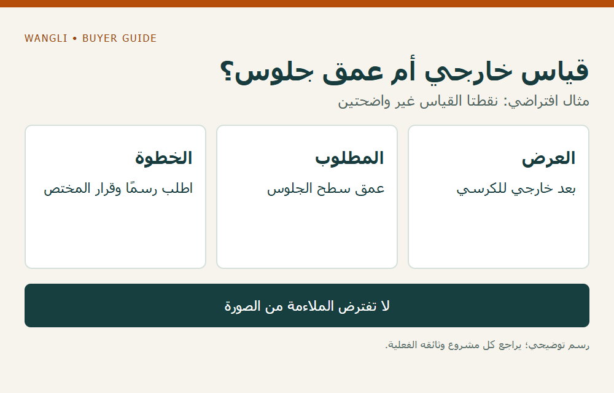

<!-- blog {"slug": "school-chair-seat-depth-procurement", "title": "عمق مقعد الكرسي المدرسي: ما الذي يحتاجه الموزع لمراجعة الملاءمة؟", "seo_title": "عمق مقعد الكرسي المدرسي | WangLi", "description": "حدد نقاط قياس عمق المقعد واربطها باحتياجات المستخدمين ومراجعة المختص.", "category": "tenders", "published": "2026-11-15T11:29:28+08:00", "image": "/assets/school-chair-seat-depth-procurement-cover-20261115.png", "image_alt": "عمق مقعد الطالب — حدد نقاط القياس ومراجعة الملاءمة", "image_caption": "عمق مقعد الطالب — حدد نقاط القياس ومراجعة الملاءمة", "image_kind": "diagram", "image_width": 1000, "image_height": 640, "draft": false} -->

# عمق مقعد الكرسي المدرسي: ما الذي يحتاجه الموزع لمراجعة الملاءمة؟

عند مقارنة كراسي الطلاب، قد يذكر العرض ارتفاع المقعد بينما يغيب عمق السطح الذي يجلس عليه الطالب. يحتاج موزع الأثاث أو شركة توريد المشروع إلى وصف القياس ونقاطه، وربطه بفئات المستخدمين التي حددتها المدرسة، ثم إحالة الملاءمة إلى المختص. لا يحدد العمر وحده مقاسًا واحدًا يصلح لكل طالب.

## افصل العمق عن العرض والارتفاع

اطلب رسمًا للمقعد يوضح نقطة بداية قياس العمق ونهايته، وشكل الحافة الأمامية وموضع مسند الظهر. اكتب وحدة القياس وإصدار الرسم، واسأل هل القيمة لسطح الجلوس الفعلي أم للبعد الخارجي للكرسي. قد تختلف مساحة الجلوس المتاحة عن العمق الخارجي؛ لذلك لا تستبدل أحدهما بالآخر من دون توضيح.

يذكر [ملخص لوزارة التعليم النيوزيلندية عن مساحات التعلم المرنة](https://web-assets.education.govt.nz/s3fs-public/2024-12/FLS-The-impact-of-physical-design-on-student-outcomes%5B1%5D.pdf?VersionId=QqfTrZBvTr6EPMPjfA8fM24V2RVvs34w) أهمية دعم الفخذ وترك مجال خلف الركبة عند النظر في عمق المقعد. هذه إرشادات عامة في سياقها، لا تشخيص فردي أو دليل ملاءمة لموديل WangLi؛ تحدد الجهة المختصة احتياجات المستخدمين وطريقة مراجعتها.

## حوّل المعلومات إلى طلب قابل للمقارنة

| السؤال | بيانات جهة المشروع | بيانات تطلب من المورد |
|---|---|---|
| من سيستخدم الكراسي؟ | مجموعات المقاسات أو المتطلبات المعتمدة دون أسماء الطلاب | الموديلات والتكوينات المقترحة |
| ما العمق المطلوب؟ | طريقة التحديد التي يعتمدها المختص | الرسم ونقطتا قياس عمق المقعد |
| ما شكل الحافة والظهر؟ | احتياجات الاستخدام والمراجعة | وصف الحافة والظهر للتكوين نفسه |
| هل تختلف الطاولات؟ | ارتفاع الطاولات ومساحة الحركة | أبعاد الكرسي والطاولة المرشحين |
| ما دليل القبول؟ | إجراء المشروع والجهة المخولة | العينة أو المستند المتاح للموديل |

لا تفترض أن المقعد قابل لتعديل العمق أو أن صورة المقعد تثبت ملاءمته، ولا ترسل بيانات شخصية للطلاب ضمن طلب التسعير. إذا حددت الجهة المختصة مقاسات متعددة، سجّلها بكميات مجمعة لكل فصل.

## مثال افتراضي: بعد خارجي وعمق جلوس مختلفان

يعرض مورد بعدًا خارجيًا للكرسي، بينما يطلب المشروع عمق سطح الجلوس من نقطة محددة إلى الحافة. تطلب شركة التوريد رسمًا يبين موضعي القياس قبل المقارنة، وتترك الملاءمة مفتوحة لحين مراجعة المختص. المثال لا يمثل قياسًا أو موديلًا من WangLi.

*مثال افتراضي؛ اضغط لتكبير الرسم.*

## اربط قياس الكرسي بباقي الطلب

راجع [توزيع مقاسات وكميات الطاولات والكراسي](/blog/school-desk-chair-size-quantity-planning/) لتنظيم كميات كل غرفة، و[مقارنة مواد المقعد والظهر](/blog/school-chair-seat-back-material-comparison/) لمراجعة التكوين والعناية، و[دليل مواصفات الطاولات والكراسي](/school-desk-chair-specifications/) لربط القياسات بالمستندات المطلوبة.

[أرسل استفسارًا إلى WangLi](/request-a-quote/) مع الموديل أو الصورة ومقاسات المشروع والكميات والرسومات المطلوبة؛ يؤكد الفريق البيانات المتاحة للتكوين المحدد.
