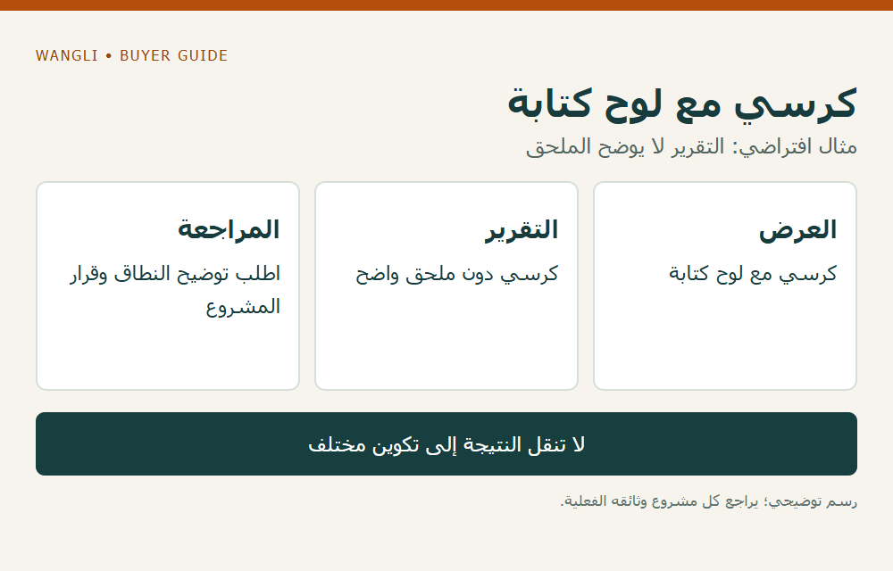

<!-- blog {"slug": "school-chair-stability-evidence", "title": "ثبات الكرسي المدرسي: ما الأدلة التي تطلبها قبل اعتماد التكوين؟", "seo_title": "ثبات الكرسي المدرسي ودليل الاختبار | WangLi", "description": "طابق متطلبات ثبات الكرسي مع الموديل والتكوين ونطاق تقرير الاختبار.", "category": "tenders", "published": "2026-11-15T11:29:42+08:00", "image": "/assets/school-chair-stability-evidence-cover-20261115.png", "image_alt": "ثبات الكرسي المدرسي — طابق التكوين مع متطلبات المشروع والدليل", "image_caption": "ثبات الكرسي المدرسي — طابق التكوين مع متطلبات المشروع والدليل", "image_kind": "diagram", "image_width": 1000, "image_height": 640, "draft": false} -->

# ثبات الكرسي المدرسي: ما الأدلة التي تطلبها قبل اعتماد التكوين؟

عندما تطلب مدرسة كرسيًا ثابتًا، لا تكفي صورة الكرسي أو عبارة «مناسب للاستخدام الشاق» لإثبات الأداء. يحتاج الموزع وشركة توريد المشروع إلى تحديد حالات الاستخدام والمتطلب الفني والوثائق المطلوبة، ثم التحقق من أن الأدلة تخص الموديل والتكوين المعروضين. يحدد مختص المشروع إجراءات القبول.

## حدد السؤال وحالة الاستخدام

اسأل جهة المدرسة عن المستخدمين والبيئة والترتيب والملحقات التي تدخل في الطلب. هل يشتمل الكرسي على لوح كتابة أو سلة أو أجزاء أخرى؟ قد يختلف التكوين الذي يحتاج إلى مراجعة عن الكرسي الظاهر وحده في الكتالوج. اطلب رسمًا يوضح قاعدة الكرسي والأبعاد والملحقات المؤكدة؛ لا تستنتج الثبات من عدد الأرجل أو شكلها.

تذكر [وثيقة تصميم تعليمية بريطانية تاريخية](https://assets.publishing.service.gov.uk/media/5a7c215d40f0b645ba3c6df5/ITT_Volume_5_Part_B_Generic_Design_Brief_V6_Feb_2014.pdf) المتانة والثبات وسجلات الاختبارات ضمن متطلبات ذلك المشروع. هذه وثيقة تخص سياقها وزمنها، وليست بيانًا للمعايير الحالية في كل بلد أو إثباتًا لاجتياز كرسي WangLi أي اختبار.

## طابق المتطلب مع التقرير

| نقطة مراجعة | ما تسأل عنه | ما يبقى مفتوحًا |
|---|---|---|
| هوية المنتج | رمز الموديل والتكوين والملحقات وإصدار الرسم | هل يطابق المنتج المعروض التقرير؟ |
| حالة الاختبار | نوع الاختبار وطريقته والظروف المذكورة في التقرير | هل يغطي التقرير حالة الاستخدام المطلوبة؟ |
| الجهة والوثيقة | مصدر التقرير وتاريخه ونتائجه ونطاقه | هل تقبل جهة المشروع الوثيقة؟ |
| التغييرات | أي فرق في المقعد أو الهيكل أو الإضافات | هل يلزم تقييم جديد للتكوين؟ |
| القرار | صاحب المراجعة ومتطلبات المناقصة | رد المورد وحده لا يمثل قبولًا |

لا تنقل نتيجة من منتج مختلف أو من نظام إدارة الجودة إلى كرسي بعينه. وإذا لم يتوفر تقرير مطلوب، سجّله غير مؤكد واطلب توضيحًا قبل إعداد الاستجابة. لا تنفذ اختبارات دفع أو تحميل على الطلاب أو الموظفين اعتمادًا على هذا المقال.

## مثال افتراضي: كرسي مع ملحق

يقدم المورد تقريرًا لكرسي دون لوح كتابة بينما يتضمن العرض لوحًا. تطلب شركة التوريد توضيح التكوين الذي اختبره التقرير وما إذا كان يغطي الملحق، وتحيل المسألة إلى جهة المشروع. المثال لا يصف شهادة فعلية أو نموذجًا معتمدًا لدى WangLi.

*مثال افتراضي؛ اضغط لتكبير الرسم.*

## اربط الاستجابة بملف الشراء

راجع [اختيار لوح كتابة كرسي المحاضرات](/blog/lecture-chair-writing-tablet-selection/) لتحديد تكوين الملحق، و[تقييم عينات المناقصة](/blog/school-furniture-tender-evaluation-samples/) لفصل غرض العينة عن تقرير الاختبار، و[دليل مواصفات الطاولات والكراسي](/school-desk-chair-specifications/) لربط المتطلبات بالأدلة.

[أرسل إلى WangLi استفسارًا](/request-a-quote/) يتضمن الموديل أو الصورة والتكوين والكميات ونص المتطلبات والوثائق المطلوبة؛ يؤكد الفريق ما يتوفر للطلب المحدد.
