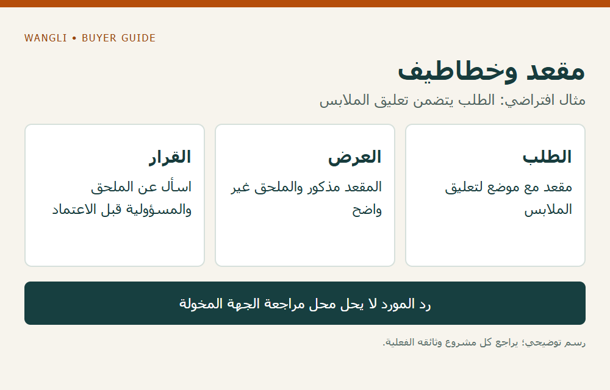

<!-- blog {"slug": "school-changing-room-bench-procurement", "title": "مقاعد غرف تبديل الملابس المدرسية: كيف تحدد التكوين قبل طلب التوريد؟", "seo_title": "مقاعد غرف تغيير الملابس المدرسية | WangLi", "description": "حدّد تكوين المقعد والملحقات وموقع الاستخدام قبل إعداد طلب توريد غرفة تبديل الملابس.", "category": "specifications", "published": "2026-11-18T11:40:38+08:00", "image": "/assets/school-changing-room-bench-procurement-cover-20261118.png", "image_alt": "مقاعد غرفة تبديل الملابس — عرّف الجلوس والملحقات قبل طلب العرض", "image_caption": "مقاعد غرفة تبديل الملابس — عرّف الجلوس والملحقات قبل طلب العرض", "image_kind": "diagram", "image_width": 1000, "image_height": 640, "draft": false} -->

# مقاعد غرف تبديل الملابس المدرسية: كيف تحدد التكوين قبل طلب التوريد؟

قد يدرج مشروع مدرسي «مقاعد لغرفة تبديل الملابس» في قائمة التجهيز دون توضيح من سيستخدمها أو كيف توضع الملابس والحقائب أثناء الجلوس. تحتاج شركة التوريد إلى فصل وظيفة الجلوس عن التخزين والتعليق، ثم طلب رسم للتكوين المحدد ومراجعة موقعه مع الجهة المسؤولة. وجود مقعد في الصورة لا يثبت أن خطاطيف أو خزانة أو تثبيتًا في الموقع مشمولة في العرض.

## صف الاستخدام والأشياء المطلوب حفظها

اطلب من المدرسة وصف عدد المستخدمين المقصودين في كل فترة وطريقة استعمال الغرفة، وما إذا كانت المتعلقات ستوضع في خزائن منفصلة أو تعلق قرب المقعد. افصل بين احتياج الجلوس وعدد الخزائن أو الخطاطيف؛ لا تفترض أن كل مستخدم يحتاج إلى حجرة أو خطاف على أساس الحساب وحده. تضع المدرسة التوزيع ومتطلبات الإشراف والخصوصية، ولا تحتاج قائمة الأسعار إلى أسماء الطلاب أو معلوماتهم الصحية.

يعرض [دليل وزارة التعليم الإنجليزية](https://assets.publishing.service.gov.uk/media/6971f649d8adeaf266040501/ER-DFE-XX-XX-T-X-0201-Technical_Manual-A-C01.pdf) أمثلة لمقاعد تغيير الملابس ومقاعد تتضمن خطاطيف، مع ربط التكوين باحتياجات المشروع. وهو مرجع لسياق إنجلترا، وليس مواصفة تلقائية لمشروع آخر أو إثباتًا لمنتج معين.

## افصل التكوين إلى بنود واضحة

| نقطة المراجعة | ما تطلبه | ما لا تثبته الصورة |
|---|---|---|
| المقعد | الطول والارتفاع والعمق والتكوين المعروض | عدد المستخدمين المقبول في مشروعك |
| التعليق أو التخزين | المكونات والعدد والمواضع إن كانت مطلوبة | أن الخطاطيف أو الخزائن مشمولة |
| التثبيت | تعليمات المنتج والأعمال والمسؤول عنها | ملاءمة أرضية أو جدار لم يفحصه المختص |
| السطح والعناية | مادة السطح وتعليمات تنظيف التكوين | توافق كل منظف أو تحمل بيئة رطبة |
| الموقع | الرسم ومسار الحركة والاستخدام | اعتماد الموقع أو الأبعاد من صورة |

إذا كانت الخطاطيف مطلوبة، اطلب توصيفها وطريقة تثبيتها ومواضعها وفق متطلبات الجهة المختصة. لا تتعامل مع كلمة «آمنة» باعتبارها تقرير اختبار أو موافقة على التصميم. وإذا كانت الغرفة رطبة أو تستخدم مواد تنظيف محددة، اكتب الظروف الفعلية واطلب بيانات المواد وتعليمات العناية للتكوين المقترح.

## راجع المقعد والملحقات على المخطط

أرسل إلى المورد مخطط الغرفة ومواضع الأبواب والخزائن والعناصر الثابتة المعروفة. اطلب رسمًا للمقعد والملحقات المقترحة مع مساحة الحركة اللازمة في حالات الاستخدام التي تحددها المدرسة. تُحال مراجعة الوصول والسلامة ومتطلبات الموقع إلى الجهة المختصة؛ لا يحدد هذا الدليل مسافة عامة أو صلاحية تثبيت بعينها.

**مثال افتراضي:** يطلب المشروع مقعدًا مع مكان لتعليق الملابس، لكن العرض يذكر المقعد فقط. يفصل المشتري السؤال إلى بندين: ما محتويات المقعد المعروض؟ وهل يلزم توريد خطاطيف منفصلة أو أعمال تثبيت؟ يبقى القرار مفتوحًا حتى يوضح كل طرف نطاقه وتراجعه الجهة المخولة. المثال لا يصف طلبًا أو منتجًا فعليًا.

*مثال افتراضي؛ اضغط لتكبير الرسم.*

## جهّز استفسارًا قابلاً للمراجعة

اربط القائمة بالمخطط وعدد الوحدات وطريقة الاستخدام والمواد أو التعليمات المطلوبة، وحدد المقعد والخطاطيف والتخزين بنودًا منفصلة. يفيد [دليل توزيع حجرات التخزين](/blog/school-locker-compartment-planning/) في تحديد استخدام الخزائن، و[دليل مراجعة التثبيت مع الموقع](/blog/school-furniture-fixing-substrate-coordination/) في فصل مسؤوليات الموقع، و[قائمة مراجعة نطاق التوريد](/school-furniture-tender-checklist/) في إبقاء البنود غير المؤكدة ظاهرة.

يمكن [إرسال قائمة التجهيز إلى WangLi](/request-a-quote/) للاستفسار عن إمكان تقديم التكوين المطلوب. توفر أي مقعد أو ملحق وشروطه يتطلبان تأكيدًا خاصًا بالطلب.
