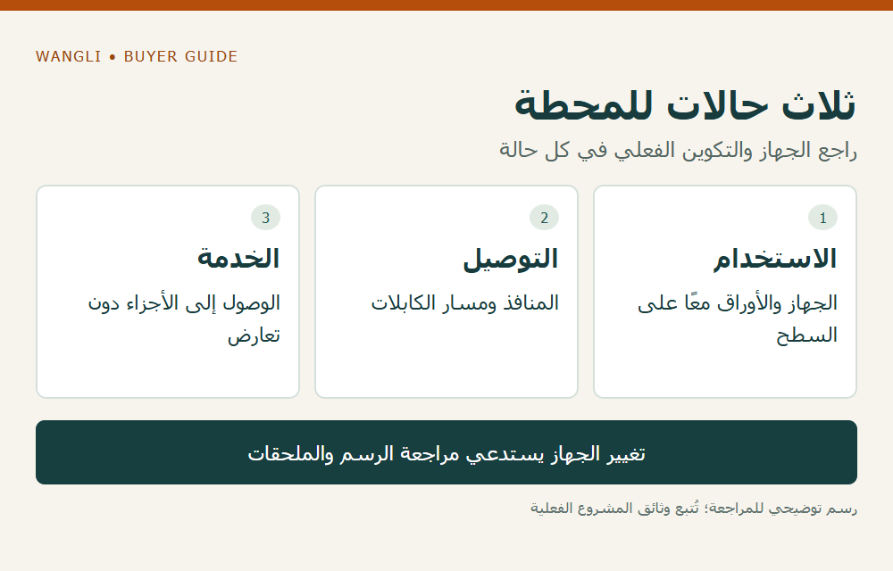

<!-- blog {"slug": "school-computer-room-furniture-interfaces", "title": "أثاث غرفة الحاسوب المدرسية: ما الذي يجب مطابقته مع الأجهزة قبل الطلب؟", "seo_title": "أثاث غرفة الحاسوب المدرسية: تنسيق الأجهزة | WangLi", "description": "طابق الأجهزة ومنافذها ومسارات الكابلات مع رسم الأثاث، وراجع حالات الاستخدام والخدمة قبل تثبيت التكوين والكمية.", "category": "specifications", "published": "2026-11-02T00:19:43+08:00", "image": "/assets/school-computer-room-furniture-interfaces-cover-20261102.png", "image_alt": "أثاث غرفة الحاسوب — طابق المعدات والخدمة قبل الطلب", "image_caption": "أثاث غرفة الحاسوب — طابق المعدات والخدمة قبل الطلب", "image_kind": "diagram", "image_width": 1000, "image_height": 640, "draft": false} -->

# أثاث غرفة الحاسوب المدرسية: ما الذي يجب مطابقته مع الأجهزة قبل الطلب؟

قد تتسع صورة طاولة لشاشة ولوحة مفاتيح، لكن تجهيز غرفة حاسوب يحتاج إلى أكثر من عرض السطح. على موزع الأثاث أو شركة توريد المشروع ربط الجهاز الفعلي بمكان استخدامه ومرور كابلاته والوصول إلى منافذه، قبل تحديد التكوين. لا يعني عرض طاولة وجود حوامل أجهزة أو قنوات أسلاك أو تمديدات كهربائية ضمن الطلب؛ يجب تعريف كل منها وبيان صاحب مسؤوليته.

## أنشئ قائمة للأجهزة التي ستستخدم فعلًا

اطلب من فريق المدرسة قائمة بالمعدات لكل محطة: شاشة وقاعدتها، وحاسوب مكتبي أو محمول، ولوحة مفاتيح وفأرة، وأوراق أو أدوات تستخدم أثناء الدرس. سجّل أبعادها وكتلتها ومنافذها وفق بيانات أصحابها. إذا لم يُحسم موديل الجهاز، اكتب نطاق المعلومات المتاحة وما ينتظر قرارًا؛ لا تصف رسم الأثاث بأنه متوافق مع جهاز لم يُحدد بعد.

تفيد [قائمة HSE لتقييم محطات الشاشات](https://www.hse.gov.uk/pubns/ck1.pdf) بأهمية مساحة المعدات والأوراق، وإمكانية الوصول، وتنظيم الكابلات ضمن محطة العمل. نستخدم هذه الأسئلة كخلفية عامة من إرشاد مهني بريطاني، دون تحويله إلى قاعدة خاصة بطلاب المدرسة أو شهادة ملاءمة لأي موديل. يعود تقييم المستخدمين ومتطلبات المكان إلى جهة المشروع المختصة.

## طابق ثلاث حالات للمحطة

ارسم المحطة أثناء الدرس، ثم أثناء توصيل جهاز أو فصله، ثم أثناء الصيانة التي يحددها فريق التقنية. قد يبدو موضع الحاسوب مناسبًا في حالة الاستخدام لكنه يحجب منفذًا مطلوبًا أو يصعّب الوصول إلى جزء يحتاج إلى خدمة. لا تحل هذه المشكلة بوضع الجهاز في مكان يخالف تعليمات صاحبه أو بحفر فتحة في الموقع دون مراجعة.

| الحالة | ما يقدمه فريق المدرسة | السؤال الموجه لمورد الأثاث |
|---|---|---|
| استخدام الدرس | المعدات والأوراق المستخدمة معًا | ما مساحة السطح الصافية وتكوين الأجزاء؟ |
| التوصيل | مواقع المنافذ والكابلات المقصودة | أين الفتحات أو القنوات المقترحة وما أبعادها؟ |
| الخدمة | الجزء الذي يحتاج الوصول وطريقته | هل يتيح الرسم ذلك دون تعارض مع الهيكل؟ |
| تغير الأجهزة | التعديل المقترح وبياناته | ما الذي يلزم إعادة تأكيده في التكوين؟ |

هذه الحالات ورقة تنسيق، وليست تعليمات لفك جهاز أو تنفيذ تمديدات. يُطلب تأكيد ما يمكن تقديمه من حوامل أو أغطية أو قنوات للموديل نفسه، مع فصل الملحق المقترح عن الجزء المشمول في السعر.

*رسم توضيحي: ثلاث حالات للمحطة — راجع الجهاز والتكوين الفعلي في كل حالة — اضغط لعرض الصورة بالحجم الكامل.*

## افصل الأثاث عن تجهيزات الكهرباء والشبكة

بيّن على الرسم مواضع الخدمات التي يؤكدها فريق المشروع، ثم اربطها بنقطة مرور الكابل في الأثاث. وجود فتحة في الطاولة لا يثبت صلاحية مسار الكابل كله، أو وجود مقبس، أو اعتماد التوصيل. يتولى المختص تحديد متطلبات الكهرباء والشبكة والتهوية وتعليمات الأجهزة؛ يقتصر ملف التوريد هنا على معلومات الواجهات والأسئلة التي يحتاج إلى إجابات.

راجع أيضًا الفراغ تحت السطح مع الكرسي والملحقات المقترحة، دون استخدام ارتفاع خارجي واحد للحكم على الملاءمة. يوضح [دليل مواصفات الطاولات والكراسي](/school-desk-chair-specifications/) كيف تسأل عن نقاط القياس، بينما يساعد [دليل نطاق التوريد والمسؤوليات](/school-furniture-tender-checklist/) على تعريف الأطراف والأعمال المستقلة.

## مثال افتراضي: جهاز يتغير بعد الرسم

افترض أن القائمة الأولية تستخدم حواسيب محمولة، ثم تقترح المدرسة أجهزة مكتبية بوحدات منفصلة. لا يكفي تغيير اسم الجهاز في الجدول؛ راجع مكان الوحدة ومنافذها ومسار الكابلات وإمكانية خدمتها، ثم اطلب تحديث الرسم والملحقات والسعر عند الحاجة. المثال لا يثبت أن طاولة معينة تقبل البديل أو أن التعديل متاح لدى WangLi.

لإعداد الاستفسار، اجمع قائمة المحطات والأجهزة والرسم والأسئلة المفتوحة، وحدد ما هو مؤكد وما يزال تقديريًا. يمكن مراجعة [فئة الأثاث المكتبي](/products/office/) لاختيار مرجع أولي، ثم [إرسال طلب عرض سعر إلى WangLi](/request-a-quote/) مع الكمية ووجهة التسليم ومعلومات المعدات والواجهات المطلوب تأكيدها.
