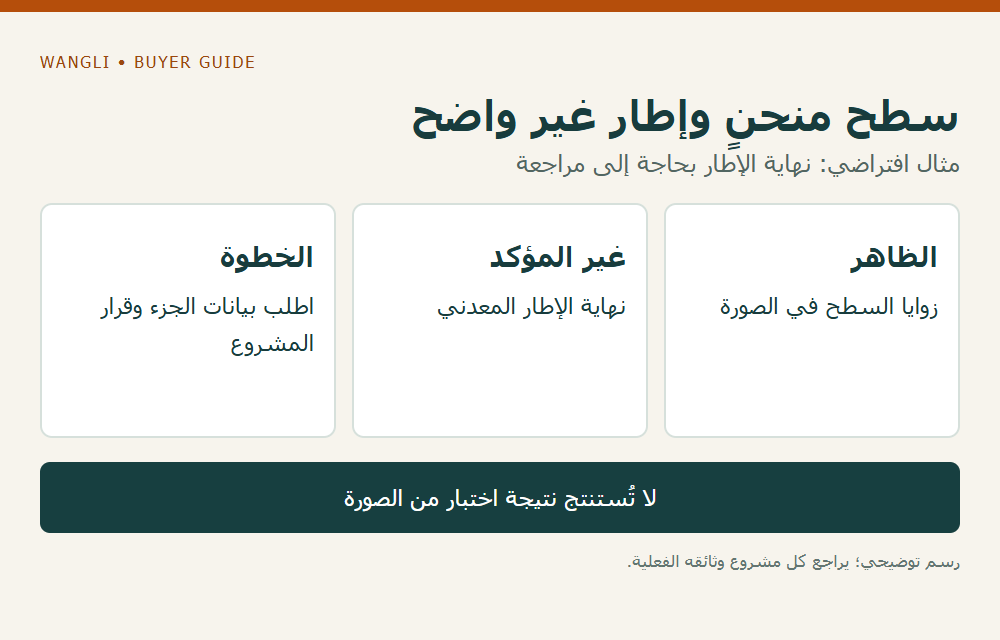

<!-- blog {"slug": "school-desk-corner-edge-review", "title": "زوايا الطاولات المدرسية: كيف تراجع الحافة والزاوية قبل اعتماد التكوين؟", "seo_title": "زوايا الطاولات المدرسية ومراجعة الحواف | WangLi", "description": "حدد حواف الطاولات وزواياها والمستندات المطلوبة وقرار جهة المشروع قبل اعتماد التكوين.", "category": "tenders", "published": "2026-11-15T00:09:32+08:00", "image": "/assets/school-desk-corner-edge-review-cover-20261115.png", "image_alt": "زوايا الطاولة وحوافها — حدد الجزء والدليل وجهة المراجعة", "image_caption": "زوايا الطاولة وحوافها — حدد الجزء والدليل وجهة المراجعة", "image_kind": "diagram", "image_width": 1000, "image_height": 640, "draft": false} -->

# زوايا الطاولات المدرسية: كيف تراجع الحافة والزاوية قبل اعتماد التكوين؟

قد تصف قائمة المشروع طاولة بعبارة «زوايا مستديرة» من دون أن تبين أي زوايا تقصد أو كيف ستراجعها. يحتاج موزع الأثاث أو شركة توريد المشروع إلى تحديد أجزاء الطاولة التي يطلب المشروع مراجعتها، وربط الرسم أو العينة بالموديل المعروض، ثم طلب دليل أو توضيح يطابق المتطلبات الفعلية. لا تكفي الصورة العلوية لإثبات سلامة جميع الحواف.

## سمِّ الأجزاء المرئية والمخفية

اطلب رسمًا يوضح زوايا سطح العمل وحوافه وأطراف الإطار والأجزاء التي قد يلمسها المستخدم في وضع الجلوس أو الحركة. قد تكون حافة السطح مختلفة عن نهاية الأنبوب أو موضع اتصال أحد الملحقات. حدّد في السؤال الجزء المطلوب بدل افتراض أن وصف «مستدير» يغطي التكوين كله.

في [نقاش منشور حول توصيات شراء أثاث مدرسي](https://www.linkedin.com/posts/dr-parmod-kumar-6a5aa134_calling-experts-oems-student-friendly-activity-7416015461819052033-s5GA)، يذكر كاتب يدعو إلى مساهمات للّجنة المدرسية الزوايا المستديرة والثبات ضمن مسائل السلامة. المنشور من سياق آخر وهو دعوة للنقاش، لا مقابلة مع عميل سعودي ولا دليل اختبار أو مواصفة لأي منتج من WangLi.

## اربط كل سؤال بمستند محدد

| ما يحتاجه المشروع | ما تطلبه من المورد | ما لا يمكن استنتاجه تلقائيًا |
|---|---|---|
| موضع الزاوية أو الحافة | رسم يحدد الجزء في التكوين المعروض | أن بقية الأجزاء تحمل المعالجة نفسها |
| الوصف أو القياس المطلوب | نقطة القياس والطريقة والرد المتاح | نصف قطر أو قيمة لم يحددها المشروع |
| طريقة المراجعة | عينة أو تقرير يحدده الإجراء | أن صورة أو عينة اللون تثبت اختبار السلامة |
| الجزء المعروض | رمز الموديل وإصدار الرسم والملحقات | شمول التقرير لتكوين أو مادة مختلفة |
| القرار | اسم الجهة التي تراجع الوثائق | أن رد المورد وحده يساوي اعتماد المشروع |

إذا طلب المشروع معيارًا أو طريقة اختبار، اسأل المختص عن الإصدار والنطاق والمتطلبات المناسبة، واطلب من المورد مستندًا يخص المنتج. لا يقرر هذا الدليل قيمة قياس أو معيارًا ينطبق على كل مدرسة، ولا يصنف حافة على أنها آمنة من صورتها.

## مثال افتراضي: السطح مختلف عن الإطار

يظهر في صورة مقترحة سطح بزوايا منحنية، بينما لا تظهر نهاية الإطار المعدني بوضوح. يطلب فريق المشروع رسم الأجزاء وصورة تفصيلية أو عينة حسب الإجراء، ويسجل نهاية الإطار بندًا مفتوحًا إلى أن تصل بياناتها وتراجعها الجهة المخولة. المثال لا يصف اختبارًا أو طلبًا فعليًا.

*مثال افتراضي؛ اضغط لتكبير الرسم.*

## راجع ارتباط الزوايا ببقية المواصفات

يساعد [دليل تركيب سطح الطاولة وحوافها](/blog/school-desk-edge-core-construction/) على توضيح طبقات الحافة والفتحات، بينما يشرح [تحديد المقاسات والكميات](/blog/school-desk-chair-size-quantity-planning/) احتياجات الغرف والمستخدمين. وعندما تطلب المناقصة عينة، راجع [غرض عينة التقييم](/blog/school-furniture-tender-evaluation-samples/) ولا تخلط قبول المظهر باعتماد الأداء.

[أرسل استفسارًا إلى WangLi](/request-a-quote/) يوضح الموديل أو صورة التكوين والكمية ومتطلبات الحافة والمستندات المطلوبة؛ يؤكد الفريق البيانات المتاحة للطلب المحدد.
