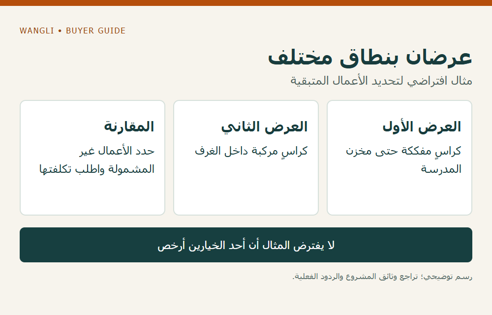

<!-- blog {"slug": "school-furniture-assembled-knockdown-delivery", "title": "أثاث المدرسة مجمّعًا أم مفككًا؟ كيف تقارن نطاق التسليم قبل توقيع الطلب؟", "seo_title": "أثاث مدرسي مجمع أم مفكك: مقارنة التسليم | WangLi", "description": "قارن حالة الأثاث عند التسليم ومسؤوليات المناولة والتجميع والتكلفة قبل اعتماد عرض توريد المدرسة.", "category": "tenders", "published": "2026-11-04T00:04:14+08:00", "image": "/assets/school-furniture-assembled-knockdown-delivery-cover-20261104.png", "image_alt": "مجمّع أم مفكك؟ — قارن نطاق التسليم قبل اختيار العرض", "image_caption": "مجمّع أم مفكك؟ — قارن نطاق التسليم قبل اختيار العرض", "image_kind": "diagram", "image_width": 1000, "image_height": 640, "draft": false} -->

# أثاث المدرسة مجمّعًا أم مفككًا؟ كيف تقارن نطاق التسليم قبل توقيع الطلب؟

قد يعرض مورد الأثاث الطاولات والكراسي مفككة لتجميعها في الموقع، بينما تنتظر المدرسة استلامها جاهزة للاستخدام. يحتاج الموزع أو شركة تجهيز المشروع إلى مقارنة حالة التسليم والتكلفة والمسؤوليات معًا، لا مقارنة أجرة النقل وحدها. لا يوجد خيار مناسب لكل مشروع؛ تتغير الإجابة بحسب التكوين والطريق وتجهيز المكان وما اتفق عليه الأطراف.

## ابدأ بما ستستلمه المدرسة

اقرأ وصف التوريد: هل يُستلم الأثاث في عبوات، أم مركبًا في موقع محدد، أم جاهزًا للاستخدام بعد مراجعة إضافية؟ اكتب أيضًا من يفرغ الشحنة ويدخل القطع ويجمعها ويتعامل مع العبوات والفائض، ومن يراجع النتيجة. قد يتولى أطراف مختلفون هذه الأعمال؛ لا يعني قبول المورد تسعير القطع أنه تعهد بكل خدمة محلية.

تظهر أهمية التمييز في [وثيقة شراء مدرسية منشورة من جهة تعليمية في الفلبين](https://sdosancarloscityr1.com/wp-content/uploads/2024/04/RFQ3.pdf): تسمح وثائق ذلك المشروع بنقل الأثاث مجمعًا أو مفككًا، لكنها تحدد مسؤولية تجميع المفكك قبل استلام المدرسة له. هذا مثال على نطاق محدد، وليس شرطًا عامًا في الدول العربية أو دليلًا على توفر تركيب محلي من WangLi.

## قارن القائمة نفسها في الخيارين

حدد الموديل والكمية والملحقات وحالة المنتج في نقطة التسليم لكل عرض. اطلب بيانات التعبئة والنقل الفعلية لكل تكوين، مع بيان ما يشمله العرض أو يحتاج إلى طرف آخر. وجود قطع مفككة لا يثبت تلقائيًا انخفاض الحجم أو التكلفة؛ قد تختلف العبوات والعمالة والمناولة باختلاف الموديل والموقع.

| بند المقارنة | أسئلة قبل اعتماد العرض | حالة تحتاج إلى توضيح |
|---|---|---|
| حالة المنتج | ماذا يُسلَّم مركبًا وماذا يحتاج إلى جمع؟ | كلمة «مجموعة» دون قائمة مكونات |
| التعبئة والنقل | ما عدد الطرود وأبعادها ووزنها الفعلي؟ | مقارنة صورة صندوق بأثاث آخر |
| أعمال الموقع | من يوفر العاملين والأدوات وأين؟ | «التركيب مشمول» دون تحديد النطاق |
| المواد والمستندات | هل تعليمات الموديل وقائمة الأجزاء متاحة؟ | تعليمات لمنتج مختلف |
| التسليم والمراجعة | من يؤكد اكتمال الأعمال وما الذي يراجع؟ | افتراض أن وصول العبوة إغلاق للتسليم |

يمكن الاستفادة من [دليل بيانات التعبئة لطلب الشحن](/blog/school-furniture-packing-data-freight-rfq/) عند جمع الأرقام. هذا الدليل لا يقرر أي خيار أقل تكلفة قبل توفر عروض تشمل البنود نفسها.

## افصل مسؤولية التجميع عن تكوين الطقم

في الخيار المفكك، اطلب توضيح الأجزاء الموردة لكل موديل وتعليمات التجميع والأدوات أو الخدمات المدرجة في العرض. ثم حدد الجهة التي ستقوم بالأعمال وفق الاتفاق ومتطلبات الموقع. يعالج [دليل مطابقة أطقم التجميع](/blog/school-furniture-assembly-kit-matching/) فحص اكتمال الطقم بعد تحديد الخيار؛ أما قرار توفير العمالة والمكان وموعد الأعمال فيجب تسجيله قبل الطلب.

إذا اشترط المشروع منتجًا جاهزًا عند التسليم، فاكتب نقطة الانتقال بين النقل والتجميع والتسليم النهائي. وإذا كان جزء من التكوين مركبًا وجزء آخر منفصلًا، اطلب تفصيل هذه الحالة بدل وضعه تلقائيًا تحت أحد الوصفين العامين.

## مثال افتراضي لعرضين بنطاق مختلف

لنفترض أن عرضًا يوضح سعر الكراسي في عبوات مفككة حتى مخزن المدرسة، بينما يوضح عرض آخر سعر الكراسي مركبة داخل الغرف. لا يُقارن الرقمان مباشرة قبل إضافة الأعمال والتكاليف المتبقية لكل نطاق وفق عروض الأطراف المعنية. المثال لا يفترض أن أيًا من الخيارين أرخص، ولا يصف طلبًا أو خدمة مؤكدة لدى WangLi.

*مثال افتراضي؛ اضغط لتكبير الرسم.*

راجع [مسار إدخال الأثاث إلى المدرسة](/blog/school-furniture-site-access-planning/) مع حالة المنتج التي ستُنقل، ثم [أرسل طلب عرض سعر إلى WangLi](/request-a-quote/) يحدد الموديلات والكميات وحالة التسليم المطلوبة والوجهة والأعمال التي تحتاج إلى تأكيد. احفظ الردود والأسئلة المفتوحة في سجل المقارنة قبل اتخاذ القرار.
