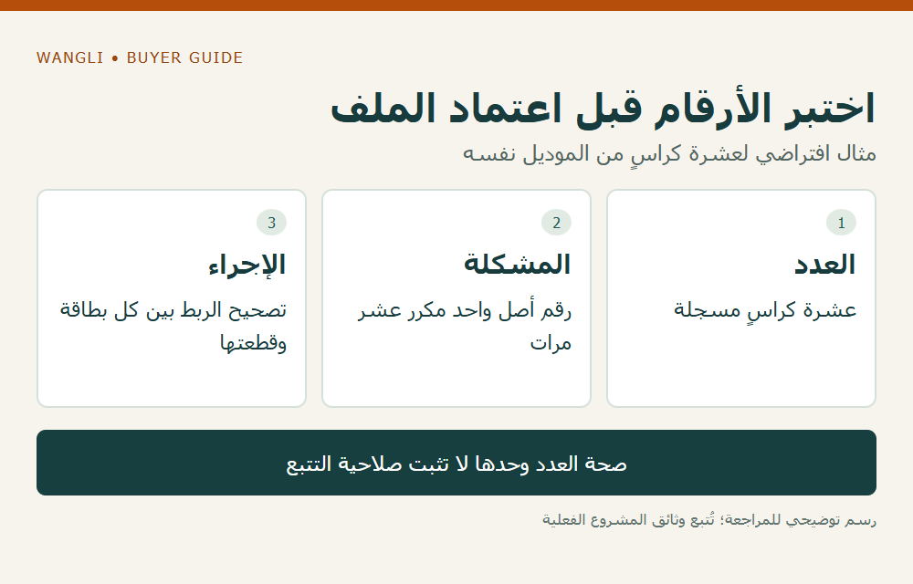

<!-- blog {"slug": "school-furniture-asset-tags-handover", "title": "ترميز الأثاث المدرسي: كيف تربط بطاقة الأصل بسجل التسليم والموقع؟", "seo_title": "ترميز الأثاث المدرسي وسجل الأصول | WangLi", "description": "حدد رقم الأصل وحقول الموقع وملف البيانات قبل طباعة الملصقات، ثم اختبر ربط البطاقة بالقطعة والسجل عند التسليم.", "category": "tenders", "published": "2026-11-02T00:17:05+08:00", "image": "/assets/school-furniture-asset-tags-handover-cover-20261102.png", "image_alt": "اربط بطاقة الأصل بسجل التسليم — ثلاث هويات لها وظائف مختلفة", "image_caption": "اربط بطاقة الأصل بسجل التسليم — ثلاث هويات لها وظائف مختلفة", "image_kind": "diagram", "image_width": 1000, "image_height": 640, "draft": false} -->

# ترميز الأثاث المدرسي: كيف تربط بطاقة الأصل بسجل التسليم والموقع؟

عند توريد أثاث لعدة غرف، قد تُسلَّم الكميات كاملة بينما لا تملك المدرسة طريقة واضحة لتتبع القطع بعد نقلها أو صيانتها. يحتاج موزع الأثاث وشركة تجهيز المشروع إلى فصل رمز الموديل عن رقم الأصل: الأول يعرّف تكوينًا في الكتالوج، والثاني يعرّف قطعة أو مجموعة بحسب نظام المدرسة. حدد بنية السجل قبل طلب الملصقات حتى لا تصبح الأرقام المطبوعة منفصلة عن البيانات التي ستستخدمها جهة التشغيل.

## حدد وحدة التتبع مع المدرسة

اسأل المسؤول عن الأصول: هل سيخصص رقم لكل كرسي وطاولة، أم لكل مجموعة متجانسة وفق سياسة المدرسة؟ إذا كان الطقم يضم طاولة وكرسيًا ويمكن نقل كل منهما منفردًا، فاطلب قرارًا بشأن علاقتهما في السجل. لا تجعل رقم الكرتون بديلًا دائمًا لرقم الأصل؛ فقد تضم العبوة أكثر من قطعة أو تتوزع قطعة واحدة على طرود مختلفة.

تتحدث [إرشادات وزارة التعليم البريطانية لإدارة الأصول](https://www.gov.uk/guidance/buying-procedures-and-procurement-law-for-schools/how-to-manage-your-fixed-assets) عن تسجيل الموقع والحالة والمسؤولية واستخدام بطاقات تعريف. وهي مرجع عام لتنظيم السؤال، لا سياسة محاسبية للسوق العربي؛ تحدد المدرسة بنفسها ما يجب تسجيله ومستوى تفصيله.

## افصل رقم الأصل عن محتوى الرمز

إذا اختارت المدرسة رمزًا شريطيًا أو رمز استجابة سريعة، فحدد ما الذي سيحمله: رقمًا ثابتًا يُبحث عنه في النظام، أم رابطًا إلى سجل تديره المدرسة. اختبر القراءة بالمعدات المقصودة قبل اعتماد التصميم. وجود مربع مطبوع على الملصق لا يعني أن بياناته دخلت النظام أو أن الرابط سيبقى صالحًا.

لا تحتاج قائمة المورد إلى أسماء الطلاب أو بياناتهم الشخصية. يكفي في هذا الملف تعريف القطعة والموقع ومرجع الطلب وفق نظام المشروع. وإذا طلبت المدرسة رابطًا، فلتحدد الجهة التي تديره وصلاحيات الوصول إليه وطريقة المحافظة عليه؛ لا تنشر معلومات داخلية في رابط عام افتراضيًا.

| الحقل | صاحب القرار | ما يراجع قبل الطباعة |
|---|---|---|
| رقم الأصل | جهة إدارة الأصول | تفرده وعدم إعادة استخدامه لقطعة أخرى |
| الموديل والتكوين | القائمة المعتمدة ورد المورد | مطابقته للقطعة الفعلية |
| الموقع الابتدائي | المدرسة أو المشروع | رمز المبنى والغرفة وإصدار القائمة |
| شكل الملصق | المشروع مع المورد إن شمله العرض | النص وحجم القراءة والمادة والموضع |
| ملف البيانات | مسؤول النظام | أسماء الأعمدة والصيغة وقواعد الاستيراد |

## جرّب الربط على مجموعة صغيرة

اطلب نموذجًا لملف البيانات وتصميم البطاقة قبل إنتاج الكمية كلها. راجع رقمًا على قطعة مرجعية مع السجل، ثم امسح الرمز وتحقق مما يظهر في النظام التجريبي. هذه مراجعة لتوافق البيانات، وليست اختبارًا لصلابة الملصق أو ضمانًا لبقائه لسنوات. يظل موضع اللصق ومادته وتعليمات تركيبه بحاجة إلى تأكيد للموديل والسطح.

**مثال افتراضي:** يذكر سجل الغرفة عشرة كراسٍ من الموديل نفسه، لكن استيراد الملف يكرر رقم أصل واحد عشر مرات. إجمالي العدد صحيح، والتتبع غير صالح. تُصحح الأرقام والعلاقة بين كل بطاقة وقطعتها قبل اعتماد الملف. لا يدل المثال على مشكلة وقعت لدى WangLi.

*رسم توضيحي: اختبر الأرقام قبل اعتماد الملف — مثال افتراضي لعشرة كراسٍ من الموديل نفسه — اضغط لعرض الصورة بالحجم الكامل.*

## سجل النقل دون تغيير هوية القطعة

عندما ينتقل كرسي إلى غرفة أخرى، يجب أن تسمح طريقة التسجيل بتحديث موقعه مع الاحتفاظ بالهوية والتاريخ. اطلب من المدرسة تحديد من يعتمد النقل ومن يحدث النظام. وتوضح [سياسة مدارس ولاية فيكتوريا لإدارة الأصول](https://www2.education.vic.gov.au/pal/finance-manual/guidance/section-13-asset-and-inventory-management) ارتباط التعريف بالتسجيل والمتابعة؛ لا تُنقل مهلها أو حدودها المالية إلى مشروع آخر.

اربط الملف بـ[توزيع الأثاث على المواقع](/blog/school-furniture-multiple-site-distribution/) عند التسليم، ثم احتفظ به للمراجعات اللاحقة مثل [جرد الأثاث ودراسة استبداله](/blog/school-furniture-repair-replacement-inventory/). [أرسل استفسارًا إلى WangLi](/request-a-quote/) يحدد الموديلات والكميات وتصميم الترميز المطلوب وملف البيانات، واطلب توضيح إمكان توفير الملصقات أو البيانات وما يدخل في العرض قبل الالتزام به للمدرسة.
