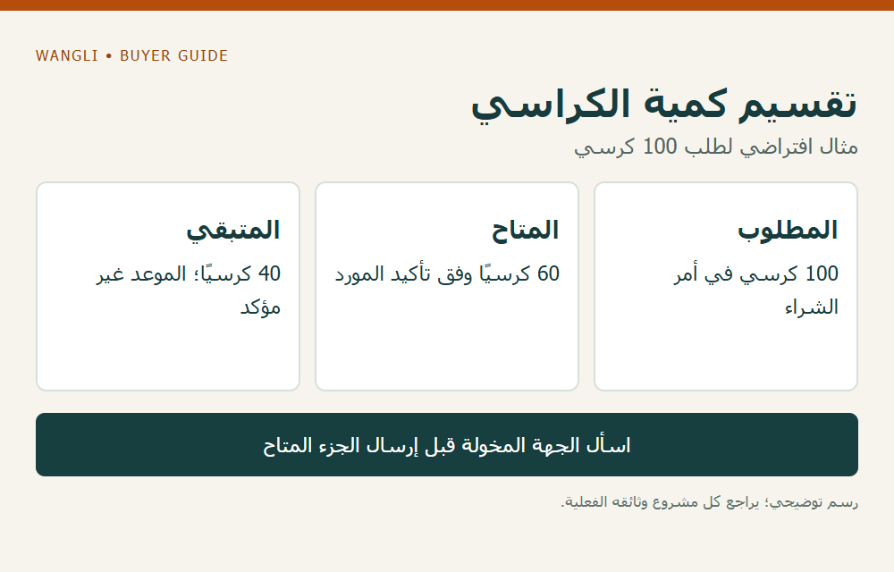

<!-- blog {"slug": "school-furniture-backorder-tracking", "title": "كميات الأثاث المدرسي المتأخرة: تتبع المتاح والمتبقي قبل الشحن", "seo_title": "تتبع كميات الأثاث المتأخرة | WangLi", "description": "سجل الكميات المتاحة والمتأخرة وراجع اكتمال المجموعة وقرار الشحن الجزئي مع الجهة المخولة.", "category": "tenders", "published": "2026-11-13T00:30:28+08:00", "image": "/assets/school-furniture-backorder-tracking-cover-20261113.png", "image_alt": "تتبع الأثاث المتأخر — من كمية الطلب إلى قرار الشحنة الجزئية", "image_caption": "تتبع الأثاث المتأخر — من كمية الطلب إلى قرار الشحنة الجزئية", "image_kind": "diagram", "image_width": 1000, "image_height": 640, "draft": false} -->

# كميات الأثاث المدرسي المتأخرة: كيف تسجل المتاح والمتبقي قبل الشحن؟

قد يؤكد المورد توافر جزء من طلب الأثاث ويُبقي جزءًا آخر بموعد تقديري. يحتاج موزع المشروع إلى معرفة الكميات التي يمكن إرسالها، والمتبقي لكل موديل وموقع، وأثر الفصل على قابلية استخدام كل مجموعة. لا تعني جاهزية جزء من الطلب موافقة المدرسة تلقائيًا على شحنة جزئية، ولا تعني قائمة التعبئة اكتمال الطلب كله.

## افصل حالة كل بند عن حالة الطلب

ابدأ بأمر الشراء المعتمد ورقم البند وتكوين المنتج والكمية والوجهة. ثم اطلب من المورد تأكيد الكمية المتاحة والكمية المتأخرة والموعد التقديري لكل بند وتاريخ آخر تحديث. اترك الموعد غير المؤكد معلّقًا؛ فهو تقدير يحتاج إلى متابعة، وليس وعدًا بموافقة المشتري أو التزامًا نضعه باسم المورد.

| البيان | السؤال الذي يجب إغلاقه |
|---|---|
| المطلوب | ما الموديل والتكوين والعدد في أمر الشراء؟ |
| المتاح | ما الكمية التي أكد المورد جاهزيتها، ومتى؟ |
| المتبقي | كم وحدة لم تتأكد جاهزيتها وما موعدها التقديري؟ |
| الوجهة | إلى أي مدرسة أو غرفة تنسب كل كمية؟ |
| القرار | من يحق له قبول الشحن الجزئي وفق العقد؟ |

تذكر [وثيقة طلب عروض أثاث تعليمي من OECM في كندا](https://oecm.ca/wp-content/uploads/2023/03/EduFurn-410-RFP.pdf) إدراج الكميات المطلوبة والمشحونة والمتأخرة في قائمة التعبئة، وتناقش تأكيد البنود المتأخرة عند تأكيد الطلب. هذه وثيقة تاريخية لمشتري محدد؛ تفاصيل الإلغاء والتكلفة فيها لا تمثل شروط WangLi ولا تنطبق تلقائيًا على مشروع آخر.

## افحص اكتمال المجموعة قبل اقتراح الشحنة

قد تكون طاولات الصف جاهزة بينما تتأخر أرجلها أو مقاعدها. اجمع الأجزاء التي يحتاجها الاستخدام أو التركيب في سجل واحد، وحدد إن كان المشروع يريد استلام وحدات مكتملة أولًا أو تخزين أجزاء منفصلة. راجع أرقام الصناديق مع الموقع وخطة التركيب؛ لا تستنتج من جاهزية الصندوق أن المجموعة صالحة للاستخدام.

**مثال افتراضي:** طلب مشروع 100 كرسي، وأفاد المورد بأن 60 جاهزة و40 بموعد تقديري غير مؤكد. اسأل الجهة المخولة هل تقبل إرسال الـ60، ولأي غرف تُخصص، وما المستند الذي يتابع الـ40. هذا مثال حسابي فقط، وليس طلبًا أو مدة حقيقية لدى WangLi.

*مثال افتراضي؛ اضغط لتكبير الرسم.*

## اتفق على القرار ثم راقب الرصيد

أرسل للمشتري قائمة البنود المتاحة والمتأخرة وتأثير أي تقسيم مقترح على الغرف والتركيب والوثائق. راجع تكاليف الشحن والتخزين وأي تعديل في المواعيد مع الأطراف المختصة قبل اعتماد القرار؛ لا تفترض أنها مجانية أو مستحقة دون اتفاق. احتفظ بقرار الجهة المخولة وتاريخه ونطاقه.

عند إصدار مستندات الشحنة، اربط كل سطر برقم أمر الشراء والموديل والكمية المرسلة والمتبقية. بعد الاستلام، قارن مستند التسليم بالكمية التي أُقرت للشحنة، ثم حدث رصيد الطلب بناء على نتيجة الاستلام. اختلاف العدد أو التلف يحتاج إلى توثيق مستقل وفق [دليل معالجة فروق الاستلام](/blog/school-furniture-delivery-receiving-discrepancies/).

## متى يحتاج الجدول إلى تحديث؟

راجع تاريخ جاهزية الكمية المتبقية كلما تغير تأكيد المورد، وسجل صاحب المعلومة وتاريخها. إذا تغيرت جاهزية المدرسة أيضًا، افصل هذا التغيير عن مشكلة التوافر وراجع [ربط الدفعات بجاهزية الموقع](/blog/school-furniture-site-readiness-delivery-phases/). وإذا اقترح المورد موديلًا مختلفًا لتجاوز التأخير، استخدم [مراجعة البديل قبل القبول](/blog/school-furniture-substitution-approval/) بدل اعتباره مجرد تحديث كمية.

للحصول على مراجعة مناسبة لطلبك، [تواصل مع فريق WangLi](/request-a-quote/) وأرسل قائمة الموديلات والكميات والوجهات وموعد الحاجة وحالة كل بند؛ يؤكد الفريق ما يستطيع تقديمه وفق التفاصيل الفعلية.
