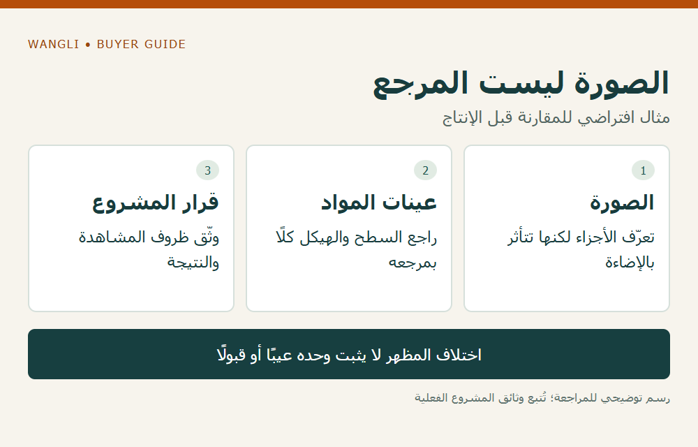

<!-- blog {"slug": "school-furniture-colour-finish-reference", "title": "ألوان الأثاث المدرسي: كيف تعتمد مرجعًا للسطح والهيكل قبل الإنتاج؟", "seo_title": "ألوان الأثاث المدرسي: مرجع اللون والتشطيب | WangLi", "description": "اعتمد مرجعًا لكل مادة وتشطيب، وحدد ظروف المشاهدة وحدود القرار لتقليل غموض مراجعة ألوان أثاث المشروع.", "category": "specifications", "published": "2026-11-02T00:17:09+08:00", "image": "/assets/school-furniture-colour-finish-reference-cover-20261102.png", "image_alt": "مرجع اللون والتشطيب — سجّل المادة وظروف المشاهدة والقرار", "image_caption": "مرجع اللون والتشطيب — سجّل المادة وظروف المشاهدة والقرار", "image_kind": "diagram", "image_width": 1000, "image_height": 640, "draft": false} -->

# ألوان الأثاث المدرسي: كيف تعتمد مرجعًا للسطح والهيكل قبل الإنتاج؟

قد يطلب المشروع لونًا واحدًا للطاولة والكرسي والخزانة، ثم يقارن صورًا ملتقطة بكاميرات وإضاءات مختلفة. هذه البداية لا تعرّف ما سيُقبل عند مراجعة التشطيبات. يحتاج الموزع وشركة توريد المدارس إلى مرجع مادي واضح لكل مادة، وشروط مشاهدة متفق عليها، وسجل يبين ما تمت مراجعته ومن قرره. اسم اللون أو رقمه يساعد في التعريف، لكنه لا يكفي وحده لوصف مظهر كل مادة.

## افصل المواد التي يراد جمعها بصريًا

أنشئ قائمة بالأسطح الظاهرة: سطح الطاولة، والحافة، والهيكل المطلي، والجزء البلاستيكي، والتنجيد إن وجد. اربط كل جزء بمادته وتشطيبه ورمزه بدل وضع الجميع تحت اسم «رمادي» مثلًا. اطلب من جهة المشروع تحديد ما إذا كانت تريد تطابقًا مقصودًا بين أجزاء معينة أم تنسيقًا بصريًا تقبله رغم اختلاف المواد.

تشرح [Datacolor أثر مصادر الضوء في تقييم اللون](https://www.datacolor.com/business-solutions/blog/what-you-need-to-know-about-light-sources-and-color-evaluation/) أن المظهر قد يتغير مع الإضاءة، وأن المقارنة تحتاج إلى ظروف محددة قابلة للتكرار. ويعرض [شرح HunterLab للتطابق اللوني تحت إضاءات مختلفة](https://support.hunterlab.com/knowledgebase/article/KA-06472/en-us) مسألة تطابق عينتين تحت مصدر واختلافهما تحت آخر. كلاهما مصدر تقني تجاري عام، وليس تقريرًا عن تشطيبات WangLi أو معيار قبول ملزمًا للمشروع.

## أنشئ مرجعًا ماديًا قابلًا للتتبع

إذا اتفق الأطراف على عينة، أعطها رمزًا وتاريخًا واربطها بجزء ومادة وتشطيب محددين. سجّل هل تمثل اختيار اللون فقط، أم الملمس واللمعان أيضًا، وما لم تغطه المراجعة. احتفظ بمرجع النسخة التي لدى كل طرف؛ لا تستخدم عبارة «نفس العينة السابقة» دون معرفة أي عينة يقصدها الرد.

| ما يحدد للمرجع | ما يكتب في سجل المراجعة | ما يبقى مفتوحًا عند غيابه |
|---|---|---|
| المادة والجزء | سطح أو هيكل أو جزء آخر ورمزه | نقل لون مادة إلى مادة مختلفة |
| التشطيب | الملمس واللمعان المطلوبان إن حددهما المشروع | الحكم على اللون بمعزل عن مظهر السطح |
| المشاهدة | الإضاءة والموضع والمرجع المستخدم | اختلاف الأحكام بين مكانين |
| القرار | الجهة والنتيجة وحدودها وتاريخها | اعتبار إرسال العينة موافقة عليها |

الصور مفيدة لتحديد الجزء أو تسجيل الملاحظة، لكنها لا تُمنح تلقائيًا وظيفة المرجع المادي. وإذا طلب المشروع قياسًا آليًا أو حدًا للفروق، فليحدد المختص الطريقة والشروط والقيمة التي سيستخدمها؛ لا نضع هنا رقمًا عامًا لفارق لون أو لمعان.

## راجع المجموعة في ظروفها المقصودة

اطلب أن تُراجع الأجزاء التي ستظهر معًا وفق الإجراء الذي يتفق عليه المشروع، مع إظهار حالات الإضاءة ذات الصلة. لا يلزم أن تختار شركة التوريد جهاز قياس أو نوع إضاءة من عندها، لكن عليها كشف أي اختلاف بين ظروف اختيار العينة وظروف قبولها. هل يكفي ذكر درجة حرارة اللون وحدها؟ أرسل هذا السؤال إلى صاحب الإجراء بدل افتراض تكافؤ أي مصباحين متشابهين في الوصف.

في مثال افتراضي، يبدو لوح الطاولة والهيكل قريبين في صورة، ثم تختلف العلاقة البصرية تحت إضاءة الغرفة. لا يثبت ذلك وحده وجود عيب أو قبول؛ ارجع إلى مراجع المواد وظروف المشاهدة والقرار المسجل. سجّل الفرق الذي يحتاج إلى مراجعة، ولا تغير التسمية أو تستبدل مرجعًا بصمت. المثال لا يصف دفعة أو شكوى فعلية.

*رسم توضيحي: الصورة ليست المرجع — مثال افتراضي للمقارنة قبل الإنتاج — اضغط لعرض الصورة بالحجم الكامل.*

## اربط المرجع بالطلب وبأي تغيير لاحق

احفظ رموز التشطيبات والعينات مع الموديلات والكميات وإصدار العرض. وإذا تغير مورد مادة أو تركيبها أو التشطيب المقترح، اسأل عن الحاجة إلى إعادة المراجعة قبل نقل القرار إلى التكوين الجديد. هذا ملف لضبط المظهر؛ لا يثبت متانة الطلاء أو نتيجة اختبار انبعاثات أو مقاومة اشتعال.

يمكن الاستفادة من [تمييز أغراض العينات](/blog/school-furniture-tender-evaluation-samples/) لفصل اللون عن التقييم العام، ومن [دليل المواصفات والأدلة](/school-desk-chair-specifications/) لتثبيت هوية التكوين. راجع [كتالوج الأثاث المدرسي](/school-furniture-catalog/)، ثم [أرسل طلب عرض سعر إلى WangLi](/request-a-quote/) مع قائمة الأجزاء ومراجع الألوان والتشطيبات والكميات والأسئلة التي تحتاج إلى تأكيد مكتوب.
