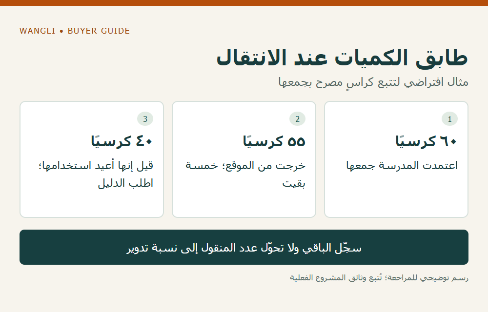

<!-- blog {"slug": "school-furniture-end-of-use-collection", "title": "إخراج الأثاث المدرسي من الخدمة: كيف تحدد نطاق الجمع ووجهة القطع؟", "seo_title": "جمع الأثاث المدرسي عند نهاية الاستخدام | WangLi", "description": "افصل قرار إخراج الأثاث عن جمعه ومساره اللاحق، وسجل الكميات والجهة المستلمة ودليل التنفيذ قبل إغلاق الخدمة.", "category": "tenders", "published": "2026-11-02T00:20:42+08:00", "image": "/assets/school-furniture-end-of-use-collection-cover-20261102.png", "image_alt": "الجمع لا يثبت إعادة التدوير — سجّل كل انتقال على حدة", "image_caption": "الجمع لا يثبت إعادة التدوير — سجّل كل انتقال على حدة", "image_kind": "diagram", "image_width": 1000, "image_height": 640, "draft": false} -->

# إخراج الأثاث المدرسي من الخدمة: كيف تحدد نطاق الجمع ووجهة القطع؟

عند تجديد مدرسة، قد تتضمن القائمة توريد أثاث جديد مع إزالة الموجود. لكن عبارة «جمع الأثاث القديم» لا توضح من يملك قرار إخراجه، وما الذي سيذهب لإعادة الاستخدام أو التدوير أو مسار آخر، وما الوثيقة التي تثبت التسليم. تحتاج شركة المشروع إلى نطاق خدمة وسجل انتقال واضحين قبل تسعير الأعمال أو إخلاء الغرف.

## ثبّت قرار الإخراج قبل تنظيم النقل

ابدأ بقائمة يراجعها صاحب الصلاحية في المدرسة: رموز القطع أو المجموعات، مواقعها وأعدادها، وحالتها، وقرار التصرف المطلوب لكل منها. لا تعتبر الأثاث موضوعًا للجمع لمجرد وجوده في ممر أو مخزن. وقد توجد قطع مستعارة أو مملوكة لطرف آخر؛ يجب أن يحدد المشروع صاحب القرار بشأنها قبل إدخالها في نطاق الخدمة.

توضح [إرشادات إدارة أصول المدارس البريطانية](https://www.gov.uk/guidance/buying-procedures-and-procurement-law-for-schools/how-to-manage-your-fixed-assets) أهمية وجود إجراءات للنقل والتحويل والتصرف في الأصول. وهي خلفية تنظيمية عامة، وليست سلطة للتخلص من ممتلكات مدرسة أخرى أو بديلًا عن قواعدها والأنظمة المحلية.

## افصل مسارات الاستفادة المتوقعة

اكتب لكل مجموعة المسار الذي يطلبه المشروع أو يسمح بتقييمه: إعادة استخدام داخل الجهة، أو نقل معتمد إلى جهة أخرى، أو فرز مواد للتدوير، أو معالجة أخرى وفق المتطلبات المحلية. إعادة الاستخدام والتدوير ليسا الوصف نفسه؛ نقل قطعة كاملة إلى مستودع لا يثبت أن موادها دُورت، وتسليمها لناقل لا يثبت وجهتها النهائية.

يعرض [ملخص تقرير المفوضية الأوروبية عن شراء الأثاث](https://publications.jrc.ec.europa.eu/repository/handle/JRC107824)، المنشور في 2017، خدمات جمع الأثاث عند نهاية استخدامه كنطاق إلى جانب شراء الجديد والتجديد. نستفيد من تمييز الخدمة، دون نقل معايير أوروبية أو افتراض أن كل مورد أثاث جديد يوفرها.

## اكتب نطاق الخدمة بحيث يمكن قياسه

| نقطة النطاق | ما يجب تحديده | دليل التنفيذ المقترح |
|---|---|---|
| القطع المسموح جمعها | القائمة والأعداد والمواقع | سجل مطابق للقائمة المعتمدة |
| حدود الأعمال | جمع فقط أو أعمال إضافية مؤكدة | بنود تفصيلية بالمشمول والمستثنى |
| الجهة المستلمة | اسمها ودورها ووجهة التسليم | إثبات استلام مرتبط بالمجموعة |
| الفرز والمسار | إعادة استخدام أو مواد أو إجراء آخر | بيان ما أُنجز فعلًا لا وعد عام |
| الحالات المستثناة | قطعة مجهولة أو لم تعتمد | سجل منفصل وقرار متابعة |

قد تحتاج بعض الحالات إلى جهة مختصة أو أذونات محلية؛ على المشروع التحقق من المطلوب لدى الجهات المعنية. لا يحدد هذا الدليل تصنيف نفايات أو أهلية ناقل أو طريقة تفكيك، ولا يشجع فريق المدرسة على معالجة مواد غير معروفة بنفسه.

## راجع الكميات عند نقاط الانتقال

**مثال افتراضي:** تعتمد المدرسة جمع 60 كرسيًا. يخرج من الموقع 55 فقط، وتبقى خمسة في غرفة لم تُفتح. لا تُغلق الخدمة على أساس العدد المعتمد؛ سجّل العدد الخارج والباقي وسببه، ثم طابق ما تسلمته الجهة التالية. إذا وصفت الجهة 40 كرسيًا بأنها أعيد استخدامها، اطلب مرجع هذا البيان ومصير الباقي، دون افتراض نسبة تدوير من عدد الكراسي وحده.

*رسم توضيحي: طابق الكميات عند الانتقال — مثال افتراضي لتتبع كراسٍ مصرح بجمعها — اضغط لعرض الصورة بالحجم الكامل.*

احتفظ بتسلسل يربط قرار المدرسة وسجل الجمع وإثبات التسليم وبيان المسار اللاحق المتاح. ولا تعدّ تكاليف أو عائد بيع قبل عرض واضح وموافقة المشروع على الشروط. يفيد [جرد الإصلاح أو الاستبدال](/blog/school-furniture-repair-replacement-inventory/) في القرار السابق للإخراج، بينما يوضح [تحليل تكلفة دورة الحياة](/blog/school-furniture-life-cycle-cost-comparison/) مكان تكلفة نهاية الفترة في المقارنة.

[أرسل طلب التوريد إلى WangLi](/request-a-quote/) مع فصل قائمة الأثاث الجديد عن أي خدمة جمع تحتاج إلى الاستفسار عنها، وحدد الجهة التي ستغطيها إن لم يشملها العرض. لا يفترض هذا المقال توفر خدمة استرجاع أو تدوير محلية لدى WangLi.
