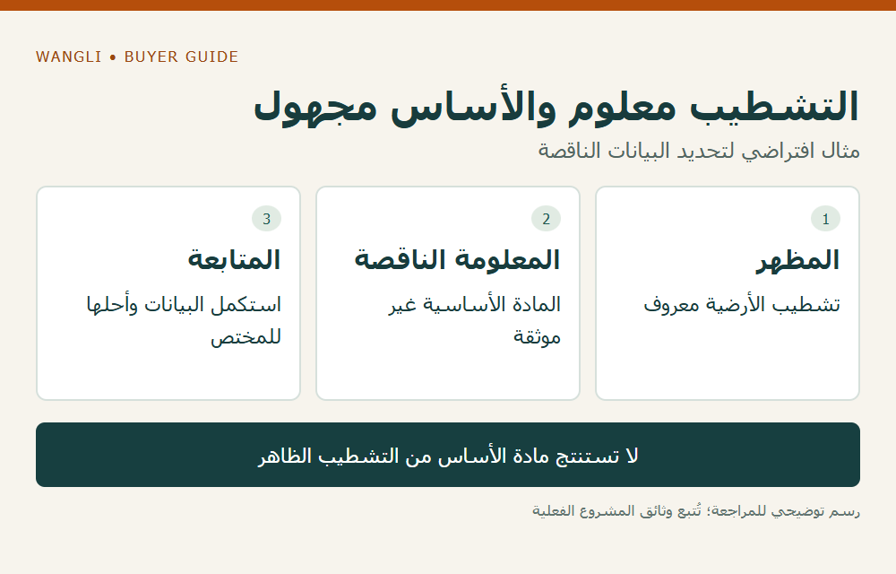

<!-- blog {"slug": "school-furniture-fixing-substrate-coordination", "title": "تثبيت أثاث المدرسة: ما بيانات الموقع التي تسبق اعتماد مستلزمات التثبيت؟", "seo_title": "تثبيت أثاث المدرسة: بيانات القاعدة والموقع | WangLi", "description": "افصل رسم قاعدة الأثاث عن بيانات المادة الأساسية بالموقع، وحدد جهة الاختيار والمراجعة قبل شراء مستلزمات التثبيت.", "category": "specifications", "published": "2026-11-02T00:18:30+08:00", "image": "/assets/school-furniture-fixing-substrate-coordination-cover-20261102.png", "image_alt": "ما الذي يسبق اعتماد التثبيت؟ — بيانات الأثاث والموقع يراجعها المختص", "image_caption": "ما الذي يسبق اعتماد التثبيت؟ — بيانات الأثاث والموقع يراجعها المختص", "image_kind": "diagram", "image_width": 1000, "image_height": 640, "draft": false} -->

# تثبيت أثاث المدرسة: ما بيانات الموقع التي تسبق اعتماد مستلزمات التثبيت؟

قد يظهر في عرض كرسي قاعة أو وحدة أثاث بند «مستلزمات تثبيت»، بينما لا يعرف فريق التوريد نوع الطبقة التي ستستقبلها في الموقع. لا تكفي قائمة المسامير أو صورة قاعدة المنتج لاعتماد الاتصال. يحتاج مسؤول المشروع إلى فصل بيانات الأثاث وبيانات الموقع، ثم إحالتها إلى المختص الذي يختار حل التثبيت ويراجع ملاءمته. الغرض هنا تنظيم ملف الشراء، وليس شرح الحفر أو تصميم التثبيت.

## حدد ما سيُثبّت وأين

أنشئ رمزًا لكل مجموعة لها تكوين أو موضع مختلف. اطلب من مورد الأثاث رسم الجزء المتصل بالموقع، ومواضع نقاطه وأبعاده ومعلومات المنتج اللازمة للمراجعة. إذا اختلفت نهاية الصف أو شكل القاعدة، فلا تنقل تفاصيل مجموعة أخرى لمجرد تشابه اسم الكرسي. احتفظ بإصدار الرسم مع العرض الذي يستند إليه.

توضح [مواد Hilti الفنية عن قواعد التثبيت](https://www.hilti.com.sg/content/hilti/A2/SG/en/engineering/design-center/anchor-systems/typical-applications/base-plate.html) أن القوى والمادة الأساسية والمسافات والحواف والتوصيلات من عوامل الاختيار. المرجع يخص أنظمة ذلك المصنّع وتطبيقات هندسية، وليس توصية بمثبت لأثاث المدرسة. لا تُنقل منه أبعاد أو منتجات إلى الطلب؛ يستخدم فقط لإيضاح سبب طلب معلومات من المختص.

## افصل التشطيب عن المادة الأساسية

اطلب من الجهة المسؤولة عن المبنى وصف الطبقات والرسومات أو المعلومات المتاحة عن موضع الاتصال، مع تمييز ما تحقق منه المختص وما زال غير معروف. اسم البلاط أو الغطاء الظاهر لا يعرّف وحده المادة الأساسية أو قدرتها على استقبال التثبيت. ولا يستنتج الموزع سمكًا أو تركيبًا من صورة أو من حالة غرفة مجاورة.

| ملف الأثاث | ملف الموقع | قرار يجب أن يصدر عن المختص |
|---|---|---|
| رسم القاعدة ونقاط الاتصال | موضعها والطبقات والمادة الأساسية | ملاءمة الحل المقترح لهذا الموضع |
| تكوين الموديل والبيانات المطلوبة | القيود والعناصر المعروفة حول الموضع | المعلومات الإضافية أو التحقق اللازم |
| المستلزمات التي يعرضها المورد | نطاق أعمال الموقع والمسؤول عنها | ما يورّد وما يصمم وما ينفذ ومن يراجع |
| تغيير موضع أو قاعدة | أثره في بيانات الموقع | هل يلزم تحديث القرار والرسم؟ |

لا يتحول اكتمال الجدول إلى تصريح بالتنفيذ. حدد في المشروع من يراجع البيانات، ومن يعتمد الحل، ومن ينفذ ويفحص الأعمال. وإذا غابت معلومة تؤثر في الاختيار، أظهرها بوضوح بدل طلب «عدة تثبيت عامة» ثم افتراض صلاحيتها عند الوصول.

*رسم توضيحي: التشطيب معلوم والأساس مجهول — مثال افتراضي لتحديد البيانات الناقصة — اضغط لعرض الصورة بالحجم الكامل.*

## اربط مستلزمات الشراء بالقرار الصحيح

بعد صدور القرار من الجهة المخولة، اطلب قائمة توضح ما يغطيه سعر الأثاث، وما يخص جهة التنفيذ أو مورد مستلزمات آخر. وجود مستلزمات داخل العبوة لا يثبت شمول تركيب محلي أو فحص الموقع أو قبول الأعمال. يساعد [دليل نطاق التوريد](/school-furniture-tender-checklist/) على تسجيل هذه المسؤوليات، بينما يوضح [جدول صفوف القاعة](/blog/auditorium-seating-row-schedule/) كيف تبقى تكوينات الصفوف مرتبطة برسومها.

إذا اقترح طرف تغيير القاعدة أو الموقع، سجّل الأثر في مرجعي المنتج والمبنى معًا. لا تعدل مواضع الثقوب أو نقاط الاتصال في الرسم التجاري لتحل تعارضًا هندسيًا بنفسك. يُعاد السؤال إلى المختص ويُطلب إصدار محدث قبل شراء المستلزمات أو اعتبار التكوين مغلقًا.

## مثال افتراضي: التشطيب معلوم والأساس غير موثق

افترض أن مخطط القاعة يوضح مكان الكراسي، وأن قائمة التشطيبات تسمي الغطاء الأرضي، لكن ملف التوريد لا يتضمن معلومات كافية عن المادة الأساسية. الحالة ليست «التثبيت مؤكد»؛ المطلوب استكمال بيانات الموقع والجهة التي تراجعها. ولا يعني المثال أن التكوين غير قابل للتثبيت، بل إن القرار لا يزال غير محسوم.

راجع [فئة كراسي القاعات](/products/auditorium/) لتحديد المرجع فقط، ثم [أرسل طلب عرض سعر إلى WangLi](/request-a-quote/) مع رسم التكوين ومواضع الاتصال ومعلومات الموقع المتاحة وحدود الأعمال المطلوبة. أبرز ما تنتظر تأكيده من مورد الأثاث وما يظل قرارًا هندسيًا لدى المشروع.
