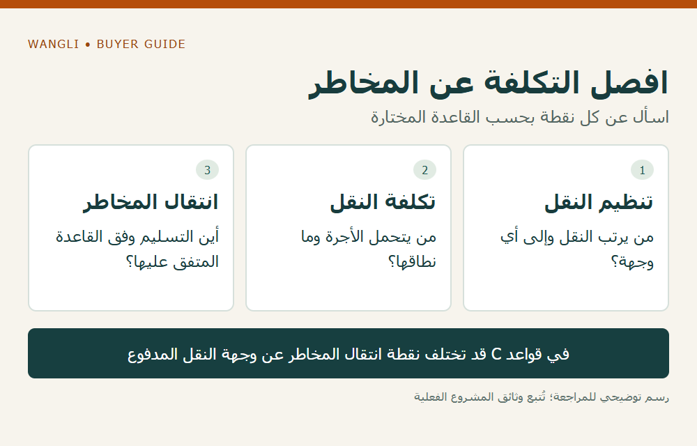

<!-- blog {"slug": "school-furniture-incoterms-named-place", "title": "شروط تسليم الأثاث المدرسي: كيف تراجع قاعدة Incoterms والمكان المحدد في العرض؟", "seo_title": "شروط تسليم الأثاث: القاعدة والمكان | WangLi", "description": "راجع قاعدة Incoterms وإصدارها والمكان المحدد، وافصل وجهة النقل وتكاليفه عن نقطة انتقال المخاطر في عرض الأثاث.", "category": "wholesale", "published": "2026-11-02T00:20:42+08:00", "image": "/assets/school-furniture-incoterms-named-place-cover-20261102.png", "image_alt": "راجع شروط التسليم كاملة — ثلاثة عناصر قبل مقارنة العروض", "image_caption": "راجع شروط التسليم كاملة — ثلاثة عناصر قبل مقارنة العروض", "image_kind": "diagram", "image_width": 1000, "image_height": 640, "draft": false} -->

# شروط تسليم الأثاث المدرسي: كيف تراجع قاعدة Incoterms والمكان المحدد في العرض؟

قد يتضمن عرض الأثاث المدرسي رمزًا من ثلاثة أحرف، لكن الرمز وحده لا يحدد الملف الذي تحتاجه شركة التوريد للمشروع. قبل مقارنة السعر أو وعد المدرسة بترتيب تسليم، اطلب اسم القاعدة وإصدارها والميناء أو المكان أو النقطة المحددة. ثم افصل من يرتب النقل، ومن يتحمل تكلفته، وأين تنتقل المخاطر؛ قد تتعلق هذه الأسئلة بأماكن مختلفة بحسب القاعدة المتفق عليها.

## اقرأ الصياغة كاملة قبل اختيار المقارنة

توضح [غرفة التجارة الدولية ICC](https://library.iccwbo.org/clp/clp-incoterms-qa-2020.htm?AGENT=ICC_UK) أن إدراج القاعدة يكون مع المكان المسمى والإصدار المقصود، وأنها تتناول التزامات وتكاليف ومخاطر معينة. لا تحل هذه القواعد محل عقد البيع، ولا تحدد وحدها انتقال الملكية أو طريقة الدفع أو مواصفات الأثاث. لذلك لا تستخدم الرمز لإغلاق أسئلة لا يجيب عنها.

انقل الصياغة من العرض كما هي، واسأل عن أي جزء ناقص. إذا ورد اسم مدينة فقط، اطلب تحديد الموقع المقصود بدرجة تسمح بمناقشة نطاق النقل. وإذا أضاف طرف ترتيبًا خاصًا خارج القاعدة، اطلب كتابته وبيان علاقته ببقية الشروط، ثم أحله إلى المسؤول التجاري أو القانوني لدى المشروع عند الحاجة. هذه مراجعة معلومات، وليست اختيارًا لشرط مناسب لكل شحنة.

## افصل نقطة المخاطر عن وجهة النقل المدفوع

من الأخطاء المحتملة افتراض أن وجود تكلفة نقل إلى وجهة معينة يعني بقاء المخاطر على البائع حتى تلك الوجهة. يبين شرح ICC أن هذا ليس استنتاجًا صحيحًا لجميع القواعد، ويظهر الفرق خصوصًا في مجموعة قواعد C. اطلب من الطرف الذي يقدم العرض تحديد نقطة التسليم التي يبني عليها انتقال المخاطر والوجهة التي يرتب إليها النقل، دون دمجهما في خانة واحدة.

| ما تراجعه | السؤال المحدد | ما لا يكفي لإغلاقه |
|---|---|---|
| القاعدة والإصدار | ما النص الذي سيظهر في العرض والعقد؟ | رمز بلا سنة أو مرجع واضح |
| المكان المسمى | ما الميناء أو العنوان أو النقطة المقصودة؟ | اسم بلد أو مدينة عند الحاجة إلى تفصيل أكبر |
| تنظيم النقل | من يتعاقد مع مقدم النقل وإلى أين؟ | عبارة عامة مثل «الشحن مشمول» |
| المخاطر | ما نقطة التسليم وفق القاعدة المختارة؟ | الاستدلال من الطرف الذي يدفع الأجرة فقط |
| الخدمات المرتبطة | ما نطاق التحميل والتفريغ والإجراءات المطلوب توضيحها؟ | صورة تحميل أو خبرة شحنة سابقة |

*رسم توضيحي: افصل التكلفة عن المخاطر — اسأل عن كل نقطة بحسب القاعدة المختارة — اضغط لعرض الصورة بالحجم الكامل.*

## طابق القاعدة مع وصف الشحنة والخدمة

أرفق بيانات التعبئة وحالة التجميع والوجهة الفعلية عند مناقشة شروط التسليم. تساعد [بيانات التعبئة لطلب عرض الشحن](/blog/school-furniture-packing-data-freight-rfq/) على تعريف الطرود، لكنها لا تختار قاعدة التسليم بدل الطرفين. كما أن عنوان المدرسة لا يثبت شمول إدخال القطع إلى الغرف أو التركيب أو زيارة فني؛ يجب وصف هذه الأعمال ونطاقها في موضع مناسب من العرض.

**مثال افتراضي:** يذكر عرض وجهة في الميناء، بينما تعتمد ميزانية شركة المشروع على وصول الأثاث إلى مبنى المدرسة. لا تضف المسافة والخدمات الناقصة بالتخمين، ولا تغير الرمز داخل جدولك كأنه تصحيح معتمد. اطلب عرضًا أو توضيحًا للنطاق المطلوب، وسجّل الجهة التي ستراجع التكلفة والمخاطر والخدمات المتبقية. المثال لا يمثل عرضًا من WangLi.

## اجعل قرار المقارنة قابلًا للمراجعة

ضع بجانب السعر صياغة التسليم الكاملة، وتاريخ العرض، والبيانات التي بني عليها، والأسئلة المفتوحة. ارجع إلى [دليل مقارنة عروض الأثاث بالجملة](/school-furniture-wholesale-guide/) لتوحيد الكميات والتكوين، وإلى [نطاق التوريد والمسؤوليات](/school-furniture-tender-checklist/) للأعمال الأخرى. ثم [أرسل طلب عرض سعر إلى WangLi](/request-a-quote/) يحدد الموديلات والوجهة ونطاق التسليم المراد مناقشته؛ توفر أي ترتيب وشروطه يحتاجان إلى رد خاص بالطلب.
