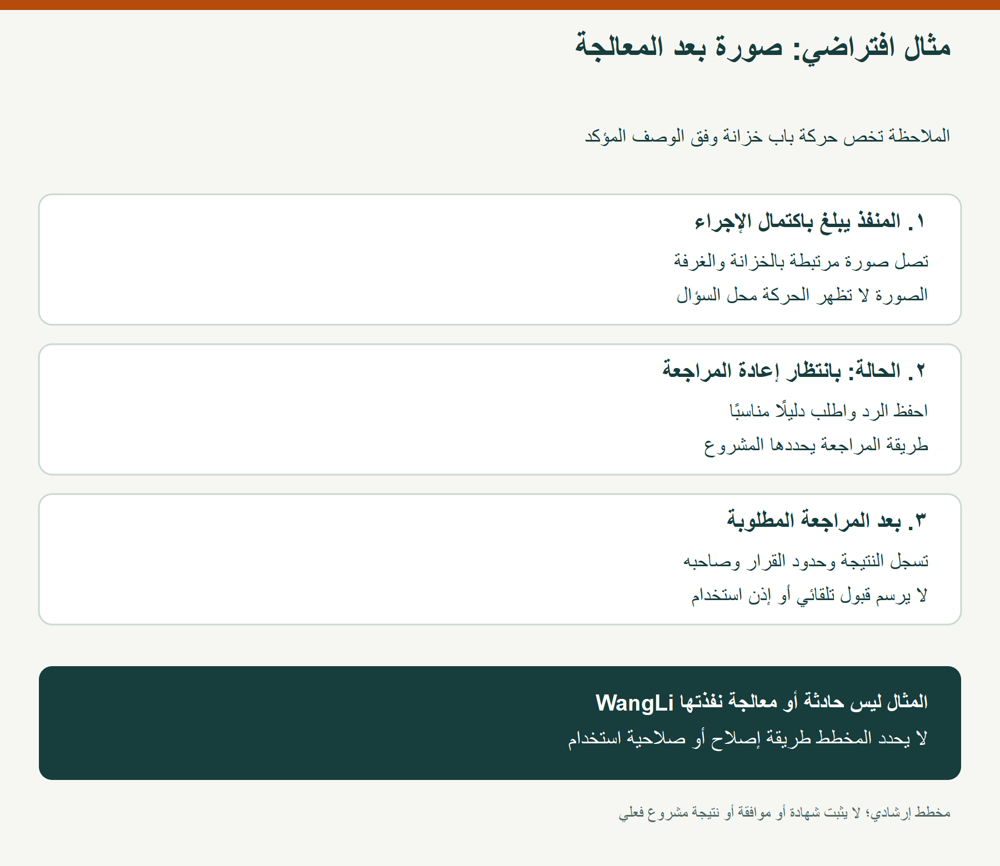

<!-- blog
{
  "slug": "school-furniture-installation-punch-list",
  "path": "/blog/school-furniture-installation-punch-list/",
  "title": "ملاحظات تركيب الأثاث المدرسي: كيف توثق المعالجة قبل إغلاق التسليم؟",
  "seo_title": "ملاحظات تركيب أثاث المدرسة وإغلاقها | WangLi",
  "description": "اربط ملاحظة تركيب الأثاث بموقعها والإجراء ودليل إعادة المراجعة، وافصل انتهاء العمل عن قرار القبول وإذن الاستخدام.",
  "category": "tenders",
  "published": "2026-10-30T08:26:42+08:00",
  "image": "school-furniture-installation-punch-list-decision-ar.png",
  "image_alt": "متى تُغلق ملاحظة التركيب؟؛ اربط الموقع والإجراء بإعادة المراجعة والقرار",
  "image_caption": "مخطط إرشادي لقرار الشراء؛ افتحه لتكبيره وراجع النص للتفاصيل.",
  "image_kind": "diagram",
  "image_width": 1800,
  "image_height": 1560,
  "draft": false,
  "modified": "2026-11-20T00:05:06+08:00"
}
-->

# ملاحظات تركيب الأثاث المدرسي: كيف توثق المعالجة قبل إغلاق التسليم؟

بعد توزيع الأثاث وتجميعه، قد يرسل المنفذ رسالة تقول «انتهى العمل»، بينما يبقى لدى المدرسة باب لا يعمل كما وصف، أو قطعة في غرفة مختلفة، أو نقطة تحتاج إلى مراجعة مختص. تحتاج شركة توريد المشروع إلى سجل يربط كل ملاحظة بموقعها والإجراء المتخذ ودليل إعادة المراجعة. نهاية زيارة فريق العمل ليست بذاتها قرار قبول للأثاث أو إذنًا باستخدام الغرفة.

## حدد حدود المراجعة بعد التركيب

اتفق مع المشروع على البنود والمواقع والأعمال التي يشملها التسليم: هل هي توريد فقط أم تجميع أو تثبيت أو أعمال أخرى مؤكدة؟ استعمل مراجع الطلب والمخطط وتعليمات المنتج. لا تدرج في السجل مسؤولية على المصنع أو جهة التركيب لمجرد وجودها في الموقع؛ المسؤولية تحدد من الوثائق والاتفاق، لا من اسم القائمة.

يذكر [دليل وزارة التعليم البريطانية لفتح مدارس UTC، الصادر في أكتوبر 2015](https://assets.publishing.service.gov.uk/media/5a7f39a340f0b62305b85d91/UTC_proposer_guide_Oct_2015_v3_for_publication.pdf) قائمة ملاحظات ضمن تسليم المبنى ومعالجة نقاط متبقية. هو سياق بناء تاريخي في بريطانيا، وليس قاعدة لقبول أثاث المدارس العربية أو للسماح ببقاء عيب معين. نستفيد فقط من فصل ملاحظة العمل عن متابعة معالجتها.

## أعط كل ملاحظة هوية يمكن الرجوع إليها

لا تكتب «الكراسي تحتاج مراجعة» دون مكان أو تعريف. سجّل رقم الملاحظة، والمبنى والغرفة، والموديل والقطعة المعنية، والمرجع الذي قورنت به، والوصف المشاهد والصورة أو المستند. لا تسجل سببًا مفترضًا أو حكم سلامة لم يصدره مختص؛ عند وجود قلق يتعلق بالاستخدام، أخطر الجهة المخولة لتقرر إجراءات الحماية والتقييم.

| الحقل | ما يسجل | ما لا يعد إغلاقًا وحده |
|---|---|---|
| الملاحظة | الموقع والقطعة والوصف والمرجع | صورة بلا تعريف للمكان |
| الإجراء المطلوب | السؤال أو المعالجة ومن يراجعها | وعد شفهي عام |
| رد المنفذ | ما نفذ وتاريخه ودليله | عبارة «تم الإصلاح» دون ربط |
| إعادة المراجعة | من راجع وماذا تحقق وما بقي | انتهاء زيارة فريق العمل |
| القرار | النتيجة وحدودها وصاحب الصلاحية | تحديث حالة الملف من طرف واحد |

## افصل التنفيذ عن التحقق والقبول

<figure class="wl-blog-diagram"><figcaption>مثال افتراضي: صورة بعد المعالجة؛ مخطط إرشادي، وليس سجل مشروع أو موافقة. افتح الصورة لتكبيرها.</figcaption></figure>

استخدم حالات مثل «مفتوحة»، و«أبلغ المنفذ باكتمال الإجراء»، و«بانتظار إعادة المراجعة»، ثم النتيجة التي تعتمدها الجهة المعنية. إذا تغيرت القطعة أو طريقة المعالجة، احتفظ بالوصف السابق والمرجع الجديد؛ لا تمحُ الملاحظة حتى يبدو السجل خاليًا.

في **مثال افتراضي**، تسجل المدرسة أن باب خزانة لا يعمل وفق الوصف المؤكد. يرسل المنفذ صورة بعد إجراء، لكن الصورة لا تظهر الحركة موضوع الملاحظة. يسجل الرد والإجراء، وتبقى المراجعة المطلوبة مفتوحة حتى يقدم الدليل المناسب أو يجري الفحص الذي يحدده المشروع. لا يقرر المقال طريقة إصلاح الباب أو إمكان استخدام الخزانة أثناء الانتظار.

## اربط مراجعة المصنع بالقطعة المركبة في المدرسة

قد يصف تقرير الفحص في المصنع عينة أو مرحلة إنتاج، بينما تكون القطعة الموجودة في غرفة المدرسة قد نُقلت وجُمعت في الموقع. احتفظ بمرجع المنتج وتكوين العينة وتقرير المصنع، ثم حدد مع المشروع ما الذي سيفحص بعد التجميع ومن يملك قرار القبول. إذا لم تنص الوثائق على فحص معين، سجّل ذلك سؤالًا مفتوحًا ولا تعتبره خدمة مشمولة تلقائيًا.

يذكر [تقرير تدقيق UNICEF لمكتب تشاد لعام 2026](https://www.unicef.org/auditandinvestigation/media/2246/file/2026-chad-country-office-audit-report.pdf.pdf)، في الصفحتين 28–29، عقدًا راجع تقرير فحص في ورشة المورد دون فحص للأثاث المركب قبل التسليم للمدارس، وملاحظات لاحقة رصدها فريق التدقيق في مدرسة. هذه واقعة منفصلة في تشاد، وليست حالة لمنتجات WangLi أو دليلًا على أن الفحص في المصنع غير مفيد. تفيد في تحديد مرحلة الفحص والدليل الذي يجب حفظه لكل مشروع.

| مرحلة التحقق | المرجع الذي يحتفظ به المسؤول | ما يبقى لجهة المشروع |
|---|---|---|
| فحص المصنع إن اتفق عليه | الموديل والتكوين ونطاق التقرير وتاريخه | تحديد نطاق الاستفادة من التقرير |
| بعد التجميع في الموقع | الغرفة والقطعة والمرجع وما لوحظ | تعيين من يجري الفحص المطلوب |
| معالجة الملاحظة | الإجراء ودليله وتاريخ الرد | إعادة المراجعة وقرار القبول |

إذا ظهرت حافة أو قطعة مقلقة، لا تبتكر طريقة إصلاح أو تعتبر الصورة موافقة على الاستخدام؛ ارفع الملاحظة للجهة المخولة وفق ترتيبات المشروع. احفظ كل مرحلة بحالتها الفعلية، فقد لا يتضمن الاتفاق بعض أعمال الفحص أو التجميع أو المتابعة.

## سلّم الحالة الفعلية مع النقاط المفتوحة

إذا كان التسليم على غرف أو دفعات، احتفظ بقائمة توضح ما راجعته الجهة، وما بقي، ومن يتابع، ومتى ستراجع الخطوة التالية وفق الاتفاق. لا تحول قبول جزء إلى قبول بقية الغرف، ولا تجعل غياب ملاحظة مسجلة شهادة بأن جميع الوظائف اختبرت. أما السماح بالاستخدام وتقييم السلامة وأثر الملاحظات في القبول فتبقى قرارات لدى أصحاب الاختصاص والصلاحية.

تختلف هذه المهمة عن [فحص الأثاث قبل الشحن](/blog/school-furniture-pre-shipment-inspection-scope/) وعن [تسجيل حالة الوصول](/blog/school-furniture-delivery-receiving-discrepancies/): هنا تتابع الملاحظة بعد العمل في موقعها حتى قرار موثق. ولتنظيم نطاق الأطراف ارجع إلى [قائمة مسؤوليات المشروع](/school-furniture-tender-checklist/). [أرسل استفسارًا إلى WangLi](/request-a-quote/) مع الموديلات ونطاق التوريد وأي متطلبات توثيق بعد التجميع، لتأكيد ما يمكن تقديمه وما يحتاج إلى ترتيب مستقل في الموقع.
