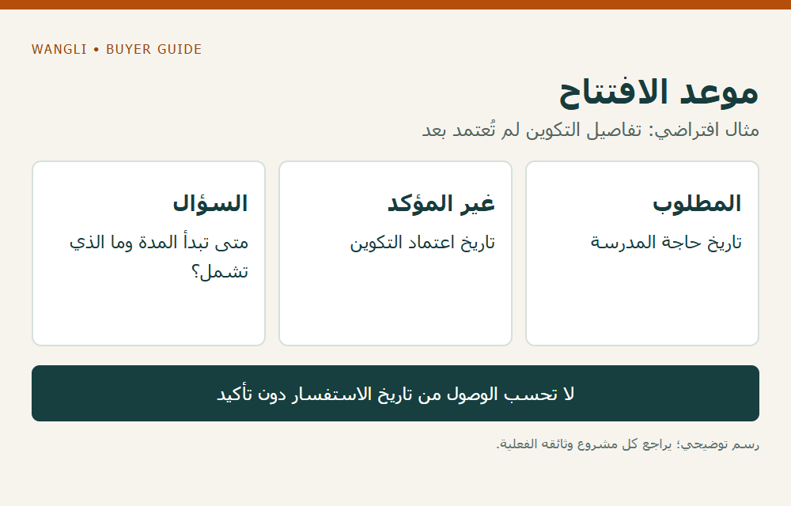

<!-- blog {"slug": "school-furniture-lead-time-milestones", "title": "مدة توريد الأثاث المدرسي: من أي تاريخ يبدأ العد وأين ينتهي؟", "seo_title": "مدة توريد الأثاث المدرسي ونقاطها | WangLi", "description": "قارن مدد التوريد بتحديد بداية العد ونهايته والكمية والوجهة والخدمات المشمولة.", "category": "tenders", "published": "2026-11-13T00:32:55+08:00", "image": "/assets/school-furniture-lead-time-milestones-cover-20261113.png", "image_alt": "كيف تقارن مدة التوريد؟ — عرّف نقطة البداية والنهاية قبل مقارنة الأرقام", "image_caption": "كيف تقارن مدة التوريد؟ — عرّف نقطة البداية والنهاية قبل مقارنة الأرقام", "image_kind": "diagram", "image_width": 1000, "image_height": 640, "draft": false} -->

# مدة توريد الأثاث المدرسي: من أي تاريخ يبدأ العد وأين ينتهي؟

قد تقارن شركة توريد مشروع بين عرضين يذكر كل منهما مدة مختلفة، لكن الرقم وحده لا يوضح هل المدة تبدأ عند إرسال الاستفسار أم بعد اعتماد الطلب، ولا هل تنتهي بجاهزية الإنتاج أم بوصول الأثاث إلى المدرسة. اطلب تعريف نقطة البداية والنهاية والافتراضات قبل إدخال المدة في جدول المشروع.

## سمِّ كل حدث بدل استخدام كلمة «التسليم» وحدها

| الحدث | ما يحتاج إلى تأكيد |
|---|---|
| الطلب | هل استلم المورد أمرًا مكتمل التفاصيل وقبله؟ |
| جاهزية المنتج | ما الكمية والتكوين اللذان يشملهما تأكيد الجاهزية؟ |
| الشحن | من يرتب النقل، وما نقطة التسليم المتفق عليها؟ |
| الوصول | إلى أي موقع، وهل الموعد مؤكد أم تقديري؟ |
| التركيب | هل يدخل في النطاق والمدة أم يحتاج ترتيبًا منفصلًا؟ |

لا تضف مددًا متداخلة دون سؤال الأطراف، ولا تعتبر تقدير النقل التزامًا نهائيًا. أرفق بتاريخ كل حدث مصدره وتاريخ آخر تحديث والجهة المسؤولة عنه. إذا كان العرض مرتبطًا باعتماد رسم أو لون أو قائمة كميات، فدوّن ذلك بوصفه شرطًا يحتاج للتأكيد لا موعدًا تحقق بالفعل.

## قارن على نفس النطاق

اطلب من كل مورد تحديد الموديل والتكوين والكمية والوجهة والمدة ونقطة بدايتها ونهايتها. قارن تاريخين محسوبين على أساس واحد، واحتفظ بالتواريخ غير المؤكدة منفصلة. قد يبدو عرض ينتهي عند جاهزية المنتج أسرع من عرض يشمل الوصول، لكن المقارنة لا تكتمل قبل معرفة النقل والخدمات والمسؤوليات.

في [إرشادات إطار أثاث بريطاني تاريخي](https://assets.crowncommercial.gov.uk/wp-content/uploads/RM6119-Furniture-and-Associated-Services-Framework-Guidance-v2.pdf)، تُعرض مراحل تحضيرية للمنافسة إلى جانب مهلة توريد توضيحية. الأرقام تخص ذلك المثال ولا تعني مهلة لدى WangLi أو ضمانًا لأي مشروع؛ تستخدم هنا لتوضيح أن التحضير والتوريد مرحلتان مختلفتان.

## اختبر التسلسل بمثال افتراضي

إذا أراد المشروع الأثاث في يوم الافتتاح، وكان تاريخ الموافقة على التكوين غير معروف، فلا يمكن حساب تاريخ وصول موثوق بمجرد إضافة مدة مقترحة إلى تاريخ الاستفسار. اسأل عن آخر موعد لتأكيد التكوين، والمدة بعد التأكيد، وما يدخل فيها، ثم اعرض الفجوة على مدير المشروع. لا يثبت المثال قدرة المورد أو موعده.

*مثال افتراضي؛ اضغط لتكبير الرسم.*

## اربط الجدول بالقرار والتحديث

إذا تغيرت جهة التسليم أو الكمية أو تصميم المنتج، اطلب إعادة تقييم الجدول من الأطراف؛ لا تفترض أن المدة القديمة ما زالت صالحة. إذا كانت بعض الكميات غير متاحة، اتبع [سجل الكميات المتأخرة](/blog/school-furniture-backorder-tracking/). وإذا تغيرت جاهزية الغرف، راجع [ربط الدفعات بجاهزية المدرسة](/blog/school-furniture-site-readiness-delivery-phases/). وعند مقارنة موقع التسليم ومسؤولية النقل، راجع [تحديد المكان في شروط التجارة](/blog/school-furniture-incoterms-named-place/).

[أرسل استفسارًا إلى WangLi](/request-a-quote/) يوضح قائمة المنتجات والكميات والوجهة والموعد المطلوب والخدمات المتوقعة؛ يسأل الفريق عن التفاصيل اللازمة لتحديد ما يمكن تأكيده لكل طلب.
