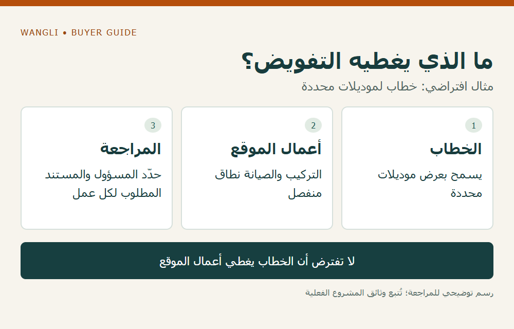

<!-- blog {"slug": "school-furniture-manufacturer-authorization", "title": "تفويض المصنع في مناقصة الأثاث: ماذا يثبت وما الذي يبقى على شركة التوريد؟", "seo_title": "تفويض مصنع الأثاث ونطاقه في المناقصة | WangLi", "description": "افصل تفويض المصنع عن أهلية المشارك وأدلة المنتج، وحدد البنود والجهة والنموذج المطلوب قبل طلب أي خطاب.", "category": "tenders", "published": "2026-11-02T00:15:32+08:00", "image": "/assets/school-furniture-manufacturer-authorization-cover-20261102.png", "image_alt": "تفويض المصنع وحدود الاستجابة — ثلاثة ملفات تؤدي مهام مختلفة", "image_caption": "تفويض المصنع وحدود الاستجابة — ثلاثة ملفات تؤدي مهام مختلفة", "image_kind": "diagram", "image_width": 1000, "image_height": 640, "draft": false} -->

# تفويض المصنع في مناقصة الأثاث: ماذا يثبت وما الذي يبقى على شركة التوريد؟

عندما تطلب مناقصة مستندًا من المصنع، قد تخلط شركة التوريد بين خطاب التفويض وعرض السعر وشهادة المنتج. هذه وثائق تؤدي مهام مختلفة. قبل طلب خطاب عام، حدد نص الشرط والبنود التي ينطبق عليها، والجهة التي ستقدمه، وما الذي يجب أن يقر به مصدره. وجود علاقة تجارية مع مصنع لا يعني تلقائيًا استيفاء أهلية المشارك أو التزامات خدمة المشروع.

## تأكد أولًا من وجود المتطلب ونطاقه

راجع قائمة الوثائق وتعليمات المشاركة وأي جواب رسمي متعلق بالتفويض. قد يختلف المتطلب بين مجموعات البنود في عملية واحدة؛ لذلك لا تعمم شرط معدات على جميع قطع الأثاث، ولا تتجاهل خانة إلزامية في المنصة من نفسك إذا بدت غير منطبقة. ارفع الاستفسار عبر المسار المعتمد للمناقصة واحتفظ بالرد.

من أمثلة وثائق الشراء [مناقصة تاريخية لـUNOPS تشمل معدات وأثاث مختبرات](https://www.ungm.org/Public/Notice/301833)، نُشرت في مايو 2026 وانتهت في يوليو من العام نفسه، وتتضمن نماذج ووثائق خاصة بها. لا يجعل هذا المثال التفويض شرطًا عامًا لكل مناقصات المدارس أو السوق العربي؛ قراءة النص المطبق وتوضيح الجهة يسبقان طلب أي خطاب.

## افصل ثلاثة ملفات في الاستجابة

| الملف | السؤال الذي يجيب عنه | ما لا يحل محله |
|---|---|---|
| تفويض أو إقرار من المصنع إذا طُلب | من يصدر البيان، ولمن، ولأي عملية وبنود ونطاق؟ | أهلية شركة التوريد القانونية أو المالية |
| الأدلة الفنية للمنتج | ما الموديل والتكوين الذي يدعمه المستند؟ | إذن جهة مالكة للعلامة أو التفويض المطلوب |
| ملف المشارك | هل تتوافر فيه شروط المشاركة والخبرة والقدرة؟ | وعد مصنع بتوفير منتج أو مستند |

حدد أيضًا من يوقع العرض ومن سيكون طرف العقد إذا تم الاختيار، وما الأعمال التي تقترح شركة التوريد تنفيذها بنفسها أو عبر أطراف أخرى. لا تُدرج اسم مصنع في التزام خدمة محلية أو مدة استجابة لم يؤكدهما كتابةً. ولا تفترض أن خطابًا لعملية سابقة يظل صالحًا بعد تغيير الجهة أو البنود.

## حوّل النموذج المطلوب إلى طلب محدد للمصنع

أرسل رقم العملية واسم المشارك المسجل، والنموذج الأصلي إن وجد، والبنود والموديلات التي تحتاج إلى تغطيتها. ضع علامة على العبارات التي تطلب التزامًا من المصدر، مثل نطاق دعم أو قطع أو مدة أو إقليم، واطلب مراجعتها من الجهة المختصة لديه. الهدف معرفة ما يمكن إصداره فعلًا، لا ملء الفراغات بما يفترضه الموزع.

إذا اعتمد النموذج مصطلحًا لا يتوافق بوضوح مع دور المصنع أو البائع، لا تعِد صياغته ثم تقدمه كأنه مقبول من الجهة المشترية. سجّل السؤال واعرض الرد من خلال المسار المحدد. يبقى قبول الصياغة لدى الجهة المخولة وفق وثائق المناقصة؛ موافقة المصنع على إصدار خطاب لا تضمن قبول العرض.

## مثال افتراضي: خطاب لا يغطي نطاق المشارك

لنفترض أن شركة تعرض طاولات من مصنع، بينما يتضمن عقد المشروع تركيبًا وصيانة محلية. إذا اقتصر الخطاب على السماح بعرض موديلات محددة، فلا توسع معناه إلى تغطية أعمال الموقع. تحتاج الشركة إلى بيان منفصل لكيفية تنفيذ تلك الأعمال ومستنداته المطلوبة. المثال لا يصف تفويضًا أو خدمة متاحة لدى WangLi.

*رسم توضيحي: ما الذي يغطيه التفويض؟ — مثال افتراضي: خطاب لموديلات محددة — اضغط لعرض الصورة بالحجم الكامل.*

استخدم [قائمة نطاق المناقصة](/school-furniture-tender-checklist/) للأعمال والمسؤوليات، و[وثائق الشركة وحدودها](/certificates/) لما يتعلق بالشهادات، و[دليل الضمان](/blog/school-furniture-warranty-scope-questions/) لأسئلة التغطية. ثم [أرسل طلبًا إلى WangLi](/request-a-quote/) يرفق النموذج والبنود والجهة واسم المشارك؛ إمكان إصدار أي تفويض أو إقرار وصيغته يحتاجان إلى مراجعة وتأكيد خاصين بالطلب.
