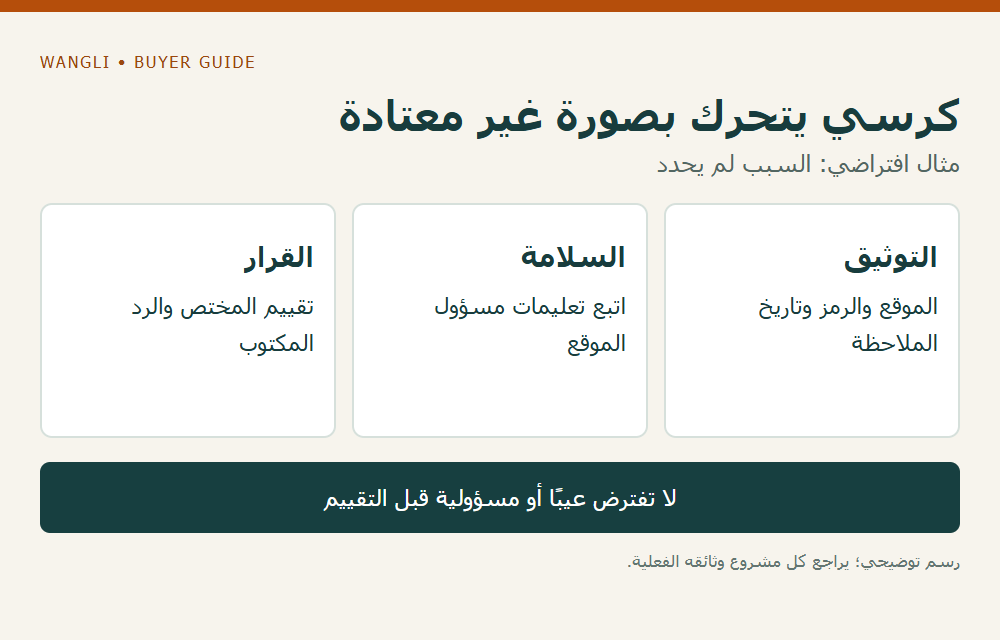

<!-- blog {"slug": "school-furniture-post-use-condition-review", "title": "مراجعة الأثاث المدرسي بعد بدء الاستخدام: كيف توثق الملاحظة وتحدد خطوتها التالية؟", "seo_title": "متابعة حالة الأثاث المدرسي بعد الاستخدام | WangLi", "description": "وثّق ملاحظة الأثاث بعد الاستخدام واربطها بالموديل والموقع وتقييم المختص وشروط الطلب.", "category": "tenders", "published": "2026-11-15T00:06:48+08:00", "image": "/assets/school-furniture-post-use-condition-review-cover-20261115.png", "image_alt": "ملاحظة بعد الاستخدام — سجل الوقائع واطلب تقييم الجهة المختصة", "image_caption": "ملاحظة بعد الاستخدام — سجل الوقائع واطلب تقييم الجهة المختصة", "image_kind": "diagram", "image_width": 1000, "image_height": 640, "draft": false} -->

# مراجعة الأثاث المدرسي بعد بدء الاستخدام: كيف توثق الملاحظة وتحدد خطوتها التالية؟

قد يستلم مشروع المدرسة الأثاث ويبدأ استخدامه، ثم تظهر ملاحظة في طاولة أو كرسي بعد فترة. يحتاج الموزع أو شركة توريد المشروع إلى سجل يربط الملاحظة بالمنتج والموقع وظروف الاستخدام، ويميز بين طلب تقييم فني وإجراء ضمان محتمل وقرار المدرسة. لا تكفي صورة واحدة لتحديد السبب أو المسؤولية.

## حدد موضع الملاحظة وما يحتاج إلى تدخل فوري

اطلب من جهة المدرسة تحديد الغرفة والقطعة ورقمها أو رمز الموديل إن كان معروفًا، ووصف ما لاحظته وتاريخ الاكتشاف. إذا ظهر جزء حاد أو مشكلة قد تؤثر في السلامة، أبلغ مسؤول الموقع واتبع تعليماته لإبعاد القطعة عن الاستخدام إلى حين تقييم المختص. لا يقدم هذا الدليل حكمًا هندسيًا، ولا يدعو الطالب أو الموظف إلى إجراء اختبار خطر.

يشير [تقرير تدقيق داخلي لليونيسف عن مكتب تشاد](https://www.unicef.org/auditandinvestigation/media/2246/file/2026-chad-country-office-audit-report.pdf.pdf) إلى حالة لاحظ فيها الفريق تلفًا وعدم ثبات في أثاث مدرسي بعد التسليم، وإلى ثغرات في توثيق الفحص. هذا تقرير عن مشروع آخر، وليس حالة تخص WangLi ولا دليلًا على سبب عام أو عيب في منتجاتها؛ قيمته هنا توضيح ضرورة توثيق ما يحدث بعد التسليم أيضًا.

## افصل الوقائع عن الاستنتاجات

| البيان | ما يجمعه مسؤول المشروع | ما يبقى بحاجة إلى قرار |
|---|---|---|
| هوية القطعة | الموديل أو الرمز، الموقع، ومرجع الطلب إن توفر | مطابقة الرمز بالدفعة أو التكوين |
| الملاحظة | وصف واضح وتاريخ وصور عامة وتفصيلية | تقييم طبيعتها من المختص |
| النطاق | عدد القطع المعروفة ومواقعها | هل تستدعي مراجعة قطع أخرى؟ |
| الاستخدام | ما تؤكده المدرسة عن ظروف الاستعمال والعناية | مدى الصلة بالملاحظة دون افتراض سبب |
| الإجراء | تاريخ الإبلاغ والطرف المسؤول عن المتابعة | الإصلاح أو الاستبدال أو أي إجراء آخر بحسب الاتفاق |

لا تنقل ملاحظة قطعة واحدة إلى كل الأثاث، ولا تسجل «عيب تصنيع» أو «سوء استخدام» من دون تقييم. إذا لم تعرف المدرسة رقم الموديل، سجله مجهولًا واطلب مساعدة الأطراف في المطابقة بدل تخمينه.

## مثال افتراضي لسجل قابل للمتابعة

لاحظ مسؤول فصل أن كرسيًا يتحرك بصورة غير معتادة، بينما لم يُحدد السبب. يسجل موقع الكرسي والرمز المتاح وتاريخ الملاحظة، ويخطر مسؤول الموقع، ثم يطلب تقييمًا وتوجيهًا من الجهة المختصة. يبقى السبب والإجراء غير محسومين إلى أن تصدر المعلومات والقرارات ذات الصلة. المثال لا يصف عميلًا أو منتجًا فعليًا.

*مثال افتراضي؛ اضغط لتكبير الرسم.*

## اربط المتابعة بالوثائق الصحيحة

راجع [نطاق الضمان وأسئلة الإجراء](/blog/school-furniture-warranty-scope-questions/) لمعرفة ما ينص عليه العرض الفعلي، و[قائمة ملاحظات التركيب](/blog/school-furniture-installation-punch-list/) إذا كانت الملاحظة مرتبطة بأعمال لم تُغلق، و[تحديد القطع البديلة](/blog/school-furniture-spare-parts-inquiry/) إذا طلب المختص بيانات جزء محدد. احتفظ بالردود وإصداراتها، وأبلغ المدرسة بما تأكد وما لا يزال قيد المراجعة.

[أرسل استفسارًا إلى WangLi](/request-a-quote/) مع مرجع المنتج المتاح والكمية والملاحظة وبيانات المشروع اللازمة؛ يؤكد الفريق المعلومات والإجراءات المتاحة للطلب المعني.
