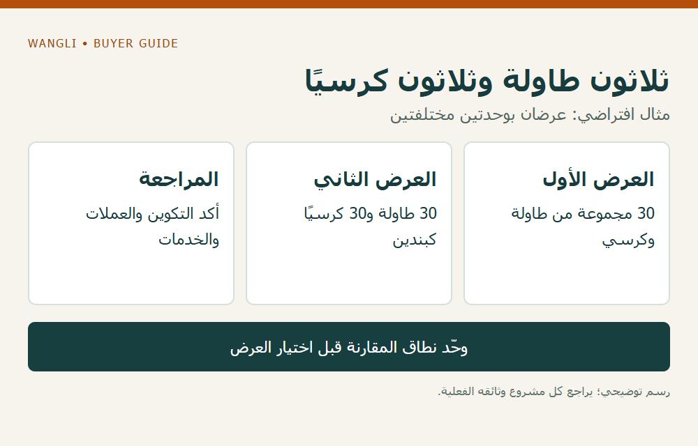

<!-- blog {"slug": "school-furniture-quote-unit-comparison", "title": "مقارنة أسعار الأثاث المدرسي: هل السعر للقطعة أم للمجموعة؟", "seo_title": "وحدة سعر الأثاث المدرسي | WangLi", "description": "قارن عروض الأثاث بعد تحديد محتوى القطعة أو المجموعة والخدمات والعملة والضريبة.", "category": "tenders", "published": "2026-11-13T00:36:43+08:00", "image": "/assets/school-furniture-quote-unit-comparison-cover-20261113.png", "image_alt": "ما وحدة السعر؟ — قارن التكوين والخدمات قبل مقارنة الأرقام", "image_caption": "ما وحدة السعر؟ — قارن التكوين والخدمات قبل مقارنة الأرقام", "image_kind": "diagram", "image_width": 1000, "image_height": 640, "draft": false} -->

# مقارنة أسعار الأثاث المدرسي: هل السعر للقطعة أم للمجموعة؟

قد يظهر عرض طاولة وكرسي بسعر «للمجموعة»، ويعرض مورد آخر سعر الطاولة والكرسي منفصلين. لا تكفي مقارنة الرقمين قبل معرفة محتوى الوحدة والكمية والخدمات الداخلة في كل سعر. يحتاج الموزع أو مقدم المشروع إلى تحويل العروض إلى نطاق قابل للمقارنة، مع إبقاء البنود غير المؤكدة واضحة.

## عرّف الوحدة ومحتواها

اطلب رمز كل موديل ووصفه وعدد القطع التي يشملها سعر الوحدة. إذا كُتب «طقم»، اسأل هل يشمل طاولة واحدة وكرسيًا واحدًا، أو تكوينًا آخر، وهل يشمل الملحقات المطلوبة. لا تفترض أن السعر لكل صندوق هو السعر لكل قطعة، أو أن صورتين متشابهتين تمثلان التكوين نفسه.

| البيان | ما يلزم لمراجعة المقارنة |
|---|---|
| الوحدة | قطعة أو مجموعة أو عبوة، وعدد المكونات |
| الكمية | عدد الوحدات المطلوبة لكل موديل ووجهة |
| المنتج | المقاس والمادة والملحقات كما أكدها المورد |
| النطاق | التغليف والنقل والتفريغ والتركيب بحسب العرض |
| العملة والضريبة | العملة وطريقة عرض الضرائب وفق مستند العملية |
| الصلاحية | فترة صلاحية العرض والشروط التي تؤثر فيه |

تشير [إرشادات حكومية بريطانية عن التسعير وتوزيع المخاطر](https://www.gov.uk/government/publications/the-sourcing-and-consultancy-playbooks/risk-allocation-and-pricing-approaches-guidance-note-html) إلى أن غموض المواصفات قد يسبب خلافًا بشأن الخدمات الداخلة في السعر. هذا توجيه عام، لا قاعدة ضريبية سعودية أو شرط بيع من WangLi؛ راجع تفاصيل العملية الفعلية.

## وحّد أساس المقارنة دون اختراع سعر

**مثال افتراضي:** يحتاج المشروع إلى 30 طاولة و30 كرسيًا. يعرض الأول 30 مجموعة تحتوي كل منها على طاولة وكرسي؛ ويعرض الثاني 30 طاولة و30 كرسيًا كبندين منفصلين. يمكن مقارنة إجمالي المنتجات بعد تأكيد المحتوى والتكوين والعملة، ثم توضيح الخدمات المعلومة على حدة. لا تتضمن هذه الفرضية أسعارًا حقيقية أو عرضًا من WangLi.

إذا لم يحدد أحد العرضين تكلفة النقل، ضعها «غير مؤكدة» بدل إدخال صفر. وإذا نصت المناقصة على نموذج أو عملة محددة، استخدم النموذج المطلوب واطلب التوضيح عند الغموض؛ لا تغير أساس التقييم من تلقاء نفسك. بعد المقارنة الأولية، يمكن استخدام [دليل تكلفة دورة الحياة](/blog/school-furniture-life-cycle-cost-comparison/) للنظر في فترة الاستخدام والمصروفات الأخرى المعلومة.

*مثال افتراضي؛ اضغط لتكبير الرسم.*

## اربط السعر بنطاق الخدمة والوثائق

سجل إصدار العرض وتاريخ تأكيد التفاصيل، واربط كل مبلغ برمز الموديل والكمية والخدمة. إن كانت خدمات التوصيل أو التجميع غير واضحة، راجع [تحديد مسؤوليات التوريد والتركيب](/blog/school-furniture-service-scope-allocation/). وإذا تطلب الإجراء فصل السعر عن المواصفات، اتبع [تنظيم الملف الفني والمالي](/blog/school-furniture-technical-financial-file-separation/) حسب تعليمات الجهة المشترية.

[أرسل طلب عرض إلى WangLi](/request-a-quote/) مع الموديلات والكميات والوجهة والخدمات المطلوبة؛ يؤكد الفريق محتوى العرض وشروطه للطلب الفعلي.
