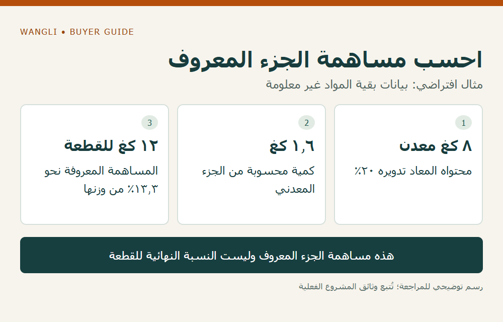

<!-- blog {"slug": "school-furniture-recycled-content-claims", "title": "المحتوى المعاد تدويره في الأثاث المدرسي: نسبة من أي مادة وبأي دليل؟", "seo_title": "المحتوى المعاد تدويره في الأثاث | WangLi", "description": "حدد المادة والمقام والوزن ومصدر البيان قبل استخدام نسبة محتوى معاد تدويره، ولا تعمم نسبة جزء على قطعة الأثاث كلها.", "category": "specifications", "published": "2026-11-02T00:19:30+08:00", "image": "/assets/school-furniture-recycled-content-claims-cover-20261102.png", "image_alt": "نسبة من أي مادة؟ — افصل حدود البيان قبل استخدامه", "image_caption": "نسبة من أي مادة؟ — افصل حدود البيان قبل استخدامه", "image_kind": "diagram", "image_width": 1000, "image_height": 640, "draft": false} -->

# المحتوى المعاد تدويره في الأثاث المدرسي: نسبة من أي مادة وبأي دليل؟

قد يذكر عرض الأثاث أن الهيكل يحتوي على معدن معاد تدويره، ثم تختصر شركة المشروع ذلك في وصف القطعة كلها بأنها «معاد تدويرها». هذا الاختصار يغير معنى البيان. يحتاج الموزع والمشتري الفني إلى معرفة المادة المشمولة، وأساس الوزن، وطريقة الحساب، والوثيقة التي تربط النسبة بالتكوين المعروض قبل استعمالها في عرض توريد أو مقارنة بيئية.

## حدد الادعاء الذي تريد مراجعته

اكتب النص كما ورد من المورد، ثم اسأل: هل النسبة تخص المعدن، أم البلاستيك، أم اللوح، أم المنتج كاملًا، أم التغليف فقط؟ وحدد هل المقصود محتوى دخل التصنيع أو إمكان تدوير المنتج بعد الاستخدام. قابلية التدوير لا تعني أن المنتج يحتوي بالفعل على مادة معاد تدويرها، كما أن وجود عبوة معاد تدويرها لا يصف الأثاث الموجود داخلها.

تنشر المفوضية الأوروبية [مثال شراء أثاث لمدينة هلسنكي](https://green-forum.ec.europa.eu/green-business/green-public-procurement/good-practice-library/circular-and-fair-procurement-office-and-public-furniture_en) يتضمن شرطًا يتعلق بالمعدن مع أساس وزني وبيان من المصنع أو المسبك. المثال تابع لشراء محدد؛ لا ننقل نسبته إلى مدرسة عربية ولا نفترض أن WangLi تحققها. يفيد في إبراز ضرورة تعريف المادة والبيان المطلوب.

## اطلب أساس الوزن ومصدر البيانات

لكل مادة مشمولة، اطلب وزنها في التكوين وطبيعة النسبة المعلنة ومصدرها وحدودها. اسأل إن كانت البيانات تخص المكوّن المعروض أو متوسطًا لخط إنتاج أو فترة أو نطاقًا آخر؛ يجب أن يظل هذا الفرق ظاهرًا. لا تحول متوسط مصنع إلى نسبة مؤكدة لكل قطعة دون أساس يوضح هذا الربط.

| بيان المقارنة | السؤال المحدد | سبب إبقاء الحالة مفتوحة |
|---|---|---|
| المادة | أي جزء من المنتج مشمول؟ | عبارة عامة بلا تعريف |
| المقام | وزن المادة أم وزن المنتج أم العبوة؟ | المقام غير مذكور |
| النسبة | كيف حُسبت وما حدودها؟ | رقم بلا طريقة أو مصدر |
| التتبع | أي موديل أو مكوّن أو فترة تغطيها؟ | وثيقة تخص تكوينًا مختلفًا |
| التحقق | من أصدر البيان وما الذي راجعه؟ | شعار لا يوضح نطاق الدليل |

## مثال افتراضي يمنع تعميم النسبة

افترض أن قطعة تزن 12 كيلوغرامًا، ويبلغ وزن المعدن فيها 8 كيلوغرامات. إذا كان بيان موثق لهذا المعدن يحدد محتوى معاد تدويره بنسبة 20% من وزنه، فإن الكمية الحسابية المشمولة تساوي 1.6 كيلوغرام. تعادل هذه الكمية نحو 13.3% من وزن القطعة كلها، إذا صحت الأوزان وحدود البيان نفسها.

لا يعني ذلك أن القطعة معاد تدويرها بنسبة 20%، ولا أن باقي المواد تحتوي على صفر. الباقي غير معلوم حتى تصل بياناته. والأرقام هنا فرضية تعليمية، لا أوزانًا أو نسبًا لمنتج WangLi. وإذا اختلفت طريقة إسناد البيانات أو نطاقها، فلتراجعها الجهة المختصة قبل تحويلها إلى بيان عن المنتج النهائي.

*رسم توضيحي: احسب مساهمة الجزء المعروف — مثال افتراضي: بيانات بقية المواد غير معلومة — اضغط لعرض الصورة بالحجم الكامل.*

## احتفظ بالصياغة الدقيقة في عرضك

اكتب ما ثبت ضمن نطاقه: المادة والجزء والنسبة والمصدر والتاريخ، وأظهر ما لم يثبت بعد. لا تجمع نسب مادتين جمعًا مباشرًا؛ تختلف الأوزان والمقامات. وإذا استبدل جزء أو تغير مورد المادة، اطلب مراجعة أثر التغيير قبل إعادة استعمال البيان السابق.

هذا الملف منفصل عن [بيانات FSC على الطلب والفاتورة](/blog/school-furniture-fsc-order-claims/)، وعن [انبعاثات الفورمالديهايد](/blog/school-furniture-formaldehyde-evidence/). لا يثبت منشأ الخشب المستدام نسبة المعادن المعاد تدويرها، ولا تثبت النسبة انخفاض الانبعاثات أو متانة القطعة. ويمكن استخدام [دليل المواصفات والأدلة](/school-desk-chair-specifications/) لربط المعلومات بالموديل.

[أرسل استفسارًا إلى WangLi](/request-a-quote/) يتضمن نص متطلب المحتوى المعاد تدويره، والمادة المقصودة، والموديلات والكميات، والدليل الذي تقبله جهة المشروع. يظل توفر البيانات وصياغة أي ادعاء مرتبطين بما يؤكد للطلب الفعلي.
