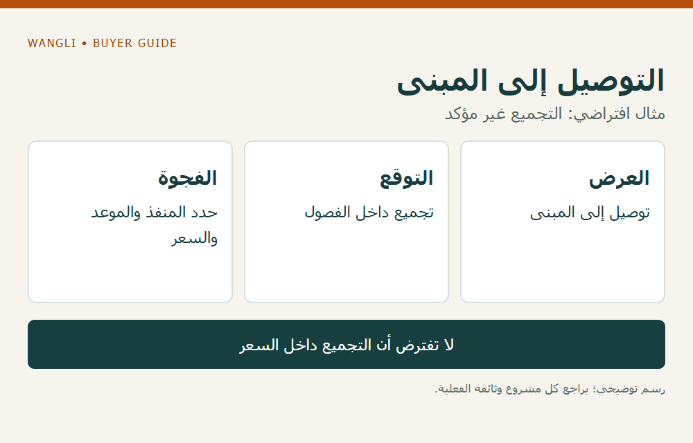

<!-- blog {"slug": "school-furniture-service-scope-allocation", "title": "توريد الأثاث المدرسي وتركيبه: كيف توزع المسؤوليات قبل إصدار الطلب؟", "seo_title": "نطاق توريد الأثاث وتركيبه | WangLi", "description": "حدد مسؤوليات توصيل الأثاث المدرسي وتجميعه وإزالة التغليف وفحص الإكمال قبل إصدار الطلب.", "category": "tenders", "published": "2026-11-13T00:35:44+08:00", "image": "/assets/school-furniture-service-scope-allocation-cover-20261113.png", "image_alt": "من ينفذ كل خطوة؟ — حدد نطاق خدمة الأثاث قبل إصدار الطلب", "image_caption": "من ينفذ كل خطوة؟ — حدد نطاق خدمة الأثاث قبل إصدار الطلب", "image_kind": "diagram", "image_width": 1000, "image_height": 640, "draft": false} -->

# توريد الأثاث المدرسي وتركيبه: كيف توزع المسؤوليات قبل إصدار الطلب؟

قد يستخدم الأطراف عبارة «توريد الأثاث» للدلالة على خدمات مختلفة. بالنسبة إلى شركة مشروع، الفارق بين وضع الصناديق عند المدخل وتجميع الأثاث وتوزيعه على الغرف وإزالة التغليف يؤثر في ترتيب الفرق والتكلفة والتسليم. اكتب حدود العمل والمسؤول عن كل خطوة قبل اعتماد الطلب بدل الاعتماد على كلمة واحدة.

## حدد ما يبدأ عنده عمل كل طرف وما ينتهي عنده

| النشاط | ما يوضحه الطلب |
|---|---|
| النقل والتفريغ | العنوان ونقطة التسليم والمسؤول عن التفريغ |
| النقل داخل المبنى | الوجهات والطوابق والمصاعد أو القيود المعلومة |
| التجميع | المنتجات المشمولة والأجزاء والأدوات ومسؤول العمل |
| التثبيت | الحاجة إلى التثبيت ومسؤول مراجعة الجدار والموافقات |
| التغليف | من يجمعه ومن ينقله ومتى |
| فحص الإكمال | المستند المطلوب والجهة التي تستلم العمل |

لا تفترض أن المصنع يقدم كل هذه الخدمات، أو أنها تدخل في السعر. قد يكون المورد مسؤولًا عن المنتج، بينما يتعاقد منفذ المشروع مع طرف آخر للعمل في الموقع؛ تبقى المسؤوليات والشروط خاضعة للعرض والعقد الفعليين.

توضح [صفحة إطار الأثاث والخدمات المرتبطة به في المملكة المتحدة](https://www.gca.gov.uk/agreements/RM6308) أن النطاق قد يشمل التوريد والتوصيل أو يشمل التركيب عند الحاجة. هذا مثال مؤسسي بريطاني لضرورة تحديد النطاق، وليس تعهدًا بأن WangLi يوفر هذه الخدمات أو قاعدة تطبق على جميع المدارس.

## افصل الأعمال المتصلة حتى لا تقع فجوة بينها

قد تتفق الأطراف على التوصيل إلى المدخل بينما تفترض المدرسة النقل إلى كل غرفة. اكتب أين تنتقل المسؤولية عن البضائع، ومن يبلغ الجهة التالية، وما الإثبات المطلوب عند التسليم. إذا طلب الموقع تثبيت خزائن، فراجع [تنسيق التثبيت مع الجدار](/blog/school-furniture-fixing-substrate-coordination/) مع مسؤول الموقع؛ لا تستنتج صلاحية الجدار أو الموافقة من رسم المنتج.

**مثال افتراضي:** يحتوي عرض على التوصيل إلى المبنى فقط، بينما تتوقع الجهة المستفيدة تجميع الطاولات في الفصول. ضع التجميع في سجل «غير مؤكد»، واطلب تحديد المنفذ والموعد والسعر قبل اعتماد الخطة. لا يعني المثال أن أيًا من الخدمات متاح من WangLi.

*مثال افتراضي؛ اضغط لتكبير الرسم.*

## اربط النطاق بالوقت والقبول

بعد تحديد المنفذين، اسأل عن احتياجات دخول الموقع والتوقيت والتنسيق، ثم راجع [خطة الدخول إلى الموقع](/blog/school-furniture-site-access-planning/). عندما ينتهي التركيب، افصل قائمة الأعمال المفتوحة عن إثبات إتمام الخطوات المتفق عليها، كما في [قائمة ملاحظات التركيب](/blog/school-furniture-installation-punch-list/). إذا اختلف العرض والعقد، اطلب توضيحًا مكتوبًا من الأطراف المؤهلة.

[تواصل مع WangLi](/request-a-quote/) وأرسل قائمة المنتجات والموقع والخدمات المطلوبة؛ يمكن للفريق توضيح نطاق العرض الذي يستطيع تأكيده للطلب المحدد.
