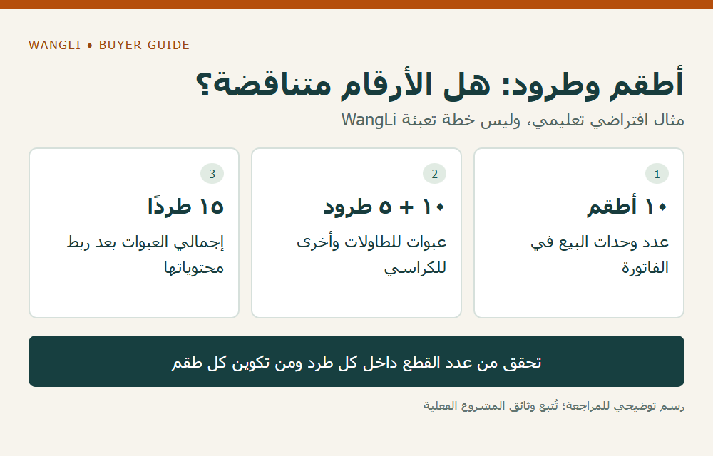

<!-- blog {"slug": "school-furniture-shipping-document-consistency", "title": "مستندات شحنة الأثاث المدرسي: كيف تراجع اتساق الفاتورة وقائمة التعبئة وبيانات النقل؟", "seo_title": "مستندات شحنة الأثاث: مراجعة الاتساق | WangLi", "description": "اربط بنود الفاتورة بوحدات البيع والعبوات وبيانات النقل، وراجع اختلاف الأرقام والأطراف وإصدارات المستندات قبل الشحن.", "category": "wholesale", "published": "2026-11-02T00:14:03+08:00", "image": "/assets/school-furniture-shipping-document-consistency-cover-20261102.png", "image_alt": "راجع وحدات مستندات الشحنة — اربط أرقام الوثائق بمعانيها قبل اعتمادها", "image_caption": "راجع وحدات مستندات الشحنة — اربط أرقام الوثائق بمعانيها قبل اعتمادها", "image_kind": "diagram", "image_width": 1000, "image_height": 640, "draft": false} -->

# مستندات شحنة الأثاث المدرسي: كيف تراجع اتساق الفاتورة وقائمة التعبئة وبيانات النقل؟

قد تكون كمية الأثاث صحيحة في الطلب، لكن المستندات تصفها بوحدات مختلفة: فاتورة بالأطقم، وقائمة تعبئة بالكراتين، وبيانات نقل بإجمالي الطرود. تحتاج شركة التوريد إلى ربط هذه المستويات قبل إصدار المستندات النهائية. المطلوب ليس جعل كل رقم متطابقًا شكليًا، بل تفسير العلاقة بين البنود والمنتجات والعبوات مع بقاء وظيفة كل وثيقة واضحة.

## حدد مستند الطلب الذي تجري المراجعة عليه

ابدأ بالقائمة المؤكدة للطلب أو الدفعة: رمز البند، والموديل، والتكوين، والكمية، ووحدة البيع، وإصدار المرجع. إذا كانت الدفعة جزءًا من عقد أكبر، اكتب ما تشمله هذه الشحنة وحدها. لا تقارن فاتورة لدفعة واحدة بإجمالي العقد ثم تعتبر الفرق نقصًا دون مراجعة نطاق المستندين.

تشرح [إرشادات التجارة الأمريكية عن مستندات التصدير](https://www.trade.gov/common-export-documents) اختلاف وظائف الفاتورة التجارية وقائمة التعبئة ومستند النقل، وتوصي ببدء تحديد المستندات المطلوبة مع المستورد أو وكيل الشحن. نستخدمها خلفية تنظيمية عامة؛ عدد النسخ واللغة والبيانات المطلوبة تعتمد على الشحنة والجهات المعنية، ولا يحدد هذا المقال متطلبات التخليص في بلدك.

## اربط وحدات البيع بالعبوات

اطلب قائمة تبين محتويات كل نوع طرد، وعدد الطرود، ورموزها أو علاماتها، وعلاقة مكوناتها ببنود الأثاث. إذا توزعت الطاولة والكرسي على عبوتين، فلا تسجل الكرتون بوصفه طقمًا دون هذا الربط. وإذا احتوت عبوة على قطع لموديلين، فيجب أن تكون حصة كل بند قابلة للتتبع.

| الحقل | مرجع المراجعة | معنى الاختلاف الذي يحتاج إلى تفسير |
|---|---|---|
| أسماء الأطراف وأدوارها | بيانات البيع والاستلام والنقل المؤكدة | اسم مختصر أو طرف مختلف بلا توضيح للدور |
| البند والموديل والكمية | الطلب الخاص بالشحنة | وصف عام لا يربط المنتج بالقائمة |
| وحدة العد | وحدة البيع ومحتويات العبوة | خلط الطقم بالقطعة أو الكرتون |
| عدد الطرود وعلاماتها | قائمة التعبئة | إجمالي في بيانات النقل لا يفسر تفاصيل العبوات |
| الوزن | الوزن الصافي والإجمالي ووحدتهما | رقم بلا تحديد ما يشمله |
| الوجهة والمراجع | تعليمات الشحنة والنسخ المؤكدة | بيانات قديمة بعد تغيير الدفعة |

لا تطلب نسخ الأسماء في جميع الخانات إذا كانت الأدوار مختلفة أصلًا؛ فالبائع والمستلم والشاحن قد لا يكونون الطرف نفسه. سجّل التفسير واطلب من مصدر المستند تصحيح الخطأ الفعلي. لا تغيّر مسودة صادرة عن طرف آخر ثم تعاملها كأنها نسخة أصدرها واعتمدها.

## مثال افتراضي يكشف فرقًا صحيحًا

افترض أن الطلب يضم عشرة أطقم، وأن بيان التعبئة المؤكد يضع الطاولات في عشر عبوات والكراسي في خمس عبوات. الفاتورة تسجل عشرة أطقم، بينما تسجل قائمة التعبئة خمسة عشر طردًا. الاختلاف ليس خطأً بذاته إذا كانت المحتويات والكميات والربط واضحة. أما إذا كان كل طقم يتضمن كرسيين، وورد في المستند عشرة كراسٍ فقط، فاطلب تفسير الفرق قبل الاعتماد. الأعداد تعليمية وليست خطة تعبئة لمنتج معين.

*رسم توضيحي: أطقم وطرود: هل الأرقام متناقضة؟ — مثال افتراضي تعليمي، وليس خطة تعبئة WangLi — اضغط لعرض الصورة بالحجم الكامل.*

## راجع المسودات ثم احتفظ بنسخة الإصدار

أنشئ سجل مراجعة يوضح الملف ورقمه وإصداره، والسؤال، وصاحب التصحيح، ومرجع النسخة التي حلت محله. بعد تغيير كمية أو تغليف، أخطر الأطراف المسؤولة عن الوثائق المتأثرة وفق مسار المشروع؛ تأكيد مستند واحد لا يثبت تحديث بقية الملفات تلقائيًا. اترك البيانات التقديرية معلنة حتى تصل المعلومة المطلوبة.

راجع [إعداد بيانات التعبئة](/blog/school-furniture-packing-data-freight-rfq/) و[توزيع كميات المواقع](/blog/school-furniture-multiple-site-distribution/) لربط الشحنة بالقائمة. أما [ملاحظات الاستلام](/blog/school-furniture-delivery-receiving-discrepancies/) فتخدم توثيق ما يظهر عند الوصول، ولا تعوض المراجعة السابقة. [أرسل استفسار توريد إلى WangLi](/request-a-quote/) مع قائمة الطلب ووجهته وأسماء المستندات التي تريد التأكد من إمكان توفيرها؛ لا يفترض هذا المقال إصدار وثيقة أو قبول جهة لها قبل التأكيد.
