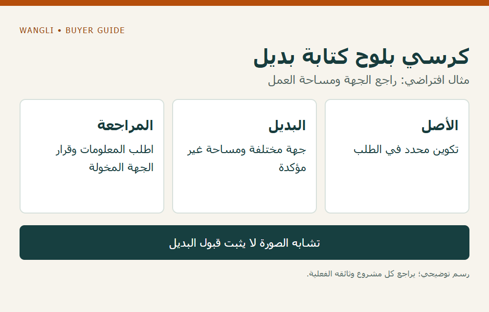

<!-- blog {"slug": "school-furniture-substitution-approval", "title": "بديل الأثاث المدرسي بعد الطلب: كيف تراجع التغيير قبل قبول موديل آخر؟", "seo_title": "بديل الأثاث المدرسي: مراجعة التغيير | WangLi", "description": "قارن البديل بالطلب الأصلي، وراجع المقاس والأدلة والسعر والجهة المخولة قبل قبول تغيير موديل الأثاث المدرسي.", "category": "tenders", "published": "2026-11-13T00:27:06+08:00", "image": "/assets/school-furniture-substitution-approval-cover-20261113.png", "image_alt": "قبل قبول موديل بديل — افصل الاقتراح عن قرار المشروع", "image_caption": "قبل قبول موديل بديل — افصل الاقتراح عن قرار المشروع", "image_kind": "diagram", "image_width": 1000, "image_height": 640, "draft": false} -->

# بديل الأثاث المدرسي بعد الطلب: كيف تراجع التغيير قبل قبول موديل آخر؟

عندما يتعذر توفير التكوين المدرج في طلب الأثاث، قد يقترح المورد موديلًا بديلًا. تشابه الصورة أو الاسم لا يكفي لنقل قرار الشراء إلى منتج آخر. يحتاج الموزع أو شركة توريد المشروع إلى تعريف ما تغير، والتحقق من أثره في متطلبات المدرسة والعرض والوثائق، ثم الحصول على قرار الجهة المخولة قبل التعامل مع البديل بوصفه مقبولًا.

## ثبّت مرجع الطلب أولًا

اجمع رمز الموديل الأصلي وإصدار الرسم والمقاس والمواد والملحقات والكمية والموقع المقصود. أرفق مرجع أمر الشراء أو القائمة التي يعمل عليها الأطراف. إذا كانت المواصفات موزعة على ملاحق، سجل المرجع الساري لكل بند؛ لا تقارن البديل بعنوان منتج مختصر فقط.

تطلب [وثائق شراء أثاث تعليمي صادرة عن OECM في كندا](https://oecm.ca/wp-content/uploads/2023/03/EduFurn-410-RFP.pdf) موافقة مسبقة من الموظفين المحددين لدى المشتري قبل استبدال المنتجات في ذلك الإجراء. هذا مثال على فصل الاقتراح عن القرار، لا شرطًا عامًا لكل العقود ولا سياسة بيع من WangLi. راجع العقد والجهة المخولة في مشروعك.

## حوّل المقترح إلى مقارنة قابلة للمراجعة

اطلب من المورد قائمة للفروق المعلومة والمعلومات التي لم يؤكدها بعد، مع رسم ودليل يخصان التكوين البديل نفسه. لا تنقل تقرير اختبار أو وصف مادة من المنتج الأصلي تلقائيًا. وقد تكون بعض الفروق مهمة للمستخدم أو الموقع رغم أن الوظيفة العامة متشابهة.

| جانب المقارنة | المنتج الأصلي | ما يراجع في البديل |
|---|---|---|
| الهوية | الرمز وإصدار الرسم | الرمز والتكوين والنسخة المقترحة |
| الاستخدام والمقاس | احتياجات المدرسة المعتمدة | الأبعاد ونقاط القياس والأثر على المستخدم |
| المادة والملحقات | ما ينص عليه الطلب | الفروق وما يشمله العرض الجديد |
| الإثبات | المستند المطلوب ونطاقه | دليل مربوط بالبديل وحدوده |
| السعر والموعد | شروط الطلب أو العرض | أثر التغيير كما تؤكده الأطراف |
| الموقع والتسليم | الغرف والكميات وحالة التوريد | ما يتغير في التعبئة أو التوزيع |

إذا غاب دليل لمتطلب معين، اتركه سؤالًا مفتوحًا. وإذا احتاج الفرق إلى تقييم فني أو تنظيمي، أحله إلى مختص المشروع؛ لا يستنتج المورد أو الموزع قبولًا نهائيًا من جدول المقارنة وحده.

## افصل رد المورد عن قرار المشتري

سجّل تاريخ الاقتراح ومصدره، ثم الأسئلة وردودها وقرار الجهة المخولة والنطاق الذي يغطيه. لا يعني إرسال عينة أو رسم أن المدرسة قبلت التغيير، كما لا يعني موافقة على لون البديل قبول مقاسه أو شروطه الأخرى. اتبع آلية التغيير في وثائق الطلب؛ إذا لم تكن واضحة فاطلب توضيحها قبل تعديل القائمة أو إصدار التزام جديد.

**مثال افتراضي:** يحتاج المشروع إلى كرسي بلوح كتابة، ويقترح المورد موديلًا آخر بصورة مشابهة. يبين الرسم الجديد أن جهة اللوح مختلفة، بينما لم تتأكد مساحة العمل. تبقى مراجعة الجهة والمساحة مفتوحة حتى يصل الرد ويصدر قرار المشروع. المثال لا يصف طلبًا حقيقيًا أو خيارًا مؤكدًا لدى WangLi.

*مثال افتراضي؛ اضغط لتكبير الرسم.*

## حدّث ما يتأثر بعد القرار

عند قبول تغيير محدد، اربط نسخته بقائمة الكميات والوجهات وسجل المستندات وعرض السعر المتفق عليه. وعند رفضه، احتفظ بسبب الرفض واطلب معالجة أخرى وفق الاتفاق. إذا تغير المقترح مرة ثانية، راجع القرار السابق وحدوده بدل افتراض أنه يغطي كل نسخة لاحقة.

يساعد [دليل عينة المناقصة](/blog/school-furniture-tender-evaluation-samples/) على تحديد غرض العينة، و[دليل لوح كتابة كرسي المحاضرات](/blog/lecture-chair-writing-tablet-selection/) على تسمية جهة اللوح ومساحة العمل، و[جدول توزيع الأثاث على المواقع](/blog/school-furniture-multiple-site-distribution/) على حفظ أثر القرار في الكميات. ثم [أرسل استفسارًا إلى WangLi](/request-a-quote/) يتضمن مرجع المنتج الأصلي والكمية والفروق والأسئلة المفتوحة؛ توفر البديل وشروطه يحتاجان إلى رد خاص بالطلب.
