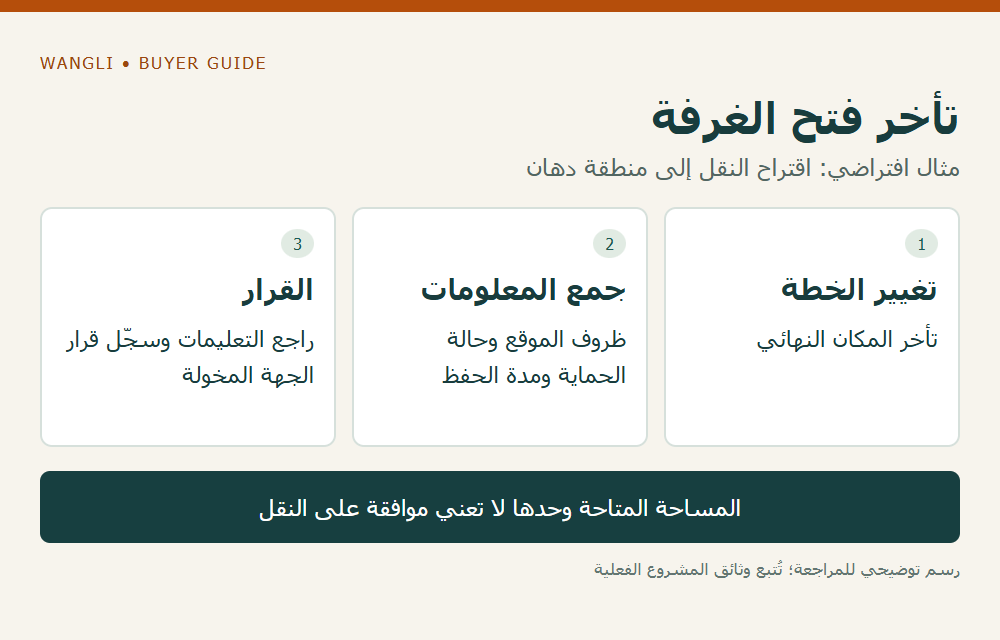

<!-- blog {"slug": "school-furniture-temporary-storage-custody", "title": "تخزين الأثاث المدرسي قبل الاستخدام: ما الذي تحدده بين الوصول وفتح الغرف؟", "seo_title": "حفظ الأثاث المدرسي قبل الاستخدام | WangLi", "description": "نظم موقع الحفظ المؤقت وحالة التغليف وتعليمات الموديل ومسؤول المتابعة بين وصول الأثاث وبدء استخدام الغرف.", "category": "tenders", "published": "2026-11-02T00:17:05+08:00", "image": "/assets/school-furniture-temporary-storage-custody-cover-20261102.png", "image_alt": "من يتابع الأثاث قبل الاستخدام؟ — خطة الحفظ تبدأ بعد الوصول", "image_caption": "من يتابع الأثاث قبل الاستخدام؟ — خطة الحفظ تبدأ بعد الوصول", "image_kind": "diagram", "image_width": 1000, "image_height": 640, "draft": false} -->

# تخزين الأثاث المدرسي قبل الاستخدام: ما الذي تحدده بين الوصول وفتح الغرف؟

قد تكون دفعة الأثاث في المدرسة بينما لا تزال بعض الغرف تحت التجهيز. في هذه الفترة لا تكفي عبارة «ضعوها في المستودع» لتحديد ظروف الحفظ أو الجهة التي تتابعها. تحتاج شركة توريد المشروع إلى خطة حيازة مؤقتة توضح مكان كل مجموعة، وحالة تغليفها، وتعليمات الموديل، ومسؤولية المتابعة، قبل تحريك الأثاث إلى الاستخدام النهائي.

## افصل خطة الحفظ عن قرار إطلاق الشحنة

يحدد [دليل ربط الدفعات بجاهزية المدرسة](/blog/school-furniture-site-readiness-delivery-phases/) متى يسمح المشروع بإطلاق التوريد. أما هنا فالسؤال عن إدارة الفترة بعد الوصول وقبل الاستخدام. لا يعني وجود مكان فارغ أنه مناسب للحفظ، ولا أن قبول طرف نقل الأثاث إليه يثبت موافقة المصنع على ظروفه.

حدد تاريخ بدء التخزين المتوقع ونهايته والمكان البديل إذا تغيرت الخطة. واطلب من الطرف المسؤول تأكيد إمكان الحفظ ونطاقه وتكلفته إن كانت خدمة منفصلة؛ لا تفترض أن المورد يوفر مستودعًا أو أن التخزين مجاني أو مشمول في سعر الأثاث.

## اطلب شروط الموديل ولا تنقل أرقامًا عامة

اجمع تعليمات التخزين للمنتج في حالته المشحونة: العبوة أو المكونات أو القطعة المركبة، وأي قيود يحددها المصنع للموقع أو التغليف أو المدة. إذا كانت المعلومة ناقصة، اطلبها قبل اعتماد المكان. لا تستنتج قدرة الكرتون على تحمل الرطوبة أو التكديس من مظهره.

تتضمن [ورقة منتج منشورة من Norix](https://norix.com/wp-content/uploads/2020/11/ATN250-Attenda-Nightstand-3.pdf) توصية خاصة بحفظ المنتج قبل التركيب في بيئة مماثلة لمكان استخدامه. هي ورقة لذلك المنتج ومؤرخة عام 2021؛ لا ننقل أرقامها أو شروط ضمانها إلى أثاث WangLi. فائدتها هنا أن ظروف الحفظ سؤال مرتبط بالمنتج وليس افتراضًا موحدًا لجميع الأثاث.

## راجع الموقع مع صاحب المسؤولية

اطلب من جهة المدرسة أو المقاول وصف المكان وحالته وأعمال البناء الجارية بالقرب منه وإمكان الوصول إليه. تُراجع صلاحية الموقع والأرضية ومسارات الحركة لدى المختصين بالمشروع. لا يقدم هذا المقال حدود تحميل أو ارتفاع تكديس أو طريقة رفع؛ تلك معلومات تحتاج إلى تعليمات المنتج وتقييم المكان.

| موضوع التسليم المؤقت | ما يسجل | ما يحتاج إلى رد |
|---|---|---|
| المجموعة | رمز الطلب والموديل والعبوات | هل الهوية والعدد مؤكدان؟ |
| الموقع | المبنى والمنطقة ومكان الحفظ | هل راجعه المسؤول المخول؟ |
| حالة الحماية | مغلف أو مفتوح ومرجع التعليمات | هل تتوافق الحالة مع خطة الحفظ؟ |
| المتابعة | الجهة المسؤولة وتواتر المراجعة المتفق عليه | من يتلقى الملاحظة ويقرر الإجراء؟ |
| الخروج للاستخدام | الجهة التي تطلب النقل وتستلم | هل يلزم فحص أو مراجعة قبل الاستخدام؟ |

## وثّق التغيير أثناء الحفظ

في مثال افتراضي، تتأخر الغرفة النهائية، ويقترح الموقع نقل الأثاث إلى منطقة تُجرى فيها أعمال دهان. لا تعتمد النقل لأن المساحة متاحة فقط؛ اطلب مراجعة شروط المكان والحماية وأثر تغيير المدة، ثم سجّل القرار. لا يثبت المثال وقوع ضرر أو أن حلًا معينًا مناسب لكل موقع.

*رسم توضيحي: تأخر فتح الغرفة — مثال افتراضي: اقتراح النقل إلى منطقة دهان — اضغط لعرض الصورة بالحجم الكامل.*

إذا ظهرت ملاحظة على عبوة أو محتوى، سجل ما شوهد ووقت الملاحظة وموقع المجموعة، ثم اتبع آلية الإبلاغ المتفق عليها. استخدم [دليل ملاحظات الاستلام](/blog/school-furniture-delivery-receiving-discrepancies/) لوصف الحالة دون افتراض سبب الضرر أو المسؤولية. وعندما تصبح الغرف جاهزة، احفظ مرجع انتقال الحيازة والمراجعات المطلوبة، ولا تجعل مجرد نقل القطع إغلاقًا تلقائيًا للأسئلة المفتوحة.

[أرسل استفسارًا إلى WangLi](/request-a-quote/) يتضمن الموديلات وحالة الشحن وفترة التخزين المتوقعة ووصف الموقع، واطلب تعليمات الحفظ الخاصة بالتكوين وأي شروط تحتاج إلى توضيح. تبقى خدمات التخزين والمناولة ومسؤولياتها مرتبطة بالاتفاق الفعلي.
