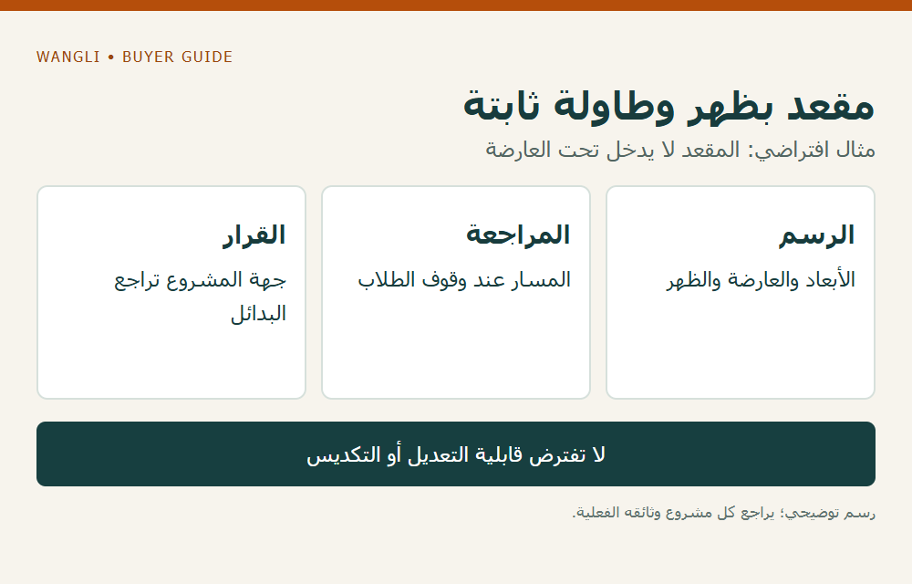

<!-- blog {"slug": "school-lab-stool-bench-matching", "title": "مقاعد المختبر المدرسي: كيف تطابق المقعد مع طاولة التجارب ومسار الحركة؟", "seo_title": "مقاعد المختبر وطاولة التجارب | WangLi", "description": "راجع ارتفاع المقعد والطاولة ومسند القدم ومكان المقعد عند الوقوف.", "category": "tenders", "published": "2026-11-14T00:13:32+08:00", "image": "/assets/school-lab-stool-bench-matching-cover-20261114.png", "image_alt": "مقعد المختبر والطاولة — راجع الجلوس ومكان المقعد عند الوقوف", "image_caption": "مقعد المختبر والطاولة — راجع الجلوس ومكان المقعد عند الوقوف", "image_kind": "diagram", "image_width": 1000, "image_height": 640, "draft": false} -->

# مقاعد المختبر المدرسي: كيف تطابق المقعد مع طاولة التجارب ومسار الحركة؟

عند شراء مقاعد للمختبر، لا يكفي أن يبدو المقعد مناسبًا بجوار طاولة التجارب في الصورة. تحتاج شركة توريد المشروع إلى مطابقة ارتفاع المقعد مع مساحة الأرجل واستخدام الطلاب، ثم مراجعة مكان المقعد عندما يقف المستخدمون للعمل. لا يُعتمد التكوين قبل مراجعة المختص والجهة المسؤولة عن المختبر.

## ابدأ بحالتين: الجلوس والعمل واقفًا

اسأل المدرسة عن الأنشطة التي تُنفذ جلوسًا، ومتى يحتاج الطلاب إلى الوقوف، وعدد المستخدمين في كل طاولة. اطلب مخطط الطاولات والخدمات الثابتة والممرات، وحدد أين ستوضع المقاعد في كل حالة. قد تؤثر أرجل الطاولة أو العوارض أو التخزين الموجود تحتها في المساحة المتاحة للمستخدم أو للمقعد.

تربط [إرشادات اختيار مقاعد المختبر بجامعة كوينزلاند](https://policies.uq.edu.au/document/view-current.php?id=419&version=1) اختيار المقعد بنوع العمل ومدته، وتناقش حيز الأرجل ودعم القدمين. هذه إرشادات لجامعة أسترالية، وليست مواصفة موحدة للمدارس أو دليلًا على أن موديل WangLi يحققها؛ تحدد المدرسة ومختص المشروع متطلبات المستخدمين الفعليين.

## اطلب رسومات للمقعد والطاولة معًا

| موضع المراجعة | ما يطلب من جهة المشروع | ما يطلب من المورد |
|---|---|---|
| الجلوس | المستخدمون ونوع المهمة | ارتفاع المقعد وأبعاد تكوينه |
| المساحة تحت الطاولة | الرسم والقيود القائمة | مواضع الأرجل والعوارض والأبعاد الصافية |
| القدم والدعم | ما يحتاج إليه المستخدم | تفاصيل أي مسند مشمول ومدى ضبطه إن وجد |
| العمل واقفًا | الممرات ومكان المقعد | أبعاد المقعد عند تحريكه أو تخزينه |
| التنظيف | المواد والإجراءات المقررة | تعليمات العناية للمواد المؤكدة |

لا تفترض أن المقعد قابل للتعديل أو التكديس، أو أن مسند القدم متاح لموديل ما، دون رد يخصه. إذا اقترحت آلية تعديل، اطلب تعليمات تشغيلها ومراجعة ملاءمتها للمستخدمين؛ لا تستنتج سلامتها من الصورة.

## مثال افتراضي: مقعد ذو ظهر قرب طاولة ثابتة

يظهر في رسم مقترح مقعد بظهر لا يدخل كاملًا تحت العارضة. قبل اعتماد الكمية، يراجع الفريق مكانه حين يقف الطلاب وما إذا كان يعيق المسار، ثم يقارن رسم المقعد بمخطط الموقع. المثال ليس وصفًا لمنتج محدد ولا يثبت ملاءمة أي بديل.

*مثال افتراضي؛ اضغط لتكبير الرسم.*

## حافظ على حدود قرار المورد

استخدم [دليل نطاق المختبر](/blog/school-laboratory-furniture-scope/) لفصل الأثاث عن الخدمات، و[دليل مقاسات الطاولات والكراسي](/blog/school-desk-chair-size-quantity-planning/) لتنظيم بيانات المقاسات، و[دليل تجهيز الممرات والموقع](/blog/school-furniture-site-access-planning/) لتوضيح قيود الدخول. يعتمد فريق المشروع ترتيب الاستخدام والسلامة النهائي.

[أرسل استفسارًا إلى WangLi](/request-a-quote/) مع رسم الطاولة وارتفاعاتها وعدد المقاعد والاستخدام المطلوب، حتى يؤكد الفريق بيانات الموديلات التي يمكن مناقشتها للطلب.
