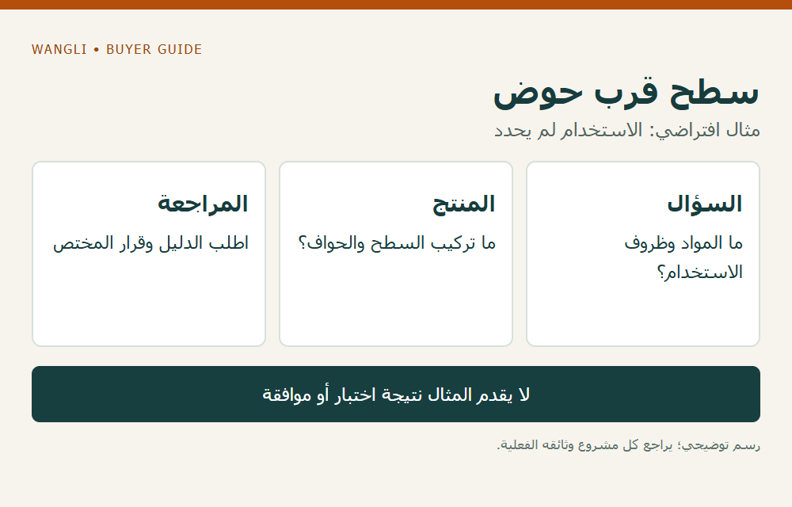

<!-- blog {"slug": "school-lab-worktop-chemical-evidence", "title": "سطح طاولة المختبر المدرسي: كيف تطلب دليل ملاءمته للمواد المستخدمة؟", "seo_title": "سطح طاولة المختبر ودليل الملاءمة | WangLi", "description": "حدد استخدام المختبر واطلب دليل السطح وحدود الاختبار للتكوين المقترح.", "category": "tenders", "published": "2026-11-14T00:13:02+08:00", "image": "/assets/school-lab-worktop-chemical-evidence-cover-20261114.png", "image_alt": "دليل سطح المختبر — اربط الاستخدام بالمادة والدليل المحدد", "image_caption": "دليل سطح المختبر — اربط الاستخدام بالمادة والدليل المحدد", "image_kind": "diagram", "image_width": 1000, "image_height": 640, "draft": false} -->

# سطح طاولة المختبر المدرسي: كيف تطلب دليل ملاءمته للمواد المستخدمة؟

قد يطلب مشروع مدرسي سطحًا «مقاومًا للمواد الكيميائية»، لكن هذه العبارة لا تحدد المواد أو ظروف الاستخدام أو طريقة إثبات الأداء. قبل مقارنة عرضي أثاث، تحتاج شركة التوريد إلى قائمة استعمال يضعها مسؤول المختبر، ثم تربط كل ادعاء أو تقرير بالتكوين المقترح وحدود الاختبار.

## اجمع سيناريوهات الاستخدام من المختص

اطلب من مسؤول المختبر بيان الأنشطة والمواد المنظفة أو المستخدمة، واحتمال الانسكاب وطريقة التعامل معه، والحاجة إلى الماء أو الحرارة وفق خطة المدرسة. لا تطلب من المعلم أو المورد تجربة مادة خطرة على السطح. إذا لم تكن القائمة معروفة، ضع الأداء المطلوب قيد التحديد بدل اختيار مادة من الاسم التجاري فقط.

يذكر [دليل تصميم مختبرات جامعة ييل](https://facilities.yale.edu/sites/default/files/files/Design%20Standards/Updated%20Design%20Standards/12%20Furnishings/12%2024%205%20Laboratory%20Casework.pdf) أن اختيار سطح المختبر يرتبط بالاستخدام وتقييم المواد الكيميائية. هذا مثال جامعي أمريكي، لا مواصفة جاهزة لكل مدرسة أو إثبات ملاءمة منتج WangLi؛ يحدد مختص المشروع احتياجاته ومتطلباته المعمول بها.

## طابق المستند بالتكوين الفعلي

| بيان | ما يحتاج إلى توضيح |
|---|---|
| السطح | اسم المادة والتركيب ورمز المنتج وإصدار الرسم |
| الاستخدام | المواد والأنشطة والظروف التي يحددها المختص |
| الدليل | ما اختُبر بالفعل وطريقته ونتيجته وحدوده |
| الحواف والوصلات | تفاصيل الأجزاء المكشوفة ومناطق القطع |
| العناية | تعليمات المصنع للمنتج المحدد وحدودها |

لا يعني تقرير لمادة أو لون آخر بالضرورة أنه يغطي السطح المقترح، ولا يعني اجتياز اختبار واحد مقاومة كل المواد وفي كل الظروف. اطلب من الجهة الفنية مقارنة دليل المورد بمتطلبات المشروع، وحافظ على البنود غير المؤكدة مفتوحة.

## مثال افتراضي قبل التسعير

يريد المشروع طاولة قرب حوض ومادة سطح يُقال إنها مقاومة للسوائل. لم يحدد وصف الطلب المواد أو مناطق الفتحات. قبل اعتماد العرض، يطلب المورد من المشروع قائمة الاستخدام، ويسأل عن تركيب السطح والحواف ودليل الأداء وتعليمات العناية للتكوين المعروض. لا يقدم المثال نتيجة اختبار أو شهادة أو موافقة لمنتج محدد.

*مثال افتراضي؛ اضغط لتكبير الرسم.*

## افصل السطح عن خدمات المختبر

راجع [حدود تجهيز المختبر المدرسي](/blog/school-laboratory-furniture-scope/) لتحديد ما إذا كانت الأحواض والخدمات ضمن النطاق، و[تركيب حواف الطاولات](/blog/school-desk-edge-core-construction/) لفهم أسئلة الحافة والفتحات، و[توافق التنظيف](/blog/school-furniture-cleaning-compatibility/) لربط مواد العناية بالسطح الفعلي. يتولى المختص اعتماد الاختيار ومراجعة السلامة؛ لا تحل هذه القائمة محل ذلك القرار.

[أرسل استفسارًا إلى WangLi](/request-a-quote/) يتضمن الاستخدام الذي حددته المدرسة وأبعاد السطح والكمية والوثائق المطلوبة، ليؤكد الفريق إمكان تقديم بيانات للتكوين المطلوب.
