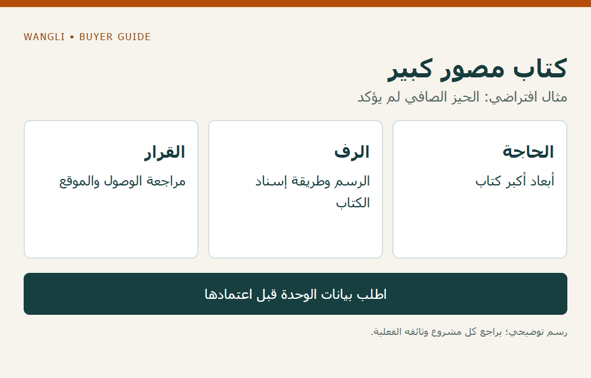

<!-- blog {"slug": "school-library-face-out-book-display", "title": "عرض كتب الأطفال في المكتبة المدرسية: كيف تحدد الرفوف قبل طلب العرض؟", "seo_title": "عرض كتب الأطفال في المكتبة المدرسية | WangLi", "description": "حدد طريقة عرض الكتب وأبعادها ووصول المستخدمين وتكوين الرف قبل طلب العرض.", "category": "tenders", "published": "2026-11-15T11:30:49+08:00", "image": "/assets/school-library-face-out-book-display-cover-20261115.png", "image_alt": "عرض أغلفة كتب الأطفال — حدد المواد والرف وطريقة وصول المستخدم", "image_caption": "عرض أغلفة كتب الأطفال — حدد المواد والرف وطريقة وصول المستخدم", "image_kind": "diagram", "image_width": 1000, "image_height": 640, "draft": false} -->

# عرض كتب الأطفال في المكتبة المدرسية: كيف تحدد الرفوف قبل طلب العرض؟

قد يريد مشروع مكتبة مدرسية عرض بعض أغلفة كتب الأطفال إلى الأمام بدل وضع جميع الكتب جنبًا إلى جنب. يختلف سؤال العرض عن حساب الطول الإجمالي للرفوف: يحتاج موزع الأثاث أو شركة المشروع إلى معرفة ما سيعرض، وكيف يصل إليه الطفل، وما الذي ستفعله الجهة بالكتب المتبقية. يحدد المشروع التكوين المقبول بعد مراجعة الأبعاد والحمولة والسلامة.

## افصل العرض عن التخزين الأساسي

اطلب من أمين المكتبة وصف المجموعات وعدد الكتب التي يرغب في عرض أغلفتها، وأبعاد أكبر كتاب والموضع المطلوب لكل فئة. اكتب عدد الكتب المرئي المطلوب بوصفه حاجة يحددها المشروع، وليس سعة مؤكدة في منتج لم يُراجع. لا تتوقع أن عرض الغلاف يناسب جميع الكتب أو أن الرف المائل متوفر في كل وحدة.

تعرض [مطوية خدمة المكتبات المدرسية في كمبريا](https://elibrary.cumbria.gov.uk/elibrary/Content/Internet/542/827/43692123030.PDF) أمثلة لرفوف عرض أغلفة في مكتبات مدارس بريطانية. إنها مادة خدمة تاريخية وصورها تخص أصحابها؛ نستخدمها لتوضيح وجود طريقة عرض، لا لإثبات نتائج تعليمية أو مشروع نفذته WangLi.

## اطلب تفاصيل التكوين

| سؤال المشروع | المعلومات التي تحتاجها للمقارنة |
|---|---|
| ما حجم الكتب؟ | ارتفاعها وعرضها وعمقها، والحيز الصافي في الرف |
| كيف توضع؟ | رسم يبين موضع الكتاب وحافة الرف وطريقة إسناده |
| من يصل إليها؟ | ارتفاع الوصول الذي تحدده الجهة المختصة وموقع الوحدة |
| ما كمية المواد؟ | عدد العرض والكتب التي تخزن منفصلة والحمولة المطلوبة |
| كيف تثبت الوحدة؟ | رسم الموقع والتعليمات والمراجعة المختصة عند الحاجة |

اطلب بيانات الموديل والرف والملحقات من المورد، مع توضيح ما يشمله العرض. لا تستنتج قابلية تعديل الميل أو حمولة الرف أو وجود حافة مانعة للسقوط من صورة عامة. تراجع المدرسة مسارات الحركة واستقرار الوحدة وفق تعليمات المنتج ومتطلبات المشروع.

## مثال افتراضي: كتب مصورة كبيرة

تريد مكتبة عرض كتب مصورة بعضها أعلى من الكتب العادية، بينما لا يحدد الرسم الحيز الصافي. تطلب الشركة أبعاد أكبر كتاب ورسم الرف وتفاصيل إسناد الكتاب، ثم يراجع المختص الوصول والموضع. المثال لا يصف طلبًا فعليًا أو يؤكد توفر وحدة محددة.

*مثال افتراضي؛ اضغط لتكبير الرسم.*

## اربط العرض بقائمة المكتبة

راجع [تحديد مساحة الكتب وحمولة الرف](/blog/school-library-bookshelf-procurement/) لحساب التخزين، و[تخطيط طاولات القراءة والضوء](/blog/school-library-study-table-glare-planning/) لترتيب المنطقة، و[تنسيق تثبيت الأثاث بالموقع](/blog/school-furniture-fixing-substrate-coordination/) إذا احتاج التكوين إلى تثبيت.

[أرسل استفسارًا إلى WangLi](/request-a-quote/) يتضمن صورة أو مرجع الوحدة وأبعاد المواد وعدد الوحدات والموقع والبيانات المطلوبة؛ يؤكد الفريق التكوين المتاح لكل طلب.
