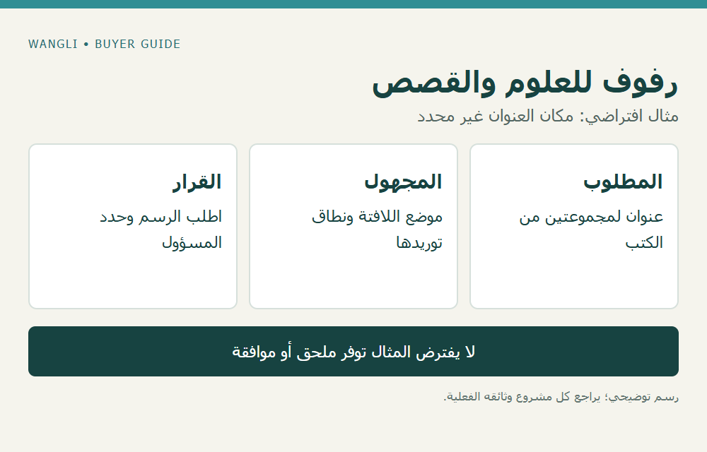

<!-- blog {"slug": "school-library-shelf-category-signs", "title": "لافتات رفوف مكتبة المدرسة: كيف تربط التصنيف بموقع الرف قبل توريد الأثاث؟", "seo_title": "لافتات رفوف مكتبة المدرسة | WangLi", "description": "اربط تصنيف الكتب وموقع الرف بمسؤولية إعداد اللافتات قبل طلب الأثاث.", "category": "specifications", "published": "2026-11-21T16:10:00+08:00", "image": "/assets/school-library-shelf-category-signs-cover-20261121.png", "image_alt": "لافتات رفوف المكتبة — اربط عنوان القسم بموقع الكتب قبل التوريد", "image_caption": "لافتات رفوف المكتبة — اربط عنوان القسم بموقع الكتب قبل التوريد", "image_kind": "diagram", "image_width": 1000, "image_height": 640, "draft": false} -->

# لافتات رفوف مكتبة المدرسة: كيف تربط التصنيف بموقع الرف قبل توريد الأثاث؟

قد تضم قائمة تجهيز مكتبة مدرسية عددًا من وحدات الرفوف، لكنها لا توضح كيف سيعرف القارئ موضع مجموعة الكتب أو من سيجهز علامات الأقسام. يحتاج موزع الأثاث أو مورد المشروع إلى جمع نظام التصنيف ومخطط الرفوف ومعلومات اللافتات، ثم فصل ما يشمله عرض الأثاث عما ستعده المدرسة أو طرف آخر.

## ابدأ بقائمة مجموعات الكتب والمستخدمين

اطلب من مسؤول المكتبة وصف مجموعات الكتب وطريقة تنظيمها واللغات التي ستستخدم في اللافتات، مع مخطط مواقع الرفوف. راجع احتياجات الطلاب والمعلمين وطريقة وصولهم إلى المعلومات مع الجهة المختصة. لا تطلب أسماء الطلاب أو بياناتهم الصحية لإعداد عرض الأثاث.

تشير [سياسة مكتبات كوفنتري البريطانية](https://www.coventry.gov.uk/libraries-1/library-policies/2) إلى استخدام العلامات الإرشادية لإبراز أقسام المكتبة وتسهيل الوصول إلى المواد. هذه سياسة لمكتبات عامة في بريطانيا، وليست متطلبًا لكل مدرسة أو دليلًا على أن WangLi توفر علامات معينة.

## افصل عنوان القسم عن رقم الوحدة

| ما تحدده المدرسة | السؤال قبل التوريد | ما يبقى مفتوحًا |
|---|---|---|
| مجموعات الكتب | أين تقع كل مجموعة على المخطط؟ | تغييرات الترتيب قبل الافتتاح |
| عنوان القسم | أين سيظهر ومن سيعد النص؟ | اللغة والحجم واعتماد المحتوى |
| وحدة الرف | هل يحدد الرسم موضع علامة أو حامل؟ | توافق الملحق مع الموديل |
| التغيير لاحقًا | هل يحتاج المشروع إلى استبدال النص؟ | طريقة الاستبدال المتاحة فعليًا |
| نطاق الطلب | هل العلامة والحامل بند مستقل؟ | السعر والتوفر ومسؤولية التركيب |

رقم الأصل أو رمز الوحدة يساعد على تتبع الأثاث، لكنه لا يخبر القارئ تلقائيًا بمحتوى الكتب. لا تفترض أن حاملًا أو ملصقًا داخل عرض الرف لمجرد ظهوره في صورة، ولا تقترح تثبيت جزء إضافي من دون مراجعة تعليمات الموديل ومسؤول الموقع.

## راجع الخريطة مع أمين المكتبة

أنشئ جدولًا يربط عنوان القسم برمز الوحدة والرف والموقع على المخطط. حدد أين ستكون العلامة مرئية للمستخدمين في الترتيب المقترح، ومن يراجع النص وتحديثه إذا تغيرت المجموعات. عند وجود احتياجات وصول أو رؤية مختلفة، يحدد المختص متطلبات المشروع؛ لا يحدد هذا الدليل ارتفاعًا أو حجم خط عامًا.

**مثال افتراضي:** يريد المشروع تخصيص رفوف للعلوم والقصص، لكنه لم يحدد ما إذا كانت العناوين على نهاية الوحدة أم على كل رف. يسجل المورد السؤال ويطلب الرسم والمواد والمسؤول عن إعداد العلامات. تبقى الملحقات والتكوين غير مؤكدة حتى يصل رد واضح وتراجعه الجهة المخولة.

*مثال افتراضي؛ اضغط لتكبير الرسم.*

## جهز قائمة الرفوف واللافتات

راجع [دليل شراء رفوف المكتبة](/blog/school-library-bookshelf-procurement/) للأبعاد والحمولة، و[عرض الكتب بواجهاتها](/blog/school-library-face-out-book-display/) لقرار العرض، و[ترميز أصول الأثاث](/blog/school-furniture-asset-tags-handover/) للتمييز بين رقم الأصل وعنوان الكتب.

[أرسل استفسارًا إلى WangLi](/request-a-quote/) مع مخطط المكتبة وعدد وحدات الرفوف والموديلات المرجعية والأسئلة عن موضع اللافتات ومكونات العرض؛ يتطلب توافر الملحقات تأكيدًا للطلب نفسه.
