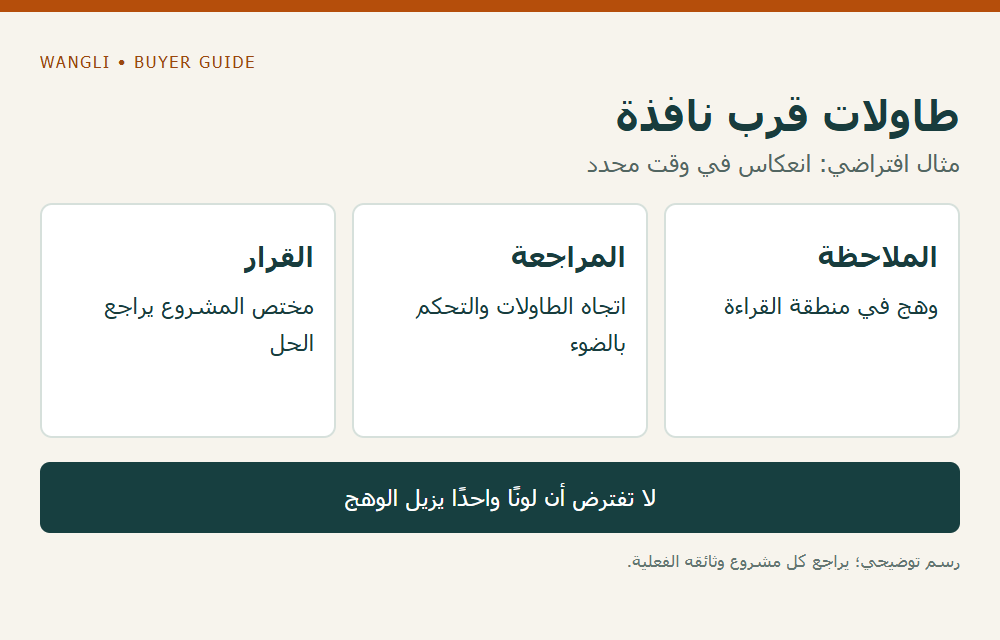

<!-- blog {"slug": "school-library-study-table-glare-planning", "title": "طاولات المكتبة المدرسية والوهج: ما الذي يراجعه المورد قبل اعتماد الترتيب؟", "seo_title": "طاولات المكتبة المدرسية والوهج | WangLi", "description": "حدد مواضع الضوء والطاولات واطلب بيانات التشطيب مع مراجعة مختص الإضاءة.", "category": "tenders", "published": "2026-11-14T00:10:37+08:00", "image": "/assets/school-library-study-table-glare-planning-cover-20261114.png", "image_alt": "طاولات المكتبة والوهج — راجع الضوء والموضع قبل اعتماد الطلب", "image_caption": "طاولات المكتبة والوهج — راجع الضوء والموضع قبل اعتماد الطلب", "image_kind": "diagram", "image_width": 1000, "image_height": 640, "draft": false} -->

# طاولات المكتبة المدرسية والوهج: ما الذي يراجعه المورد قبل اعتماد الترتيب؟

قد تحتاج المدرسة إلى طاولات قراءة قرب النوافذ أو الشاشات، لكن المخطط الذي يتسع للأثاث لا يوضح وحده ما سيراه الطالب على سطح العمل. يحتاج مورد المشروع إلى تنسيق مواضع الطاولات مع الإضاءة واتجاه النظر، دون أن يعد بأن لون سطح معين سيزيل الوهج أو يستبدل تصميم الإضاءة.

## ابدأ برسم الاستخدام ومصادر الضوء

اطلب مخطط المكتبة ومواضع النوافذ والإنارة والشاشات ومسارات الحركة، مع توضيح مناطق القراءة الفردية والعمل الجماعي. سجّل فترات الاستخدام، وهل يمكن تعديل موضع الطاولات أو الشاشات وفق جهة المشروع. إذا لم تتوفر تلك المعلومات، ضعها في قائمة مفتوحة بدل تحديد ترتيب نهائي اعتمادًا على صورة.

توصي [إرشادات وزارة التعليم النيوزيلندية للإضاءة والراحة البصرية](https://web-assets.education.govt.nz/s3fs-public/2024-10/Lighting-and-Visual-Comfort-V2.1-2020-April-2024-Changes.pdf?VersionId=KywCcQswnmylEL_oZoshfNisjGsyC9pp) بتقييم خطر الوهج من أسطح العمل والشاشات في المكتبات، والنظر في اتجاه الطاولات والشاشات. هذا توجيه تصميمي في سياقه، وليس دليلًا على أداء سطح لدى WangLi أو قاعدة اعتماد لكل مشروع.

## اطلب بيانات التكوين واترك التقييم للمختص

| سؤال | ما يقدمه المشروع أو المختص | ما يطلب من المورد |
|---|---|---|
| أين يقع سطح القراءة؟ | موضع النافذة والإضاءة واتجاه الجلوس | أبعاد الطاولة وتكوينها |
| ما تشطيب السطح؟ | احتياجات الاستخدام والتنظيف | وصف التشطيب والعينة إن أمكن تأكيدها |
| هل توجد شاشة؟ | نوع استخدامها وموقعها المقترح | مساحة السطح ومواقع الملحقات المؤكدة |
| هل يمكن تعديل المخطط؟ | قيود الحركة والمخارج والجهة المخولة | أبعاد القطع وتفاصيلها الموثقة |

لا تستنتج من اسم اللون أو صورة المنتج قياسًا للانعكاس. إذا طلب المشروع بيانات أداء محددة، اطلب المستند المرتبط بالتكوين، وسجّل عدم توفره بصراحة. يراجع مختص الإضاءة اختيار الإنارة والستائر والتوافق مع متطلبات المكان؛ لا يتحول اقتراح المورد إلى اعتماد تصميمي.

## مثال افتراضي: طاولات قرب نافذة

يضع مخطط أولي طاولات قراءة بمحاذاة نافذة، ويظهر انعكاس مزعج في وقت محدد وفق ملاحظة المدرسة. يمكن أن تناقش الجهة المختصة اتجاه الطاولات وخيارات التحكم بالضوء وتشطيب السطح مع الحفاظ على الحركة. لم يُختبر في المثال منتج بعينه، ولا يمكن الجزم بأن إعادة ترتيب واحدة ستحل المشكلة.

*مثال افتراضي؛ اضغط لتكبير الرسم.*

## اربط الأسئلة ببقية التجهيز

راجع [شراء رفوف المكتبة](/blog/school-library-bookshelf-procurement/) للكميات وموقع التخزين، و[تنسيق أثاث غرفة الحاسوب مع الأجهزة](/blog/school-computer-room-furniture-interfaces/) عندما تتضمن المكتبة أجهزة وشاشات، و[إعداد قائمة التوريد للمواقع](/blog/school-furniture-multiple-site-distribution/) عند اختلاف الغرف. احتفظ بملاحظات الإضاءة ورسم الأثاث مع نسخة الطلب التي وافق عليها أصحاب الصلاحية.

[أرسل إلى WangLi استفسارًا](/request-a-quote/) يتضمن نوع الطاولات وعددها ورسم الغرفة والتشطيب المطلوب وأي بيانات منتج تحتاج إلى تأكيدها.
