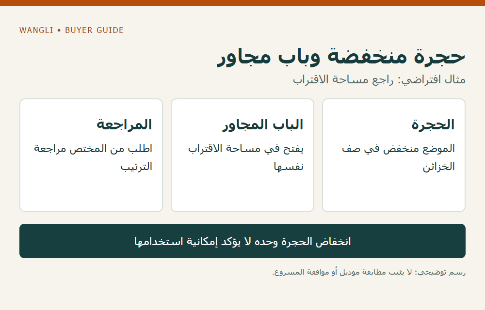

<!-- blog {"slug": "school-locker-accessible-use-planning", "title": "استخدام الخزائن المدرسية: كيف تراجع الوصول إلى الحجرة والقفل قبل التوريد؟", "seo_title": "الوصول إلى الخزائن المدرسية ومراجعة الاستخدام | WangLi", "description": "راجع مسار الاقتراب وفتح الباب وتشغيل القفل مع جهة المشروع، واربط متطلبات الاستخدام برسم الخزانة قبل التوريد.", "category": "specifications", "published": "2026-11-05T00:37:26+08:00", "image": "/assets/school-locker-accessible-use-planning-cover-20261105.png", "image_alt": "الوصول إلى الخزانة — راجع الاستخدام في الموقع قبل تأكيد الطلب", "image_caption": "الوصول إلى الخزانة — راجع الاستخدام في الموقع قبل تأكيد الطلب", "image_kind": "diagram", "image_width": 1000, "image_height": 640, "draft": false} -->

# استخدام الخزائن المدرسية: كيف تراجع الوصول إلى الحجرة والقفل قبل التوريد؟

قد تتضمن قائمة المشروع خزانة بعدد الحجرات الصحيح، لكن القائمة لا توضح كيف يصل المستخدم إلى الباب ويستعمل القفل ويضع أغراضه. يحتاج الموزع أو شركة توريد المدرسة إلى جمع متطلبات الوصول من جهة المشروع، ثم ربطها برسم الوحدة وترتيبها الفعلي. لا يكفي وصف خزانة بأنها «سهلة الوصول» أو إظهار حجرة منخفضة في صورة للحكم على ملاءمتها لجميع المستخدمين.

## حدد مهمة الاستخدام مع الجهة المختصة

اسأل المدرسة عن المستخدمين والمهام المطلوبة: الوصول إلى الوحدة، وفتح الباب، وتشغيل القفل، ووضع المحتوى وإخراجه. قد يستخدم بعض الطلاب كرسيًا متحركًا أو يحتاجون إلى ترتيب آخر؛ تحدد جهة المشروع المتطلبات المناسبة دون إرسال بيانات صحية أو أسماء طلاب ضمن طلب السعر. اطلب تحديد جهة المراجعة، وأبق المعلومات غير المتاحة في سجل الأسئلة.

تتناول [معايير مجلس الوصول الأمريكي للتخزين](https://www.access-board.gov/ada/) الحيز ومسارات الوصول وأجزاء التشغيل ومدى الوصول، وتذكر الخزائن ضمن حالات التخزين. هذا مرجع أمريكي يوضح عناصر السؤال، ولا يثبت انطباق مقاساته أو نسبه على مدرسة في دولة أخرى. تحدد جهة المشروع النظام المطبق واحتياجات المستخدمين قبل اعتماد أي تكوين.

## راجع الوحدة في موضعها الفعلي

اطلب رسمًا يوضح ارتفاع الوحدة ومواضع الحجرات والأقفال والمقابض واتجاه فتح الأبواب. أضف موقعها إلى مخطط الغرفة مع الجدران والأثاث المجاور، ثم اطلب من المختص مراجعة مساحة الاقتراب والحركة والأبواب في أوضاع الاستخدام. ارتفاع القفل وحده لا يصف المسار إليه أو ما إذا كان الباب المفتوح يعيق الحركة.

| مسألة الاستخدام | ما تجمعه من المشروع | ما تطلبه من المورد |
|---|---|---|
| الاقتراب | موضع الخزانة والمسار والأثاث المحيط | الأبعاد الخارجية والرسم المقترح |
| الباب | طريقة الاقتراب والمساحة التي يراجعها المختص | جهة الفتح وحركة الباب وحدودها |
| القفل والمقبض | متطلبات التشغيل ونقاط المراجعة | الموقع ونوع الجزء وتعليمات التكوين |
| الحجرة | الأشياء المراد وضعها وإخراجها | موقع الحجرة وأبعادها الداخلية وفتحتها |
| التحقق | الجهة التي تراجع الاستخدام والمتطلبات | رمز الموديل وإصدار الرسم والعينة إن اتفق عليها |

لا تختَر أبعادًا أو آلية قفل من هذا الجدول. توافر خيار معين وتوافقه مع الموديل يحدده رد المورد؛ أما الملاءمة والمتطلبات التنظيمية فتراجعها الجهة المخولة في المشروع.

## افصل مراجعة الوصول عن عدد الحجرات ونظام المفاتيح

يشرح [دليل توزيع حجرات الخزائن](/blog/school-locker-compartment-planning/) كيفية ربط العدد بالمحتويات والمستخدمين، بينما يتناول [دليل المفاتيح](/blog/school-locker-keying-access-plan/) صلاحيات الفتح والاستبدال. يكمل هذا المقال السؤالين بمراجعة طريقة وصول المستخدم إلى الحجرة وتشغيلها في موقعها؛ لا تعني كفاية عدد المفاتيح إمكانية استخدام القفل في كل وضع.

**مثال افتراضي:** يضع المخطط حجرة منخفضة في صف من الخزائن، لكن باب خزانة مجاورة يفتح في مساحة الاقتراب نفسها. لا يكفي انخفاض الحجرة لتأكيد إمكانية استخدامها. سجّل مواضع الأبواب والحركة، واطلب من المختص مراجعة الترتيب وأي تغيير مطلوب. المثال لا يصف خزانة أو مشروعًا فعليًا.

*مثال افتراضي؛ اضغط لتكبير الرسم.*

## احفظ القرار مع ملف الطلب

ثبّت نسخة الرسم والموديل ومواقع الحجرات والملحقات والكمية، مع تمييز رد المورد عن مراجعة المختص وقرار الجهة المعتمدة. إذا تغير القفل أو موقع الوحدة أو اتجاه الباب، اسأل هل يلزم تحديث المراجعة بدل نقل الموافقة تلقائيًا. يمكن استخدام [دليل الطاولة لمستخدم كرسي متحرك](/blog/school-wheelchair-desk-procurement/) لتنظيم أسئلة المسار في الغرفة؛ لا ينقل متطلبات الطاولة إلى الخزانة تلقائيًا.

[أرسل استفسارًا إلى WangLi](/request-a-quote/) مع مخطط الموقع والمتطلبات التي حددها المشروع والكميات والأسئلة الخاصة بالأبواب والأقفال. يظل توفر التكوين وأي تعديل بحاجة إلى تأكيد مكتوب، ولا يمثل هذا المقال اعتمادًا لمنتج بعينه.
