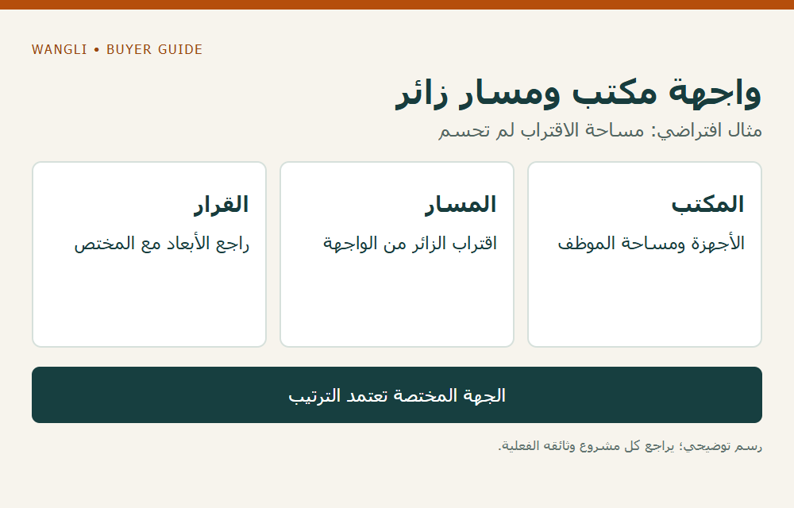

<!-- blog {"slug": "school-reception-desk-visitor-access-brief", "title": "أثاث استقبال المدرسة: كيف تحدد احتياجات الموظف والزائر قبل طلب العرض؟", "seo_title": "أثاث استقبال المدرسة | WangLi", "description": "حدد وظائف الموظف ووصول الزائر والأبعاد قبل طلب أثاث الاستقبال.", "category": "specifications", "published": "2026-11-16T00:10:52+08:00", "image": "/assets/school-reception-desk-visitor-access-brief-cover-20261116.png", "image_alt": "أثاث استقبال المدرسة — راجع عمل الموظف واقتراب الزائر معًا", "image_caption": "أثاث استقبال المدرسة — راجع عمل الموظف واقتراب الزائر معًا", "image_kind": "diagram", "image_width": 1000, "image_height": 640, "draft": false} -->

# أثاث استقبال المدرسة: كيف تحدد احتياجات الموظف والزائر قبل طلب العرض؟

تجهيز استقبال المدرسة يتضمن تفاعل الموظف مع زائر قد يأتي مشيًا أو يستخدم كرسيًا متحركًا، إضافة إلى التعامل مع أوراق أو أجهزة وتخزينها. لا يحدد عدد المكاتب وحده مكان اقتراب الزائر أو مساحة العمل خلف المكتب. تحتاج شركة توريد المشروع إلى ملف يجمع هذه المهام والقياسات التي يعتمدها المختص قبل اختيار التكوين.

## افصل مهام الموظف عن تفاعل الزائر

اسأل جهة المدرسة عن إجراءات الاستقبال، والأجهزة والملفات التي تستخدم، وعدد العاملين، وطريقة اقتراب الزوار إلى نقطة الخدمة. اطلب مخطط الدخول والانتظار والمكتب والأبواب؛ لا تجمع أسماء الزوار أو معلوماتهم الشخصية ضمن طلب السعر. إذا كانت بعض المتطلبات لم تعتمد، اجعلها أسئلة مفتوحة في القائمة.

تعرض [وثيقة بريطانية تاريخية عن تصميم المدارس لذوي الاحتياجات المختلفة](https://assets.publishing.service.gov.uk/media/5e5690eee90e07110bfa5d33/_WITHDRAWN_Building_Bulletin_102_designing_for_disabled_children_and_children_with_SEN.pdf) مثالًا على استقبال مع مساحة لاستخدام شخص على كرسي متحرك. الوثيقة مسحوبة وتستخدم هنا مثالًا توضيحيًا فقط، لا معيارًا حاليًا أو دليلًا على توافق منتج من WangLi. يحدد المختص المتطلبات المعمول بها في الموقع.

## اطلب رسم الواجهة ومساحة الاستخدام

| الحاجة | ما تحدده المدرسة | ما تطلبه من المورد |
|---|---|---|
| اقتراب الزائر | المسار ومتطلبات الوصول | أبعاد الواجهة وقاعدة المكتب |
| تعامل الموظف | مواضع الأجهزة والأوراق | سطح العمل والحيز المتاح خلفه |
| التواصل | موضع التفاعل الذي يحدده المشروع | رسم الارتفاعات والأجزاء الأمامية |
| التخزين | نوع الملفات والمحتويات | التقسيم والأبعاد والملحقات المؤكدة |
| القبول | المتطلبات المحلية والجهة المسؤولة | أدلة ورسومات التكوين نفسه |

لا تفترض قابلية ضبط الارتفاع أو وجود فتحة كابلات أو أدراج من صورة المكتب. ولا تضع قياسات عامة للوصول بدل القياسات التي يعتمدها المشروع. تطلب جهة التصميم مراجعة المخطط مع المستخدمين والمختصين قبل اعتماد التكوين.

## مثال افتراضي: مكتب يلائم الموظف ومسار زائر غير محسوم

يُظهر رسم أولي شاشة وملفات مناسبة للموظف، لكنه لا يوضح مساحة اقتراب الزائر من الواجهة. تطلب شركة التوريد مخطط الموقع وأبعاد قاعدة المكتب ثم تحيل المسار إلى المختص. المثال لا يثبت مطابقة أي مكتب أو طلب لدى WangLi.

*مثال افتراضي؛ اضغط لتكبير الرسم.*

## اربط الواجهة بالتصميم والطلب

راجع [تحديد مهام مكتب المعلم](/blog/teacher-workspace-furniture-brief/) لفصل مهام العامل والتخزين، و[تنسيق الأثاث مع الأجهزة](/blog/school-computer-room-furniture-interfaces/) لأسئلة منافذ الأجهزة، و[تخطيط الوصول إلى الموقع](/blog/school-furniture-site-access-planning/) لتجهيز التسليم. يبقى تصميم الوصول والاعتماد مسؤولية المشروع.

[أرسل استفسارًا إلى WangLi](/request-a-quote/) مع مخطط الاستقبال والكميات والوظائف والأبعاد والوثائق المطلوبة؛ يؤكد الفريق التكوين والبيانات المتاحة للطلب المحدد.
