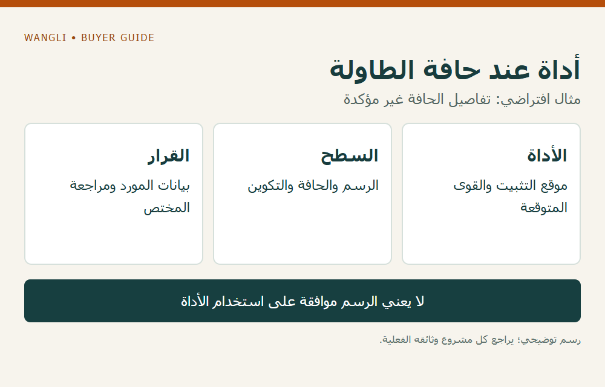

<!-- blog {"slug": "school-technology-workbench-procurement", "title": "طاولات الورش التعليمية: ما الذي تحدده قبل طلب تجهيز مساحة التقنية؟", "seo_title": "طاولات الورش التعليمية | WangLi", "description": "حدد أدوات الورشة وموقع التثبيت والحمل ومسارات الحركة قبل طلب الطاولات.", "category": "tenders", "published": "2026-11-14T00:15:34+08:00", "image": "/assets/school-technology-workbench-procurement-cover-20261114.png", "image_alt": "تجهيز طاولة الورشة — حدد العمل والأداة والموقع قبل اعتماد الطاولة", "image_caption": "تجهيز طاولة الورشة — حدد العمل والأداة والموقع قبل اعتماد الطاولة", "image_kind": "diagram", "image_width": 1000, "image_height": 640, "draft": false} -->

# طاولات الورش التعليمية: ما الذي تحدده قبل طلب تجهيز مساحة التقنية؟

قد يريد مشروع مدرسي طاولات لورشة تقنية أو أعمال يدوية. شكل سطح العمل وحده لا يحدد الأدوات التي سيستخدمها الطلاب أو الأحمال ونقاط التثبيت أو المساحة اللازمة حول كل محطة. تحتاج شركة التوريد إلى وصف المهمة والتجهيزات ومسار الحركة قبل مقارنة تكوينات الطاولات، ثم إحالة قرار السلامة إلى مختص المشروع.

## اجمع وصف العمل من المدرسة

اطلب قائمة الأنشطة المقررة والأدوات والأجهزة التي يستخدمها كل طالب أو فريق، وأبعادها وكتلتها وتعليمات تثبيتها من أصحابها. حدّد إن كان المطلوب تثبيت أداة على الطاولة أو مجرد وضعها عليها، وأين تقف المواد أثناء العمل. لا تفترض أن طاولة دراسية عادية مناسبة للأدوات أو القوى التي ينتجها الاستخدام دون معلومات وتقييم.

توضح [إرشادات وزارة التعليم النيوزيلندية للسلامة في التعليم التقني](https://web-assets.education.govt.nz/s3fs-public/2024-08/SES-Safety-in-Technology-Education-AW.pdf?VersionId=6GUgcT3NfV.L55hF5rxZKy9Qr7Z1Q53z) أهمية تخطيط الطاولات بحيث تبقى الممرات والمداخل والمخارج خالية، ومراجعة ارتفاع العمل للمستخدمين. هذا مثال إرشادي في سياقه، وليس حكمًا على سلامة منتج WangLi أو بديلًا عن اشتراطات المشروع ومراجعته المختصة.

## حوّل النشاط إلى أسئلة عن التكوين

| البيان | ما تحدده المدرسة أو المختص | ما يحتاج المورد إلى تأكيده |
|---|---|---|
| المهمة | الأدوات والمواد وطريقة استخدامها | نطاق الطاولة المقترحة |
| السطح | أبعاد الأداة واحتياجات العمل | الأبعاد والمواد والتكوين |
| التثبيت | موقع الأداة ومتطلبات صاحبها | نقاط التثبيت الموثقة أو عدم توفر بيانات |
| الحمل والثبات | القوى والحالات المطلوب تقييمها | بيانات الأداء للتكوين المحدد وحدودها |
| الموقع | الحركة والمخارج والخدمات | أبعاد الطاولة وحالة توريدها |

لا تعتبر وزن الأداة وحده دليلًا على تحمل الطاولة قوى العمل. اطلب بيانات من المورد، وعند غيابها اترك الملاءمة غير مؤكدة. يحدد المختص الاختبارات والأحمال ومعايير القبول؛ لا تنشئ ثقوبًا أو تركب أدوات اعتمادًا على صورة أو تقدير.

## مثال افتراضي: أداة تثبت على حافة الطاولة

يريد المشروع استخدام أداة تثبيت على حافة سطح العمل. يظهر رسم أولي طاولة بكسوة وحافة لم تتأكد تفاصيلها. قبل اعتمادها، يراجع المسؤول مكان الأداة والقوى وتعليمات صاحبها، ويطلب من المورد رسم الحافة والتكوين والبيانات المتاحة. المثال لا يثبت قدرة طاولة معينة ولا يقدم طريقة تشغيل للأداة.

*مثال افتراضي؛ اضغط لتكبير الرسم.*

## رتب بقية نطاق العمل

راجع [تركيب حواف الطاولات](/blog/school-desk-edge-core-construction/) لفهم ما يجب سؤاله عن الحافة، و[تحديد نطاق خدمات التوريد والتركيب](/blog/school-furniture-service-scope-allocation/) لفصل أعمال الأطراف، و[تخطيط دخول الموقع](/blog/school-furniture-site-access-planning/) لتنسيق الوصول. تعتمد الجهة المختصة مخطط التشغيل والسلامة النهائي.

[أرسل طلبًا إلى WangLi](/request-a-quote/) مع وصف الورشة والأدوات المطلوبة ورسم الموقع والكمية والبيانات التي تحتاجها؛ يؤكد الفريق نطاق المنتجات والوثائق المتاحة للطلب.
