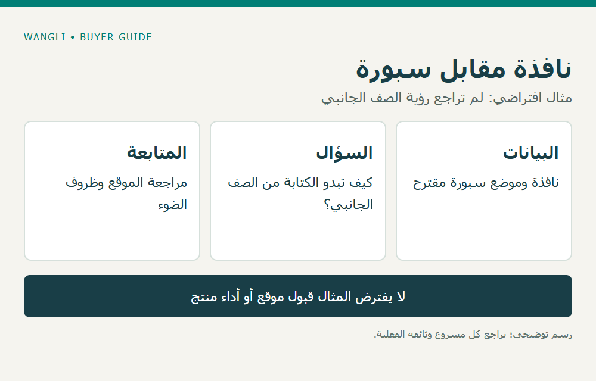

<!-- blog {"slug": "school-whiteboard-visibility-glare-planning", "title": "السبورة المدرسية وضوء الفصل: كيف تراجع الرؤية قبل تحديد الموقع والمقاس؟", "seo_title": "السبورة المدرسية والرؤية داخل الفصل | WangLi", "description": "راجع موضع السبورة والضوء وزوايا الرؤية مع مختص المشروع قبل إعداد طلب التوريد.", "category": "specifications", "published": "2026-11-18T11:43:27+08:00", "image": "/assets/school-whiteboard-visibility-glare-planning-cover-20261118.png", "image_alt": "السبورة وضوء الفصل — راجع الرؤية قبل تثبيت الموقع والمقاس", "image_caption": "السبورة وضوء الفصل — راجع الرؤية قبل تثبيت الموقع والمقاس", "image_kind": "diagram", "image_width": 1000, "image_height": 640, "draft": false} -->

# السبورة المدرسية وضوء الفصل: كيف تراجع الرؤية قبل تحديد الموقع والمقاس؟

قد يختار فريق تجهيز المدرسة سبورة بالمقاس المطلوب، ثم يكتشف أن بعض الطلاب لا يرون الكتابة بوضوح من مواقعهم بسبب الانعكاس أو اتجاه الإضاءة. يحتاج موزع الأثاث أو شركة توريد المشروع إلى جمع معلومات المكان ومواضع الجلوس ووصف سطح السبورة، ثم رفع أسئلة الرؤية إلى مختص المشروع قبل تثبيت الموقع النهائي. لا يكفي وصف المنتج بأنه «واضح» لإثبات ملاءمته لكل فصل.

## اجمع معلومات الفصل بدل الاعتماد على صورة السبورة

اطلب مخطط الفصل مع مواقع النوافذ والإنارة وموضع السبورة المقترح والصفوف، واسأل الجهة التعليمية عن الترتيبات المختلفة التي تستعملها. عند وجود مستخدمين لهم احتياجات بصرية، تطلب الجهة المختصة المتطلبات الملائمة دون مشاركة أسماء الطلاب أو بياناتهم الصحية في طلب التسعير.

تشير [إرشادات مجلس مدينة بريستول للبيئة المدرسية](https://www.bristol.gov.uk/sensory-support-service/for-professionals/vision-support-for-professionals/vision-friendly-settings/accessible-school-environment) إلى أهمية ضبط الضوء والانعكاس في بيئة التعلم. هذا مرجع بريطاني يساعد على تسمية سؤال الرؤية، وليس معيارًا لكل بلد أو نتيجة اختبار لسبورة من WangLi.

## افصل بين مساحة الكتابة وموضع الرؤية

| ما تراجعه | المعلومات المطلوبة | ما يبقى مفتوحًا |
|---|---|---|
| موضع السبورة | الرسم وارتفاع التثبيت المقترح | موافقة الجهة المختصة على الموقع |
| مصادر الضوء | النوافذ والإنارة ووسائل التحكم المتاحة | أثرها في وقت الاستخدام الفعلي |
| مقاعد الطلاب | مخطط الصفوف وزوايا النظر | الرؤية من المواضع التي يحددها المشروع |
| سطح السبورة | وصف السطح وتعليمات استخدامه | الأداء في ظروف لم تُراجع |
| حدود التوريد | اللوحة والملحقات وأعمال التثبيت | ما يشمله العرض ومسؤولية التنفيذ |

لا تحدد ارتفاعًا أو مسافة رؤية ثابتة لكل الفصول. يراجع مختص المشروع المخطط والاحتياجات المحلية، ويسأل المورد عن بيانات المنتج المحدد. إذا تغير موضع الإنارة أو اتجاه السبورة، سجّل التغيير واطلب إعادة مراجعة النقاط المتأثرة.

## جهّز مراجعة واضحة إذا اتفق المشروع على عينة

حدد التكوين والموضع وأوقات الإضاءة التي سيجري النظر فيها، والأدوات المستخدمة للكتابة، والأماكن التي يريد المشروع تقييمها. يسجل الفريق الملاحظة وظروفها وما لم يستطع فحصه، ويراجع الحل مع الجهة المختصة. مشاهدة عينة في مكان واحد لا تثبت أداء كل لوحة أو تؤكد الامتثال لمتطلبات لم تذكر في وثائق المشروع.

**مثال افتراضي:** يقترح الرسم وضع سبورة مقابل نافذة، ولم تُراجع الرؤية من الصف الجانبي. يسجل المورد موضع النافذة والصف والسؤال المفتوح، ثم يطلب من جهة المشروع مراجعة الموضع وظروف الضوء قبل اعتماد القائمة. لا يثبت المثال وجود عيب في منتج أو نجاح ترتيب معين.

*مثال افتراضي؛ اضغط لتكبير الرسم.*

## حوّل النتيجة إلى طلب توريد

توضح [مراجعة سطح السبورة ونطاق تثبيتها](/blog/school-whiteboard-surface-mounting-selection/) أسئلة السطح والحامل والمكونات؛ ويعرض [دليل إضاءة طاولات المكتبة](/blog/school-library-study-table-glare-planning/) مسألة مختلفة تتعلق بسطح العمل، فلا تُنقل نتيجته تلقائيًا إلى السبورة. استخدم [مراجعة التثبيت مع الموقع](/blog/school-furniture-fixing-substrate-coordination/) لتعيين مسؤول فحص الجدار والتنفيذ.

[أرسل استفسارًا إلى WangLi](/request-a-quote/) مع مخطط الفصل والمواضع والكميات والخصائص المطلوب تأكيدها، وافصل أسئلة الرؤية والموقع عن موافقة الجهة المخولة.
