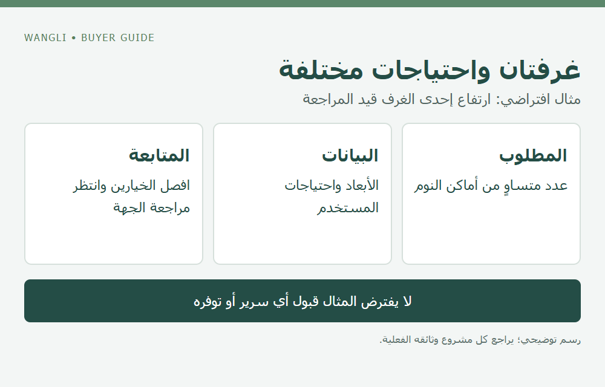

<!-- blog {"slug": "student-dormitory-single-vs-bunk-bed-choice", "title": "سرير مفرد أم بطابقين للسكن الطلابي؟ راجع الاستخدام والفراغ قبل تحديد التكوين", "seo_title": "سرير مفرد أم بطابقين للسكن الطلابي | WangLi", "description": "قارن احتياجات المستخدم والغرفة ومكونات السرير قبل طلب أثاث السكن الطلابي.", "category": "specifications", "published": "2026-11-18T11:50:08+08:00", "image": "/assets/student-dormitory-single-vs-bunk-bed-choice-cover-20261118.png", "image_alt": "سرير مفرد أم بطابقين؟ — قارن المستخدم والغرفة والمكونات قبل العدد", "image_caption": "سرير مفرد أم بطابقين؟ — قارن المستخدم والغرفة والمكونات قبل العدد", "image_kind": "diagram", "image_width": 1000, "image_height": 640, "draft": false} -->

# سرير مفرد أم بطابقين للسكن الطلابي؟ راجع الاستخدام والفراغ قبل تحديد التكوين

عندما يجهز مورد مشروع سكن طلابي، قد تبدو مقارنة سريرين مفردين بسرير بطابقين مسألة عدد مواضع النوم فقط. لكن طريقة الوصول إلى السرير، وارتفاع الغرفة، ومكونات الحماية، وملاءمة المرتبة، ومسؤوليات التركيب تحتاج إلى مراجعة مستقلة. اجمع احتياجات المستخدمين ومخطط الغرفة أولًا، ثم اطلب بيانات كل تكوين لعرضها على مختص المشروع.

## صف المستخدم والغرفة قبل مقارنة عدد الأسرة

اطلب من جهة السكن أعمار المستخدمين ومتطلبات الوصول والإشراف التي تعتمدها، دون إدراج أسماء أو معلومات صحية شخصية في استفسار السعر. اجمع مخطط الغرفة والأبعاد التي أكدها المشروع ومواقع الأبواب والنوافذ والتخزين والعناصر الثابتة. إذا كان الوصول إلى المستوى العلوي غير مناسب لبعض المستخدمين وفق تقييم المختص، فلا يزيل تحقيق عدد الأسرة هذا القيد.

تعرض [فئة أثاث السكن الطلابي](/products/dormitory/) أسرّة مفردة وتكوينات بطابقين. هي نقطة بداية لتعيين الفئة، ولا تثبت أن تكوينًا أو مادة أو ملحقًا متاح لكل طلب. اطلب الرسم وبيانات الموديل ومكوناته، واطلب من الجهة المسؤولة مراجعة الترتيب في الغرفة.

## افصل أسئلة السرير المفرد عن أسئلة الطابق العلوي

| نقطة القرار | سرير مفرد | سرير بطابقين |
|---|---|---|
| العدد | وحدات الأسرة ومواضع النوم | الوحدات ومواضع النوم في كل وحدة |
| الاستخدام | الوصول والترتيب ومتطلبات المستخدم | الوصول إلى المستويين ومتطلبات المستخدم |
| الغرفة | أبعاد السرير ومسار الحركة | أبعاد التكوين والارتفاع ومسار الوصول |
| المكونات | الإطار والدعامات وما يشمله العرض | الإطار والدعامات والحواجز ووسيلة الصعود إن وجدت |
| المرتبة | مقاسها ومرجع توافقها مع الهيكل | التوافق وحدود السماكة لكل تكوين |

لا تقرر أن أحد الخيارين أكثر أمانًا أو يوفر مساحة معينة من صورة. اطلب تعليمات المصنع والبيانات المتعلقة بالموديل الذي يعرضه المورد، وتحقق من مسؤولية التركيب والمراجعة والمتطلبات التي تنطبق على المشروع.

تشرح [هيئة سلامة المنتجات الاستهلاكية الأمريكية](https://www.cpsc.gov/Business--Manufacturing/Business-Education/Business-Guidance/Bunk-Beds) أن مراجعة الأسرّة ذات الطابق العلوي تشمل الحواجز والفتحات وعلاقة المرتبة بالهيكل ضمن قواعدها الأمريكية. يوضح المصدر سبب السؤال عن هذه المكونات؛ لا يعني انطباق القواعد الأمريكية على المشروع أو مطابقة سرير من WangLi. يتحقق المختص من معايير السوق والمنتج والوثائق المطلوبة.

## مثال افتراضي: غرفتان واحتياج مختلف

يريد المشروع عددًا متساويًا من أماكن النوم في غرفتين، لكن إحدى الغرف تنتظر مراجعة ارتفاعها أو احتياجات شاغليها. يسجل المورد خيار السرير المفرد وخيار الطابقين كلًا في سطر مستقل، ويطلب الرسومات والمكونات والبيانات الناقصة، دون اعتماد الخيار الثاني من العدد وحده. المثال لتنظيم المقارنة ولا يصف غرفة أو طلبًا فعليًا.

*مثال افتراضي؛ اضغط لتكبير الرسم.*

## ثبّت النتيجة في قائمة كل غرفة

استخدم [دليل توزيع أثاث السكن على الغرف](/blog/student-dormitory-bed-layout-rfq/) لتسجيل الكميات والمحتويات بعد اختيار التكوين، و[مراجعة توافق المرتبة مع السرير](/blog/student-bunk-bed-mattress-compatibility/) لربط المرتبة بتعليمات الهيكل، و[مراجعة المناولة إلى الموقع](/blog/school-furniture-site-access-planning/) لطلب أبعاد العبوات ومسؤوليات الإدخال.

[أرسل استفسارًا إلى WangLi](/request-a-quote/) يتضمن مخططات الغرف وعدد أماكن النوم والتكوينات المراد مقارنتها والكميات والوجهة والأسئلة المفتوحة. التوفر ومكونات العرض والتوافق تحتاج إلى تأكيد خاص بالطلب ومراجعة الجهة المخولة.
