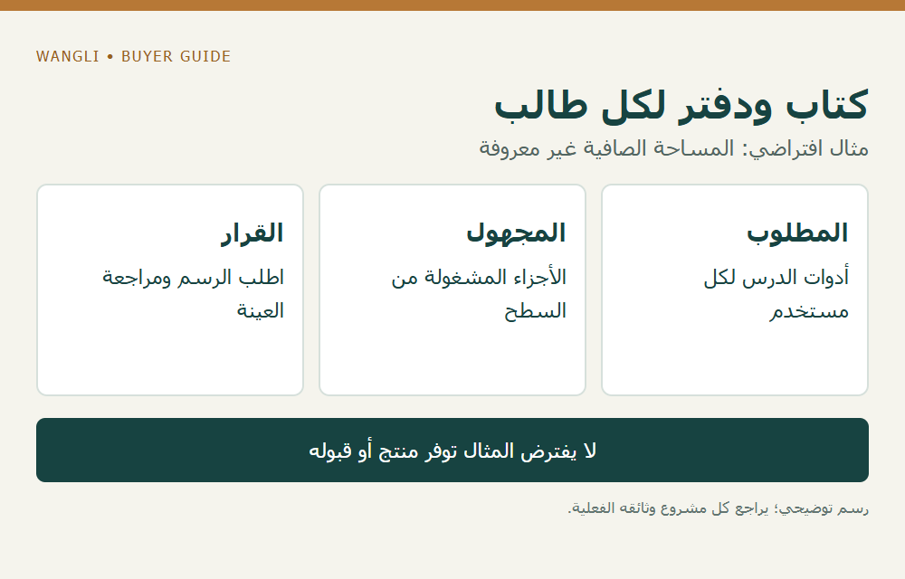

<!-- blog {"slug": "two-student-school-desk-writing-space", "title": "طاولة مدرسية لطالبين: كيف تراجع مساحة الكتابة المشتركة قبل الطلب؟", "seo_title": "مساحة الكتابة في الطاولة المدرسية المزدوجة | WangLi", "description": "راجع مساحة الكتابة والأدوات المستخدمة قبل طلب طاولة مدرسية لطالبين.", "category": "specifications", "published": "2026-11-21T16:05:22+08:00", "image": "/assets/two-student-school-desk-writing-space-cover-20261121.png", "image_alt": "طاولة لطالبين — راجع مساحة الكتابة للمهمة الفعلية", "image_caption": "طاولة لطالبين — راجع مساحة الكتابة للمهمة الفعلية", "image_kind": "diagram", "image_width": 1000, "image_height": 640, "draft": false} -->

# طاولة مدرسية لطالبين: كيف تراجع مساحة الكتابة المشتركة قبل الطلب؟

قد تصف قائمة المشروع طاولة بأنها «لطالبين» من دون أن تحدد الكتب والأدوات التي سيضعها كل طالب عليها. يحتاج موزع الأثاث أو مورد المشروع إلى مقارنة مساحة السطح ومهمة الدرس وتكوين المقاعد، ثم مراجعة الرسم أو العينة مع المدرسة. عدد الأماكن المعلن لا يكفي وحده لإثبات أن كتابين ودفترين سيتسعان في كل نشاط.

## اجمع أدوات الدرس من جهة المشروع

اطلب أمثلة للأدوات التي ستستخدم معًا وأبعادها التقريبية: دفتر وكتاب مفتوح، أو جهاز وورقة، أو أدوات نشاط مشترك. حدد هل يعمل الطالبان بالتوازي أم يتشاركان المواد. اطلب من المدرسة احتياجات المستخدمين والمقاسات التي تعتمدها، من دون جمع أسماء الطلاب أو معلومات صحية ضمن طلب السعر.

تصف [UNICEF في سوريا](https://www.unicef.org/syria/stories/new-desk-makes-big-difference) تجربة طالب ذكر ضيق مساحة الحركة والكتابة عند مشاركة طاولة بين ثلاثة أو أربعة طلاب. هذه شهادة فردية في سياق سوري عن أثاث أصلحته جهة أخرى، وليست تجربة عميل WangLi أو قياسًا لطلب السوق. تفيد في طرح سؤال مساحة الكتابة قبل مقارنة الموديلات.

## فرّق طول السطح عن المساحة المستخدمة

| ما تراجعه | ما تطلبه | ما لا يثبته الرقم وحده |
|---|---|---|
| سطح الكتابة | الطول والعمق ونقاط القياس | المساحة المتاحة لكل نشاط |
| المقعدان | التكوين وعلاقته بموضعي الجلوس | مناسبة الوضع لجميع المستخدمين |
| الأدوات | أحجام الكتب والدفاتر وطريقة الاستخدام | أن الصورة تتسع لكل المحتويات |
| الحواف والملحقات | الرسم ومواضع الأجزاء المرتفعة | المساحة الصافية لسطح الكتابة |
| الترتيب | مخطط الفصل وطريقة الحركة | قبول جهة المشروع للتكوين |

اطلب رسمًا يبين السطح والأجزاء التي تشغل منه مساحة، ومواضع جلوس الطالبين. إن قُسم العرض الكلي على اثنين فهو حساب أولي فقط، وليس قياسًا مؤكّدًا لحصة كل مستخدم أو دليلًا على الملاءمة؛ قد تؤثر الحواف والهيكل والمواد المشتركة في المساحة المتاحة.

## خطّط لموضعين ومنطقة مشتركة

على الرسم، اطلب من المدرسة تحديد موضع أدوات الطالب الأول والثاني أثناء النشاط نفسه، ثم أي مواد مشتركة بينهما. راجع ما إذا كانت الأدوات تحتاج إلى مساحة دائمة أو تتبادل الموضع، وهل يمنع ترتيبها الوصول إلى أدوات أحد المستخدمين. احتفظ بالرسم وأبعاد الأدوات والمواضع كأسئلة للمراجعة، لا كمقياس موحد لكل فصل. إذا لم تتحدد الأدوات أو المساحة الصافية، اترك النتيجة غير محسومة حتى توفر البيانات.

## راجع المهمة على عينة إذا اتفق عليها

اتفق على التكوين ورمز العينة وأدوات الدرس الفعلية والجهة التي ستراجعها. يسجل الفريق ما ظهر في المراجعة وظروفها والأسئلة التي بقيت مفتوحة، ثم يرفع القرار إلى صاحب الصلاحية. لا تعمم نتيجة عينة على كل موديل أو عمر، ولا تحولها إلى اختبار سلامة أو وعد أداء.

**مثال افتراضي:** يريد المشروع كتابًا مفتوحًا ودفترًا لكل طالب، لكن العرض يذكر أبعاد الطاولة الخارجية فقط. يطلب المشتري رسم المساحة المتاحة ويضع الأدوات المطلوبة في خطة مراجعة العينة إن اتفق عليها. يبقى الحكم مفتوحًا حتى مراجعة التكوين؛ المثال لا يصف طلبًا فعليًا.

*مثال افتراضي؛ اضغط لتكبير الرسم.*

## أرسل قائمة مقارنة واضحة

تفيد [مقارنة المقعد المتصل والكرسي المنفصل](/blog/classroom-attached-bench-separate-chair-choice/) في تحديد بنية التكوين، و[دليل مقاسات وكميات الفصول](/blog/school-desk-chair-size-quantity-planning/) في توزيع المقاسات، و[دليل أبعاد ومواصفات الطاولات](/school-desk-chair-specifications/) في تسمية نقاط القياس.

[أرسل طلب عرض سعر إلى WangLi](/request-a-quote/) مع الكميات والموديل المرجعي وأدوات الدرس ومخطط الفصل وأسئلة المساحة، لتأكيد بيانات التكوين قبل قرار المشروع.
